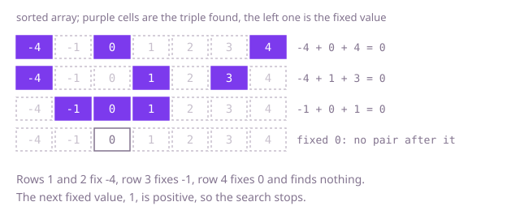

## The question

Given an array of whole numbers, list every distinct group of three values, taken from three different positions, that add up to zero. A triple is identified by its values, so each one is listed once however many positions can supply it.

What makes it harder than it looks is the duplicates. Equal values at different positions would report the same triple again and again, and an array of five zeros has ten position triples but one answer. A single `0` must not be used three times. And with 5,000 values, checking every group of three is about 20 billion sums.

## How to think about it

The first idea is to check every group of three and keep the ones that add to zero, with a set to throw away repeats. That repeats a lot: for each pair it scans the rest of the array looking for the third value, but the third value is fixed, it is the negative of the other two. So fix one value and the question shrinks to one you have seen: find two values, after it, that add up to its negative. Sorting makes both halves easy. Equal values become neighbours, so skipping repeats is a matter of comparing with the previous value, and the pair search can either remember what it has passed in a hash set, or, because the data is sorted, walk two positions in from the ends and let the sum say which end to move.

Walk Example 1, `nums = [-4, 1, 3, 0, 2, -1, 4]`. Sorted it is `[-4, -1, 0, 1, 2, 3, 4]`. Fix -4 and look for a pair that adds to 4. The ends give -1 + 4 = 3, too small, so move left. Then 0 + 4 = 4: the triple `[-4, 0, 4]`. Move both in: 1 + 3 = 4, the triple `[-4, 1, 3]`. The positions meet. Fix -1 and look for a pair that adds to 1: 0 + 4 is too big, then 0 + 3 and 0 + 2 are too big, then 0 + 1 = 1 gives `[-1, 0, 1]`. Fix 0: every pair after it is positive, no match. The next value, 1, is positive, so nothing after it can reach zero and the search stops.



## Brute force

Check every group of three positions and keep the ones that add to zero. It is what you say first, and it fixes the answer every faster version must agree with. It is correct because it looks at every group; sorting a copy first puts each triple's values in order, so equal triples compare equal, and a set of the triples already found throws the repeats away.

```java
static List<List<Integer>> zeroSum(int[] nums) {
    int[] a = nums.clone(); // the input must not be changed
    Arrays.sort(a); // every triple comes out in order, so equal triples are equal lists
    Set<List<Integer>> seen = new HashSet<>();
    List<List<Integer>> result = new ArrayList<>();
    for (int i = 0; i < a.length; i++) {
        for (int j = i + 1; j < a.length; j++) {
            for (int k = j + 1; k < a.length; k++) { // three different positions
                if (a[i] + a[j] + a[k] == 0) {
                    List<Integer> triple = List.of(a[i], a[j], a[k]);
                    if (seen.add(triple)) { // first time this triple of values appears
                        result.add(triple);
                    }
                }
            }
        }
    }
    return result;
}
```

**Complexity:** time O(n³) average (every matching triple costs one set operation, and an all-zero array makes nearly all of them match), O(n³ log n) worst case (Java treeifies a crowded bucket), extra space O(n + k) for the sorted copy, the set and the result of k triples.

## Better: sort, fix one value, look up the third in a hash set

Sort a copy. For each first value, walk the values after it and keep a hash set of those already passed. For the value `a[j]`, the value that completes the triple is `-a[i] - a[j]`: if the set holds it, report the triple. Because the array is sorted, the completing value came earlier, so it is no larger than `a[j]`, and the triple comes out in order. To avoid repeats, skip a first value equal to the one before it, and after a match skip the equal copies of `a[j]`.

```java
static List<List<Integer>> zeroSum(int[] nums) {
    int[] a = nums.clone();
    Arrays.sort(a);
    List<List<Integer>> result = new ArrayList<>();
    for (int i = 0; i < a.length - 2 && a[i] <= 0; i++) { // a positive first value cannot reach zero
        if (i > 0 && a[i] == a[i - 1]) {
            continue; // the same first value would repeat triples already found
        }
        Set<Integer> passed = new HashSet<>(); // values after i that we have already walked past
        for (int j = i + 1; j < a.length; j++) {
            int need = -a[i] - a[j];
            if (passed.contains(need)) {
                result.add(List.of(a[i], need, a[j]));
                while (j + 1 < a.length && a[j + 1] == a[j]) {
                    j++; // skip copies of a[j]: they would find the same triple
                }
            }
            passed.add(a[j]);
        }
    }
    return result;
}
```

**Complexity:** time O(n²) on average, O(n² log n) in the worst case (sorting is O(n log n); each set operation is O(1) on average, and Java treeifies a crowded bucket, so O(log n) in the worst case), extra space O(n) for the sorted copy and the set.

**Prefer it when:** you want every step to be a plain lookup ("have I passed the value that completes this triple?") rather than an argument about which end of a pair to move, and you can spend O(n) memory and a hash operation per pair.

## Optimal: sort, fix one value, two positions for the rest

After sorting, the pair search needs no hash set. Put one position just after the fixed value and one at the end. If the sum of the three is below zero, the left value is too small to pair with anything still in play, so move the left position in; if it is above zero, move the right one in. On a match, record the triple, move both in, and skip equal copies of the left value so the same pair is not reported twice. The same skip on the fixed value, and the early stop on a positive fixed value, finish the job. This is the reference solution.

```java
static List<List<Integer>> zeroSum(int[] nums) {
    int[] a = nums.clone();
    Arrays.sort(a);
    List<List<Integer>> result = new ArrayList<>();
    for (int i = 0; i < a.length - 2 && a[i] <= 0; i++) {
        if (i > 0 && a[i] == a[i - 1]) {
            continue; // the same first value would repeat triples already found
        }
        int left = i + 1;
        int right = a.length - 1;
        while (left < right) {
            int sum = a[i] + a[left] + a[right];
            if (sum < 0) {
                left++;
            } else if (sum > 0) {
                right--;
            } else {
                result.add(List.of(a[i], a[left], a[right]));
                left++;
                right--;
                while (left < right && a[left] == a[left - 1]) {
                    left++; // skip repeats of the pair's left value
                }
            }
        }
    }
    return result;
}
```

**Complexity:** time O(n²), extra space O(n) for the sorted copy, besides the output.

## Complexity

| Approach | Time | Extra space |
| --- | --- | --- |
| Brute force | O(n³) average, O(n³ log n) worst | O(n + k) |
| Better: sort, fix one value, hash set | O(n²) average, O(n² log n) worst | O(n) |
| Optimal: sort, fix one value, two positions | O(n²) | O(n) |

## Where it shows up

No coding-round problem is linked to this question. Finding groups of values that cancel out is a reconciliation task: three ledger entries that net to zero, or three adjustments that offset one another. The idea of sorting once and then fixing one choice while two cursors handle the rest also underlies "k-sum" searches and many pair-matching jobs over sorted data.

## Follow-up answers

**Can you beat O(n³) time?** Yes, to O(n²): sort, fix one value and search for the other two with two positions moving inwards, as in the optimal solution. Sorting costs O(n log n), which is small next to the n² pair searches.

**How would you change it to find triples that add up to any given target?** Search for a pair that sums to `target - a[i]` instead of the negative of `a[i]`. The early stop on a positive first value only works for a target of zero, so drop it, or replace it with a check suited to the target.

**How would you generalise to groups of four values?** Fix two values with two nested loops and run the two-position walk on the rest. That is O(n³), and the same skipping of equal values applies at every level.
