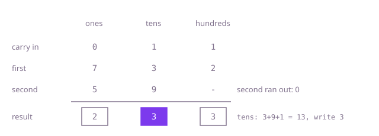

## The question

Two non-negative numbers are stored as linked lists of digits with the lowest digit first; return their sum in the same form. The input lists must not change.

What makes it harder than it looks: the numbers can have 10,000 digits, so reading them into a `long` overflows after 18. The lists can have different lengths, and a carry left over after the last column, as in 16 + 84 = 100, needs a new node that neither list has a column for.

## How to think about it

The first idea is to turn each list into a number, add, and turn the sum back into a list. With `long` that breaks at 19 digits; with `BigInteger` it works, but it converts to decimal text and back just to do what a schoolchild does column by column.

The lists are already in column order: the head is the ones column, the next node the tens, and so on. So walk both lists together, add the two digits and the carry, write the last digit of that into a new node and carry the rest. A list that has run out contributes 0. Keep going while either list has nodes or a carry remains; that last condition is the one that adds the final 1 in 16 + 84.

Walk Example 1, `[7,3,2]` + `[5,9]`. Ones: 7 + 5 = 12, write 2, carry 1. Tens: 3 + 9 + 1 = 13, write 3, carry 1. Hundreds: 2 + nothing + 1 = 3, write 3, carry 0. Both lists are done and the carry is 0, so the answer is `[2,3,3]`, the number 332.



## Brute force

Read both lists into `BigInteger`s, add them and write the sum's digits back out lowest first. It comes first because it is what you say first, and it fixes the answer to compare against. It is correct because `BigInteger` holds any number of digits exactly; a `long` here would overflow.

```java
static ListNode add(ListNode first, ListNode second) {
    java.math.BigInteger sum = toNumber(first).add(toNumber(second));
    String digits = sum.toString();
    ListNode dummy = new ListNode();
    ListNode tail = dummy;
    for (int i = digits.length() - 1; i >= 0; i--) { // the lowest digit is the last character
        tail.next = new ListNode(digits.charAt(i) - '0');
        tail = tail.next;
    }
    return dummy.next;
}

private static java.math.BigInteger toNumber(ListNode head) {
    StringBuilder digits = new StringBuilder();
    for (ListNode n = head; n != null; n = n.next) {
        digits.append(n.val);
    }
    return new java.math.BigInteger(digits.reverse().toString()); // the head is the lowest digit
}
```

**Complexity:** time O(n²) for the decimal conversions (parsing n digits into binary is quadratic in Java's `BigInteger`), extra space O(n) for the text and the numbers.

## Better: recursion with the carry

Add the two head digits and the incoming carry, make that node, and let a recursive call build the rest of the sum from the two `next` nodes and the new carry. It is the column-by-column idea written as recursion.

```java
static ListNode add(ListNode first, ListNode second) {
    return add(first, second, 0);
}

private static ListNode add(ListNode first, ListNode second, int carry) {
    if (first == null && second == null && carry == 0) {
        return null; // nothing left, not even a carry
    }
    int sum = carry + (first == null ? 0 : first.val) + (second == null ? 0 : second.val);
    ListNode rest = add(first == null ? null : first.next, second == null ? null : second.next, sum / 10);
    return new ListNode(sum % 10, rest);
}
```

**Complexity:** time O(n), extra space O(n) for the call stack, one frame per digit; at 10,000 digits that overflows Java's default stack and the long test fails with `StackOverflowError`.

**Prefer it when:** the numbers are known to be short (a few hundred digits) and the recursive form fits the surrounding code, such as a recursive routine over the same lists.

## Optimal: one pass with a carry

Walk both lists together from a dummy head, appending one digit per column, and loop while either list has nodes or a carry is left. This is the reference solution.

```java
static ListNode add(ListNode first, ListNode second) {
    ListNode dummy = new ListNode();
    ListNode tail = dummy;
    int carry = 0;
    // a carry left after both lists end still needs a digit of its own
    while (first != null || second != null || carry != 0) {
        int sum = carry;
        if (first != null) {
            sum += first.val;
            first = first.next;
        }
        if (second != null) {
            sum += second.val;
            second = second.next;
        }
        tail.next = new ListNode(sum % 10);
        tail = tail.next;
        carry = sum / 10;
    }
    return dummy.next;
}
```

**Complexity:** time O(n), extra space O(1) besides the result list, where n is the length of the longer list.

## Complexity

| Approach | Time | Extra space |
| --- | --- | --- |
| Brute force | O(n²) | O(n) |
| Better: recursion with the carry | O(n) | O(n) call stack, overflows at 10,000 digits |
| Optimal: one pass with a carry | O(n) | O(1) besides the result |

## Where it shows up

No coding-round problem is linked to this question. Column addition with a carry is the core of every arbitrary-precision integer library (they use base 2^32 or 10^9 limbs instead of single digits, lowest limb first for exactly this reason), and of money and counter code that adds amounts stored as digit strings or in fixed-size parts, such as a 128-bit sum kept in two `long` halves.

## Follow-up answers

**What changes if the digits are stored highest digit first?** The columns now arrive in the wrong order. Push both lists' digits on two stacks (or reverse both lists) so you can pop the ones column first, add as before, and build the result by putting each new node in front of the previous one, which also reverses it back to highest first.

**How would you subtract the smaller number from the larger one instead?** Decide which is larger first: the longer list is larger, and for equal lengths the highest differing digit decides, which needs a walk over both. Then subtract column by column with a borrow instead of a carry (a negative column adds 10 and borrows 1), and strip the zeros that the subtraction leaves at the high end, keeping at least one node.

**How would you add numbers stored in base 10^9 per node?** The same loop works with 10^9 in place of 10: each node holds a limb from 0 to 999,999,999, the column sum is at most about 2 * 10^9 + 1, so compute it in a `long`, keep `sum % 1_000_000_000` and carry `sum / 1_000_000_000`. Nine times fewer nodes means about nine times fewer steps.
