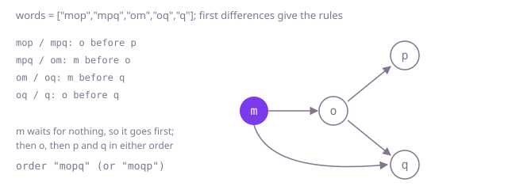

## The question

Given a list of words claimed to be sorted in an unknown alphabet, return an order of the letters they use under which the list is sorted, any one if several work, or the empty string if the list contradicts itself.

What makes it harder than it looks is reading the words correctly. Two neighbouring words say something only at their first differing position: in `"bx"` then `"xb"`, b comes before x, and the second letters say nothing; reading them as well invents a rule x before b and a false contradiction. When there is no differing position, the only thing to check is that the longer word is not first: `"lamp"` before `"lam"` is impossible in any alphabet. Every letter that appears must be returned, including letters no rule mentions. And the list can hold 100,000 words, so comparing every pair is out.

## How to think about it

The first idea is to compare every pair of words, since each pair of a sorted list is in order: the first differing letters give a rule, and a word before its own prefix ends the search. With the rules in hand, place letters one at a time, any letter whose required earlier letters are all placed; if letters remain and none can be placed, they wait on each other in a cycle. That is correct, and the pair comparisons cost O(n²): five billion of them for 100,000 words.

Neighbouring pairs are enough. If the neighbours are each in order, the whole list is in order, because dictionary order is transitive; so the rules from neighbours imply the rules from every other pair. That brings the comparisons down to n - 1, each no longer than the shorter word.

What is left is a topological order on a graph of at most 26 letters, with an edge from x to y for each rule "x before y". Kahn's algorithm gives it: count, for each letter, the rules still waiting on it; start with the letters waiting on nothing; each time a letter is output, its outgoing rules are met, and letters that reach zero join the queue. If some letters never reach zero, they sit on a cycle and the answer is the empty string. Count a rule once even if several pairs give it, or a letter is left waiting on a rule already met.

Walk Example 1, `["mop","mpq","om","oq","q"]`. The neighbours give o before p, m before o, m before q and o before q. Only m waits on nothing, so it goes first; that frees o; o frees p and q. The order is `"mopq"`, and `"moqp"` is just as good.



## Brute force

Compare every pair of words for rules, then place letters by repeated scans. It comes first because it uses only the definition of a sorted list, and it fixes the answers to compare against. It is correct because every pair of a sorted list must be in order, so every rule it collects is needed, and a letter is placed only after all letters it must follow.

```java
static String letterOrder(String[] words) {
    boolean[] used = new boolean[26];
    for (String word : words) {
        for (int i = 0; i < word.length(); i++) {
            used[word.charAt(i) - 'a'] = true;
        }
    }
    boolean[][] before = new boolean[26][26]; // before[x][y]: letter x must come before letter y
    for (int i = 0; i < words.length; i++) {
        for (int j = i + 1; j < words.length; j++) { // every pair, not just neighbours
            String first = words[i];
            String second = words[j];
            int shorter = Math.min(first.length(), second.length());
            int k = 0;
            while (k < shorter && first.charAt(k) == second.charAt(k)) {
                k++;
            }
            if (k < shorter) {
                before[first.charAt(k) - 'a'][second.charAt(k) - 'a'] = true;
            } else if (first.length() > second.length()) {
                return ""; // a word before its own proper prefix
            }
        }
    }
    StringBuilder order = new StringBuilder();
    boolean[] placed = new boolean[26];
    boolean progress = true;
    while (progress) { // place any letter whose earlier letters are all placed
        progress = false;
        for (int y = 0; y < 26; y++) {
            if (!used[y] || placed[y]) {
                continue;
            }
            boolean free = true;
            for (int x = 0; x < 26; x++) {
                free &= !(before[x][y] && !placed[x]);
            }
            if (free) {
                placed[y] = true;
                order.append((char) ('a' + y));
                progress = true;
            }
        }
    }
    for (int y = 0; y < 26; y++) {
        if (used[y] && !placed[y]) {
            return ""; // a letter on a cycle never becomes free
        }
    }
    return order.toString();
}
```

**Complexity:** time O(n² × L + k³), where n is the number of words, L the longest word and k ≤ 26 the number of letters; extra space O(k²).

## Better: neighbouring pairs, then repeated scans

Keep the scan that places letters, but take rules only from neighbouring words. Replace the double loop of the brute force with one loop over `w` and `w + 1`; the rest is unchanged.

```java
static String letterOrder(String[] words) {
    boolean[] used = new boolean[26];
    for (String word : words) {
        for (int i = 0; i < word.length(); i++) {
            used[word.charAt(i) - 'a'] = true;
        }
    }
    boolean[][] before = new boolean[26][26];
    for (int w = 0; w + 1 < words.length; w++) { // neighbours imply every other pair
        String first = words[w];
        String second = words[w + 1];
        int shorter = Math.min(first.length(), second.length());
        int k = 0;
        while (k < shorter && first.charAt(k) == second.charAt(k)) {
            k++;
        }
        if (k < shorter) {
            before[first.charAt(k) - 'a'][second.charAt(k) - 'a'] = true;
        } else if (first.length() > second.length()) {
            return "";
        }
    }
    StringBuilder order = new StringBuilder();
    boolean[] placed = new boolean[26];
    boolean progress = true;
    while (progress) {
        progress = false;
        for (int y = 0; y < 26; y++) {
            if (!used[y] || placed[y]) {
                continue;
            }
            boolean free = true;
            for (int x = 0; x < 26; x++) {
                free &= !(before[x][y] && !placed[x]);
            }
            if (free) {
                placed[y] = true;
                order.append((char) ('a' + y));
                progress = true;
            }
        }
    }
    for (int y = 0; y < 26; y++) {
        if (used[y] && !placed[y]) {
            return "";
        }
    }
    return order.toString();
}
```

**Complexity:** time O(C + k³), where C is the total length of the words and k ≤ 26; extra space O(k²).

**Prefer it when:** the alphabet is small, as here, where k³ is at most 17,576 steps and the scan is simpler to get right than in-degree counts; it runs as fast as the optimal one on these inputs, and the timed tests do not separate them. A depth-first search that outputs letters as it finishes them, reversed, is another equally fast way to order the letters.

## Optimal: neighbouring pairs and Kahn's algorithm

Take rules from neighbours, counting each distinct rule once, then run Kahn's algorithm: a queue of letters waiting on nothing, and each letter output lowers the counts of the letters after it. Fewer letters out than letters used means a cycle.

```java
static String letterOrder(String[] words) {
    boolean[] used = new boolean[26];
    int letters = 0;
    for (String word : words) {
        for (int i = 0; i < word.length(); i++) {
            if (!used[word.charAt(i) - 'a']) {
                used[word.charAt(i) - 'a'] = true;
                letters++;
            }
        }
    }
    boolean[][] before = new boolean[26][26]; // before[x][y]: letter x must come before letter y
    int[] waiting = new int[26]; // rules not yet met before each letter
    for (int w = 0; w + 1 < words.length; w++) {
        String first = words[w];
        String second = words[w + 1];
        int shorter = Math.min(first.length(), second.length());
        int k = 0;
        while (k < shorter && first.charAt(k) == second.charAt(k)) {
            k++;
        }
        if (k == shorter) {
            if (first.length() > second.length()) {
                return ""; // a word before its own proper prefix
            }
            continue; // equal, or a prefix first: no rule
        }
        int x = first.charAt(k) - 'a'; // only the first difference says anything
        int y = second.charAt(k) - 'a';
        if (!before[x][y]) { // count each rule once, however often it repeats
            before[x][y] = true;
            waiting[y]++;
        }
    }
    int[] queue = new int[26];
    int head = 0;
    int tail = 0;
    for (int x = 0; x < 26; x++) {
        if (used[x] && waiting[x] == 0) {
            queue[tail++] = x;
        }
    }
    StringBuilder order = new StringBuilder();
    while (head < tail) {
        int x = queue[head++];
        order.append((char) ('a' + x));
        for (int y = 0; y < 26; y++) {
            if (before[x][y] && --waiting[y] == 0) {
                queue[tail++] = y;
            }
        }
    }
    return order.length() == letters ? order.toString() : ""; // letters left over sit on a cycle
}
```

**Complexity:** time O(C + k²), the word comparisons plus one pass over the rule matrix per letter; extra space O(k²). With a list of edges instead of the matrix it is O(C + k + E) for E distinct rules.

## Complexity

| Approach | Time | Extra space |
| --- | --- | --- |
| Brute force | O(n² × L + k³) | O(k²) |
| Better: neighbouring pairs, then repeated scans | O(C + k³) | O(k²) |
| Optimal: neighbouring pairs and Kahn's algorithm | O(C + k²) | O(k²) |

n is the number of words, L the longest word, C the total length of the words and k ≤ 26 the number of letters used.

## Where it shows up

Recovering an order from sorted output is how you learn an unknown collation, for example the sort order a database or a foreign locale applies to strings, from a sample of its sorted results. The second half, a topological order with cycle detection, is the same machinery as build systems ordering targets, package managers ordering installs, and spreadsheets ordering cell recalculation; a cycle there is a circular dependency.

## Follow-up answers

**How would you tell whether the letter order is the only one possible?** It is unique exactly when Kahn's queue never holds more than one letter: two letters ready at once could go in either order. Equivalently, consecutive letters of the output must each be joined by a rule.

**Why is it enough to compare neighbouring words, not every pair?** Dictionary order under a fixed alphabet is transitive. If an order makes every neighbouring pair sorted, then the whole list is sorted under it, so every other pair is too; the rules from other pairs add nothing. So the neighbours alone decide the question: if no order sorts them there is no answer, and if one does, it is an answer for the whole list.

**What changes if the alphabet had thousands of symbols instead of 26 letters?** The 26 by 26 matrix becomes a waste: use a hash map from symbol to a set of successors, and a hash map of waiting counts. Kahn's algorithm is then O(C + k + E), with hash operations O(1) on average and O(log) worst case for Java's treeified buckets. The repeated scans of the Better approach grow like k³ and stop being an option.
