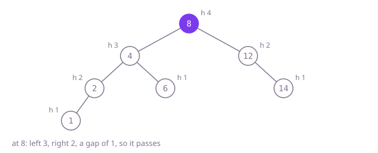

## The question

Given the root of a binary tree, decide whether every node's left and right subtrees differ in height by at most one, heights counted in nodes. An empty tree is balanced.

What makes it harder than it looks: the condition holds at every node, not just the root; in Example 2 both sides of the root are 3 tall, yet a node one level down is off by 2. It is also not the same as "all leaves are within one level of each other": a balanced tree can have leaves two levels apart. And asking "is it balanced?" and "how tall is it?" as two separate recursive questions measures the same subtrees over and over.

## How to think about it

The first idea follows the definition literally: at the root, compute both subtree heights and compare them, then check the two subtrees the same way. That is correct, but every height call walks a whole subtree, so the nodes near the bottom are measured again for every ancestor that gets checked.

Remembering heights in a map stops the re-measuring. Better still, notice that both questions can travel in one answer. Compute heights bottom-up; at each node you hold both child heights and can check the gap right there. If the gap is too big, or a child already reported trouble, return `-1`, a value no real height can have, and let every caller pass it straight up. One post-order pass answers both questions, and it stops early: once the left side reports `-1`, the right side is never visited.

Walk Example 1, `[8,4,12,2,6,null,14,1]`. Leaves 1, 6 and 14 have height 1. At 2 the sides are 1 and 0: fine, height 2. At 4 they are 2 and 1: fine, height 3. At 12 they are 0 and 1: fine, height 2. At 8 they are 3 and 2: fine, height 4. Nothing returned `-1`, so the tree is balanced.



## Brute force

Compare the two heights at the root, then check both subtrees the same way. It comes first because it is the definition turned into code, and it fixes the answer to compare against. It is correct because it checks the gap at every node it reaches, and it only stops early when it has already found a node that fails.

```java
static boolean isBalanced(TreeNode root) {
    if (root == null) {
        return true;
    }
    return Math.abs(height(root.left) - height(root.right)) <= 1 // heights recomputed at every node
            && isBalanced(root.left)
            && isBalanced(root.right);
}

private static int height(TreeNode node) {
    return node == null ? 0 : 1 + Math.max(height(node.left), height(node.right));
}
```

**Complexity:** time O(n·h) as an upper bound, where h is the depth (each node is measured once per checked ancestor); O(n log n) on a balanced tree. Extra space O(h) for the call stack, at most 1,000 frames here.

## Better: remember every height

Compute every height once in a post-order pass and store it in a map from node to height; then check the gap at every node from the map.

```java
static boolean isBalanced(TreeNode root) {
    Map<TreeNode, Integer> heights = new HashMap<>();
    fill(root, heights);
    for (TreeNode n : heights.keySet()) {
        if (Math.abs(heights.getOrDefault(n.left, 0) - heights.getOrDefault(n.right, 0)) > 1) {
            return false;
        }
    }
    return true;
}

private static int fill(TreeNode node, Map<TreeNode, Integer> heights) {
    if (node == null) {
        return 0;
    }
    int h = 1 + Math.max(fill(node.left, heights), fill(node.right, heights));
    heights.put(node, h);
    return h;
}
```

**Complexity:** time O(n) on average; `TreeNode` keys use identity hash codes and are not `Comparable`, so if many hash codes collided a crowded bucket would be searched one entry at a time and the worst case is O(n²). Extra space O(n) for the map plus O(h) call stack.

**Prefer it when:** the heights are wanted afterwards as well, or you must report every node that is out of balance rather than stop at the first: the map holds every height, so the loop can collect the failing nodes instead of returning at the first one.

## Optimal: heights that carry the verdict

One post-order function returns a node's height, or `-1` as soon as anything at or below the node is out of balance. This is the reference solution.

```java
static boolean isBalanced(TreeNode root) {
    return height(root) >= 0;
}

private static int height(TreeNode node) {
    if (node == null) {
        return 0;
    }
    int left = height(node.left);
    if (left < 0) {
        return -1; // already out of balance: skip the right side
    }
    int right = height(node.right);
    if (right < 0 || Math.abs(left - right) > 1) {
        return -1;
    }
    return 1 + Math.max(left, right);
}
```

**Complexity:** time O(n), extra space O(h) for the call stack, at most 1,000 frames here; a path of tens of thousands of nodes would overflow Java's default stack.

## Complexity

| Approach | Time | Extra space |
| --- | --- | --- |
| Brute force | O(n·h) upper bound, O(n log n) balanced | O(h) call stack |
| Better: remember every height | O(n) average, O(n²) worst if hash codes collide | O(n) map plus O(h) call stack |
| Optimal: heights that carry the verdict | O(n) | O(h) call stack, overflows on paths of tens of thousands |

## Where it shows up

No coding-round problem is linked to this question. The balance check is the invariant behind AVL trees, which keep search, insert and delete at O(log n) by restoring it after every change; a check like this one is what a test suite runs to prove the tree still holds it. The same "return a value plus a failure marker from one post-order pass" shape appears when validating any tree bottom-up, such as checking that a directory tree stays within size quotas.

## Follow-up answers

**Why is it not enough to compare the shallowest and the deepest leaf?** Because balance is about heights at each node, not about leaf depths across the whole tree. A balanced tree can have leaves two or more levels apart: build a node whose left subtree is a balanced tree of height 4 and whose right subtree is one of height 3, each made as sparse as allowed; the shallowest leaf sits at depth 2 and the deepest at depth 4, yet no node has a gap above 1. The reverse fails too: in Example 2 the root's two sides are equally tall while a node below is off by 2.

**How much slower is checking the heights again at every node, really?** Less than it looks. It costs one subtree walk per node it checks, and it only descends through nodes that pass. On a balanced tree that is O(n log n). A tree built to make it work hard, a long spine of passing nodes each with a thin path beside it, costs about n^1.5/6 steps, around 15 million for 100,000 nodes: slower than one pass, far from quadratic. O(n·h) is the safe upper bound to quote.

**How would a self-balancing tree keep this property after each insert?** An AVL tree stores each node's height. After inserting a leaf it walks back up the path to the root, updating heights; at the first node whose gap becomes 2 it performs one or two rotations, which restore the gap and the subtree's previous height, so nothing above needs fixing. That keeps every insert at O(log n).
