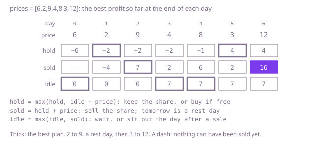

## The question

Given a share price for each day, trade one share at a time as often as you like, but never buy on the day right after a sale. Return the largest total profit.

What makes it harder than it looks is that the rule for unlimited trades no longer works. Without the rest day the answer is simply the sum of every rise: buy before each rise and sell after it. With it, two rises next to each other leave no day to rest between them, so in Example 1 the three rises add up to 20 but only 16 can be had. Sometimes the right move is to keep the share through a dip, as in Example 2; sometimes it is to sell a day before the peak so that the rest day falls on the peak and the dip after it can be bought: on `[11,2,0,3,11,0,9]` selling at 3 and then trading 0 to 9 makes 12, where holding from 0 to 11 makes 11. And the number of possible plans grows exponentially with the days.

## How to think about it

The first idea is to decide day by day. Holding a share, you either sell it today, which makes tomorrow a rest day, or keep it; holding nothing, you either buy today or wait. Try both and keep the better. That is correct, and it repeats itself: the best you can do from some day on depends only on the day and on whether you hold a share, not on the trades that led there. So there are only 2n different questions, and storing each answer makes the search linear.

Turned into a single pass from the first day, it becomes three running numbers, one per situation the desk can be in at the end of a day: `hold`, the best profit so far while holding a share; `sold`, the best profit so far having sold today, so that tomorrow is a rest day; and `idle`, the best profit so far holding nothing and free to buy tomorrow. Each day: `hold` keeps the share or buys, and a buy can only come from yesterday's `idle`, never from `sold`, which is the whole rest-day rule; `sold` is yesterday's `hold` plus today's price; `idle` either waits or is the rest day after yesterday's sale. All three new values must be computed from yesterday's three: updating `idle` first and then buying from it would let the desk buy on the rest day.

Walk Example 1, `prices = [6,2,9,4,8,3,12]`. After day 1 the best way to hold a share is to have bought at 2, so `hold` is −2. On day 2 selling gives `sold` = −2 + 9 = 7. Day 3 is the rest day: `idle` becomes 7, but buying at 4 had to come from day 2's `idle`, still 0. On day 4 buying at 8 from `idle` 7 gives −1; on day 5 buying at 3 gives 4, the better hold. On day 6 selling gives `sold` = 4 + 12 = 16, and the answer is the larger of `sold` and `idle`, 16.



## Brute force

From each day, try every move the rules allow and keep the best result. It comes first because it is the rules written as code, and it fixes the answers the faster versions must match. It is correct because every plan is one sequence of these choices, and selling jumps straight to the day after the rest day, so no plan ever buys on a rest day.

```java
static int bestProfit(int[] prices) {
    return from(prices, 0, false);
}

/** Best profit from day d on, free to act on day d, holding a share or not. */
private static int from(int[] prices, int d, boolean holding) {
    if (d >= prices.length) {
        return 0; // a share still held is never sold, so buying it only cost money
    }
    int wait = from(prices, d + 1, holding);
    if (holding) {
        return Math.max(wait, prices[d] + from(prices, d + 2, false)); // sell today; tomorrow is a rest day
    }
    return Math.max(wait, from(prices, d + 1, true) - prices[d]); // buy today
}
```

**Complexity:** time exponential, up to about 2^n calls, since every day splits the search in two; extra space O(n) for the recursion, at most 5,000 deep, which fits in the stack: it simply never finishes on a long run of days.

## Better: memoised search

The same search, with the answer for each day and each "holding or not" stored the first time it is worked out. Profits from a day on are never negative, since doing nothing earns 0, so −1 can mark "not worked out yet".

```java
static int bestProfit(int[] prices) {
    int[][] memo = new int[prices.length][2]; // memo[d][1]: holding a share on day d, memo[d][0]: not
    for (int[] day : memo) {
        Arrays.fill(day, -1); // -1: not worked out yet; real answers are 0 or more
    }
    return from(prices, 0, 0, memo);
}

private static int from(int[] prices, int d, int holding, int[][] memo) {
    if (d >= prices.length) {
        return 0;
    }
    if (memo[d][holding] < 0) {
        int wait = from(prices, d + 1, holding, memo);
        int act = holding == 1
                ? prices[d] + from(prices, d + 2, 0, memo) // sell today; tomorrow is a rest day
                : from(prices, d + 1, 1, memo) - prices[d]; // buy today
        memo[d][holding] = Math.max(wait, act);
    }
    return memo[d][holding];
}
```

**Complexity:** time O(n), extra space O(n) for the memo and the recursion, at most 5,000 deep here, which fits in the stack; a run of a few hundred thousand days would overflow it.

**Prefer it when:** you want the plan as well as the profit. With the whole memo kept, you can walk forward from day 0 and at each day take the choice whose value matches the stored best.

## Optimal: three running values

Carry `hold`, `sold` and `idle` along the days, each new value computed from the three of the day before. Nothing can be held or sold before the first day, so `hold` and `sold` start at a value far below any real profit. This is the reference solution.

```java
static int bestProfit(int[] prices) {
    // far below any real profit, and adding a price to it cannot overflow
    int impossible = Integer.MIN_VALUE / 2;
    int hold = impossible; // best profit so far, ending the day with a share
    int sold = impossible; // best profit so far, having sold today, so tomorrow is a rest day
    int idle = 0; // best profit so far, holding nothing and free to buy tomorrow
    for (int price : prices) {
        int newHold = Math.max(hold, idle - price); // keep the share, or buy: never on the day after a sale
        int newSold = hold + price; // sell the share bought on an earlier day
        int newIdle = Math.max(idle, sold); // wait, or sit out the rest day after yesterday's sale
        hold = newHold;
        sold = newSold;
        idle = newIdle;
    }
    return Math.max(sold, idle);
}
```

**Complexity:** time O(n), extra space O(1). The largest profit, at most 1,000 per trade and one trade every three days, is under 2 × 10^6 and fits an `int`.

## Complexity

| Approach | Time | Extra space |
| --- | --- | --- |
| Brute force | exponential, up to about 2^n calls | O(n) recursion, at most 5,000 deep |
| Better: memoised search | O(n) | O(n), recursion at most 5,000 deep |
| Optimal: three running values | O(n) | O(1) |

## Where it shows up

Any plan made day by day under a rule that ties today to what happened just before has this shape: a small set of situations, and the best value in each carried forward one step at a time. A machine that must cool down for a shift after each run, a rental that cannot be let again the day it comes back because it needs cleaning, or a trading rule that bars buying back right after a sale are all this question with different numbers.

## Follow-up answers

**What if every sale cost a fixed fee and there were no rest day?** Two situations are enough: holding a share or not. Buying comes from yesterday's "not holding" value, and selling adds the price minus the fee to yesterday's "holding" value. The fee makes small rises not worth trading, and the pass stays O(n) time and O(1) space.

**What if the rest lasted k days after each sale?** A buy on day i may then only follow a sale on day i − k − 1 or earlier. Keep the `sold` values of the last k days in a small ring; each day the oldest one leaves the ring, now old enough, and is folded into `idle`, from which buys are made. With k = 1 that is exactly the pass above. It costs O(n) time and O(k) space.

**What if the desk could make at most two trades in all?** Then the number of trades so far is part of the situation, and the rest day still applies after the first sale. Keep five running values: holding during the first trade, sold the first share today, done with one and free to buy, holding during the second trade, and done with two. The first sale lands in "sold today" and moves into "done with one" only the next day, and the second buy comes from yesterday's "done with one", so it never falls on the rest day. All five are computed from the day before's values, in O(n) time and O(1) space. With at most k trades it becomes about 3k running values, O(n × k) time.
