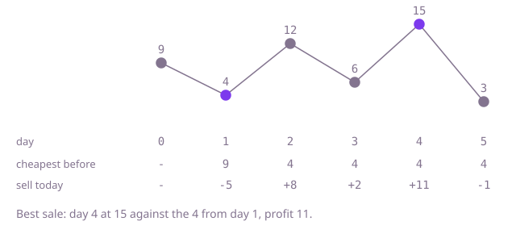

## The question

Given a stock's price on each day, find the largest profit from buying on one day and selling on a strictly later day. If no trade makes money, the answer is 0.

What makes it harder than it looks is the order. The tempting shortcut, the highest price minus the lowest, fails whenever the high comes first: in `[6, 5, 4, 1, 3]` it gives 5, but the real answer is 2. A falling list and an empty list must give 0, not a negative number. And with 200,000 days, trying every buy day against every later sell day is about 20 billion pairs.

## How to think about it

The first idea is to try every pair of days, buy first and sell later, and keep the largest difference. It repeats work: for a fixed selling day it looks at every earlier day, but only one of them can be the best buy, the cheapest. So fix the selling day instead. The best profit for that day is today's price minus the cheapest price before today, and the cheapest price so far is something you can carry as you walk forward. If you picture the days from the buy day to the current sell day as a window, the left edge of the window only needs to move when a cheaper price shows up, because a cheaper buy day beats the old one for every later sale.

Walk Example 1, `prices = [9, 4, 12, 6, 15, 3]`. Day 0: nothing earlier, the cheapest so far becomes 9. Day 1: price 4 against 9 loses 5, so the cheapest so far becomes 4. Day 2: 12 against 4 gains 8. Day 3: 6 against 4 gains 2. Day 4: 15 against 4 gains 11, the best. Day 5: 3 against 4 loses 1, and the cheapest becomes 3, too late for any sale. The answer is 11.



## Brute force

Try every buy day with every later sell day and keep the largest profit, starting from 0 for "no trade". It is what you say first, and it fixes the answer every faster version must agree with. It is correct because it considers every allowed pair, and starting from 0 means a falling list returns 0 rather than a loss.

```java
static int bestProfit(int[] prices) {
    int best = 0; // doing nothing is always allowed
    for (int buy = 0; buy < prices.length; buy++) {
        for (int sell = buy + 1; sell < prices.length; sell++) { // strictly later than the buy day
            best = Math.max(best, prices[sell] - prices[buy]);
        }
    }
    return best;
}
```

**Complexity:** time O(n²), extra space O(1).

## Better: an array of the cheapest earlier price

Fix the selling day. The best buy for it is the cheapest price on an earlier day, so first record, for each day, the cheapest price up to and including that day. Then each selling day looks up the entry for the day before it.

```java
static int bestProfit(int[] prices) {
    int n = prices.length;
    if (n == 0) {
        return 0;
    }
    int[] cheapest = new int[n]; // cheapest[i] = lowest price on days 0..i
    cheapest[0] = prices[0];
    for (int i = 1; i < n; i++) {
        cheapest[i] = Math.min(cheapest[i - 1], prices[i]);
    }
    int best = 0;
    for (int sell = 1; sell < n; sell++) {
        best = Math.max(best, prices[sell] - cheapest[sell - 1]); // day before: strictly earlier
    }
    return best;
}
```

**Complexity:** time O(n), extra space O(n) for the array.

**Prefer it when:** you want, for every selling day, the cheapest earlier price, not only the final profit: `cheapest` holds it for every day. The next version keeps only the latest entry.

## Optimal: one pass with the cheapest price so far

The array is only ever read at the previous day, so keep that one value in a variable. Walk the days once: compare today's price with the cheapest earlier price, keep the better profit, then update the cheapest price. The update comes after the comparison, because a day cannot be both the buy and the sell. This is the reference solution.

```java
static int bestProfit(int[] prices) {
    int best = 0;
    int lowest = Integer.MAX_VALUE; // cheapest price seen on an earlier day
    for (int price : prices) {
        best = Math.max(best, price - lowest); // sell on this day against the cheapest earlier day
        lowest = Math.min(lowest, price);
    }
    return best;
}
```

**Complexity:** time O(n), extra space O(1).

## Complexity

| Approach | Time | Extra space |
| --- | --- | --- |
| Brute force | O(n²) | O(1) |
| Better: array of the cheapest earlier price | O(n) | O(n) |
| Optimal: one pass with the cheapest price so far | O(n) | O(1) |

## Where it shows up

No coding-round problem is linked to this question. Finding the largest rise between an earlier and a later point appears in market and metrics dashboards (the biggest gain over a period) and in monitoring, where "largest increase since the quietest moment" is a standard way to flag a ramp. The pattern of carrying a running best from the left is common wherever a later value is compared with the best earlier one.

## Follow-up answers

**Can you do it in one pass over the prices with O(1) extra memory?** Yes: carry the cheapest price so far and the best profit so far, as in the optimal solution. Nothing else about the earlier days is needed.

**What changes if you may complete as many buy-and-sell trades as you like, one share at a time?** Then every rise between neighbouring days can be collected: add `prices[i] - prices[i-1]` whenever it is positive. You never hold more than one share, and splitting a long climb into daily steps earns the same total.

**How would you also return the buy day and the sell day?** Remember the day of the lowest price, and whenever a new best profit is found, record that remembered day as the buy day and the current day as the sell day. Update the remembered day only when the lowest price changes.
