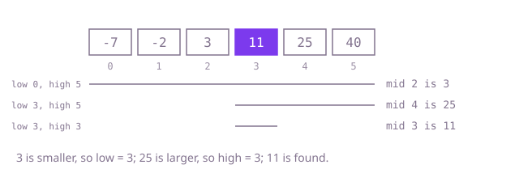

## The question

Given a strictly increasing array and a target, return the index where the target sits, or -1 when it is absent. The tests call this tens of thousands of times on a million values.

What makes it harder than it looks: the idea is one sentence, but the loop has three places to be off by one (the loop condition and the two range updates), and a wrong choice either skips the last candidate or loops forever. The empty array and the one-element array are where those mistakes show. And comparing by subtraction, `nums[middle] - target`, overflows when the values span the whole `int` range, which sends the search the wrong way.

## How to think about it

The first idea is to walk the array until the target turns up. It is correct, and it ignores the one thing the question gives you: the order. Comparing the target with any value tells you which side of that value the target must be on, so a comparison with the middle value rules out half of what is left.

So I keep a range `[low, high]`, both ends included, that holds the target if it is anywhere. Compare with the middle: equal means done; a smaller middle means the target is to the right, so `low = middle + 1`; a larger one means `high = middle - 1`. The range shrinks by at least one each time, so the loop ends, and when `low > high` the range is empty and the answer is -1. With both ends included, the loop runs while `low <= high`; using `<` would stop with one candidate left unchecked.

Walk Example 1, `nums = [-7, -2, 3, 11, 25, 40]`, `target = 11`. The range is indexes 0 to 5 and the middle is 2, holding 3, which is smaller, so `low = 3`. The range 3 to 5 has middle 4, holding 25, which is larger, so `high = 3`. The range 3 to 3 has middle 3, holding 11: found, answer 3.



## Brute force

Check every index from the left. It comes first because it is what you say first, and it fixes the answer the faster versions must agree with. It is correct because it looks at every position, so it finds the target if it is there.

```java
static int indexOf(int[] nums, int target) {
    for (int i = 0; i < nums.length; i++) {
        if (nums[i] == target) {
            return i; // values are distinct, so the first match is the only one
        }
    }
    return -1;
}
```

**Complexity:** time O(n) per call, extra space O(1).

## Better: the library search

`Arrays.binarySearch` does the halving for you. It returns the index when it finds the target and a negative number, `-(insertion point) - 1`, when it does not, so every negative result maps to -1.

```java
static int indexOf(int[] nums, int target) {
    int found = Arrays.binarySearch(nums, target);
    return found >= 0 ? found : -1; // a negative result encodes where the target would go
}
```

**Complexity:** time O(log n) per call, extra space O(1).

**Prefer it when:** you are writing production code rather than showing that you can write the search. It is the same algorithm, already tested.

## Optimal: binary search with both ends included

Keep `[low, high]` with both ends included, loop while it is not empty, and move one end past the middle each time. The middle is `(low + high) >>> 1`, and the comparison uses `<`, never a subtraction. This is the reference solution.

```java
static int indexOf(int[] nums, int target) {
    int low = 0;
    int high = nums.length - 1; // if the target is present, it lies in [low, high]
    while (low <= high) {
        int middle = (low + high) >>> 1;
        if (nums[middle] == target) {
            return middle;
        }
        if (nums[middle] < target) { // compare, never subtract: the difference can overflow
            low = middle + 1;
        } else {
            high = middle - 1;
        }
    }
    return -1;
}
```

**Complexity:** time O(log n) per call, extra space O(1).

## Complexity

| Approach | Time | Extra space |
| --- | --- | --- |
| Brute force | O(n) per call | O(1) |
| Better: the library search | O(log n) per call | O(1) |
| Optimal: binary search with both ends included | O(log n) per call | O(1) |

## Where it shows up

Looking up a key in a sorted index file or a sorted array of IDs without building a hash table; `git bisect`, which finds the commit that broke a build by halving the range of commits; and database B-tree pages, which binary search the sorted keys inside each page.

## Follow-up answers

**What changes if values may repeat and you must return the first position of the target?** Do not stop on a match. Search for the boundary instead: the first index whose value is at least the target, moving `high` onto the middle whenever the middle is not smaller. Then check that the value at that index equals the target.

**How would you search a sorted sequence whose length you do not know in advance?** Probe positions 1, 2, 4, 8 and so on until you pass the end or reach a value at least the target. That brackets the target between the last two probes in O(log p) steps, where p is its position, and a normal binary search finishes inside the bracket.

**Why is the middle computed as (low + high) >>> 1 rather than (low + high) / 2?** For arrays longer than about a billion elements, `low + high` can pass `Integer.MAX_VALUE` and turn negative. The unsigned shift reads the overflowed sum as the correct positive number, so the middle stays right. At this question's sizes both forms work, but the shift costs nothing.
