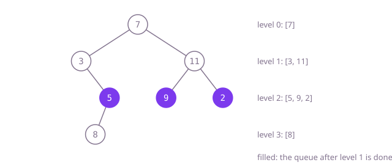

## The question

Given the root of a binary tree, return its values grouped by level: the root's level first, each level read from left to right. An empty tree gives an empty list.

What makes it harder than it looks: the natural ways to walk a tree go deep first, while the answer is wide first. A plain queue gives the right order but loses where one level stops and the next starts, and the first fix people reach for, walking down from the root once per level, is correct but repeats the top of the tree for every level below it.

## How to think about it

The first idea is to answer one level at a time: find the height, then for each depth d walk down from the root and collect the nodes exactly d steps below it. It is correct, but every walk repeats everything above level d, so a tree with a long tail under a large block pays for the block a thousand times.

What is worth remembering is the level just written: the next level is exactly the children of its nodes, left to right. A queue keeps them in that order, first in first out. The boundary problem has a simple answer: when a level starts, the queue holds that level and nothing else, so its size says how many nodes to take before the next level begins.

Walk Example 1, `[7,3,11,null,5,9,2,8]`. The queue starts as `[7]`: one node, so level 0 is `[7]`, and its children make the queue `[3, 11]`. Two nodes: level 1 is `[3, 11]`, and their children make `[5, 9, 2]`. Three nodes: level 2 is `[5, 9, 2]`, leaving `[8]`, which is level 3.



## Brute force

Walk from the root once per level. It comes first because it is what you say first, and it fixes the answer to compare against. It is correct because a walk that goes left before right and stops at depth d meets the nodes of level d from left to right.

```java
static List<List<Integer>> levels(TreeNode root) {
    List<List<Integer>> out = new ArrayList<>();
    int height = height(root);
    for (int d = 0; d < height; d++) { // one walk from the root per level
        List<Integer> level = new ArrayList<>();
        collect(root, d, level);
        out.add(level);
    }
    return out;
}

private static int height(TreeNode n) {
    return n == null ? 0 : 1 + Math.max(height(n.left), height(n.right));
}

private static void collect(TreeNode n, int d, List<Integer> level) {
    if (n == null) {
        return;
    }
    if (d == 0) {
        level.add(n.val);
        return;
    }
    collect(n.left, d - 1, level);
    collect(n.right, d - 1, level);
}
```

**Complexity:** time O(n·h), where h is the depth, since the walk for level d revisits every node above it; extra space O(h) for the call stack, at most 1,000 frames here.

## Better: one walk that carries the depth

Walk the tree once, left before right, passing the depth down, and append each value to the list for its depth, creating the list the first time that depth is reached. Left-before-right order within a depth is kept because the walk meets the nodes of any one level from left to right.

```java
static List<List<Integer>> levels(TreeNode root) {
    List<List<Integer>> out = new ArrayList<>();
    visit(root, 0, out);
    return out;
}

private static void visit(TreeNode node, int depth, List<List<Integer>> out) {
    if (node == null) {
        return;
    }
    if (depth == out.size()) {
        out.add(new ArrayList<>()); // first node seen at this depth
    }
    out.get(depth).add(node.val);
    visit(node.left, depth + 1, out);
    visit(node.right, depth + 1, out);
}
```

**Complexity:** time O(n); extra space O(h) for the call stack, at most 1,000 frames here, but a path of tens of thousands of nodes would overflow Java's default stack.

**Prefer it when:** the tree is wide and shallow: the stack holds one path, while a queue holds a whole level, which in a complete tree is about half the nodes.

## Optimal: a queue, one level at a time

Keep the nodes of the current level in a queue; take exactly as many as the queue held when the level started, writing their values and queueing their children. This is the reference solution.

```java
static List<List<Integer>> levels(TreeNode root) {
    List<List<Integer>> out = new ArrayList<>();
    ArrayDeque<TreeNode> queue = new ArrayDeque<>();
    if (root != null) {
        queue.add(root);
    }
    while (!queue.isEmpty()) {
        int size = queue.size(); // exactly the nodes of the current level
        List<Integer> level = new ArrayList<>(size);
        for (int i = 0; i < size; i++) {
            TreeNode n = queue.poll();
            level.add(n.val);
            if (n.left != null) queue.add(n.left);
            if (n.right != null) queue.add(n.right);
        }
        out.add(level);
    }
    return out;
}
```

**Complexity:** time O(n); extra space O(w) for the queue, where w is the widest level (about n/2 in a complete tree), on the heap, so any depth is fine.

## Complexity

| Approach | Time | Extra space |
| --- | --- | --- |
| Brute force | O(n·h) | O(h) call stack, at most 1,000 frames here |
| Better: one walk that carries the depth | O(n) | O(h) call stack, safe for depth up to 1,000, overflows on paths of tens of thousands |
| Optimal: a queue, one level at a time | O(n) | O(w), the widest level, on the heap |

## Where it shows up

No coding-round problem is linked to this question. Level-by-level reading is how an org chart or a file tree is shown one tier at a time, how a crawler explores links in rounds of increasing distance from the start page, and how a game finds everything within k moves. The same queue, with the size taken at the start of each round, is breadth-first search on any graph.

## Follow-up answers

**How would you return the levels from the bottom up instead?** Build the levels top down as above, then reverse the outer list, which is O(number of levels). Adding each level at the front of a `LinkedList` or `ArrayDeque` works too. Reading the tree bottom up directly is not easier, because the bottom is only known at the end.

**How would you alternate the direction of every other level?** Keep the same queue walk and, for odd levels, reverse the level's list before adding it, or fill it from the back with `addFirst` on an `ArrayDeque`. The order in which children are queued must not change, or the levels below come out scrambled.

**How much memory does the queue need at most, and for which tree shape?** It holds at most two neighbouring levels, so its size is bounded by the widest level plus its children. A complete tree is the worst case: the bottom level holds about half of all nodes, so about n/2. A path is the best case: the queue never holds more than one node.
