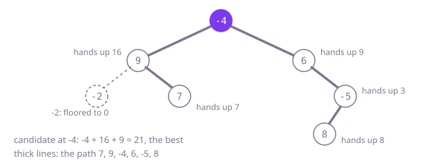

## The question

Given a binary tree of integers, some negative, return the largest sum of the values along any path: a chain of nodes joined by parent-child links, at least one node long, anywhere in the tree. The path may climb from one node to a common ancestor and come down the other side.

What makes it harder than it looks: three easy slips each give a wrong number. Starting the best sum at 0 answers 0 for a tree of negative values, though a path cannot be empty. Adding a child's best chain when it is negative makes a path worse. And the number a node hands its parent is not the number it offers as an answer: a path that turns at a node uses both sides, but the parent can extend only one.

## How to think about it

A path is fixed by its two ends, so the first idea is to start at every node and follow every path from there, up and down. That is correct and quadratic.

Better: every path has one highest node, where it turns. The best path turning at a node is the node plus the best chain going straight down on its left plus the same on its right, where a chain that sums below zero is left out. Trying every node as the turning point, with a fresh walk down from each, is O(n·h).

The fresh walks repeat work: a node's best downward chain is itself plus the better of its children's chains. So compute the chains bottom-up in one post-order pass. At each node, with `left` and `right` its children's chains floored at zero, record `val + left + right` as a candidate and hand `val + max(left, right)` to the parent.

Walk Example 1. The leaf -2 hands up -2, which its parent floors to 0; 7 hands up 7. At 9 the candidate is 9 + 0 + 7 = 16 and it hands up 16. On the right, 8 hands up 8; -5 offers -5 + 8 = 3 and hands up 3; 6 has no left child, offers 6 + 0 + 3 = 9 and hands up 9. At the root the candidate is -4 + 16 + 9 = 21, the largest seen, so the answer is 21.



## Brute force

Start at every node and walk every path from it, remembering the parent of each node so the walk can go up as well as down. It comes first because it follows the definition, and it fixes the answer to compare against. It is correct because every path is found from each of its two ends, and each partial path's sum is checked as a place to stop.

```java
static int maxPathSum(TreeNode root) {
    Map<TreeNode, TreeNode> parent = new IdentityHashMap<>();
    List<TreeNode> nodes = new ArrayList<>();
    collect(root, null, parent, nodes);
    int best = Integer.MIN_VALUE;
    for (TreeNode start : nodes) {
        best = Math.max(best, walk(start, null, 0, parent)); // every path, from each of its two ends
    }
    return best;
}

private static void collect(TreeNode node, TreeNode up, Map<TreeNode, TreeNode> parent, List<TreeNode> nodes) {
    if (node == null) {
        return;
    }
    parent.put(node, up); // so a walk can go up as well as down
    nodes.add(node);
    collect(node.left, node, parent, nodes);
    collect(node.right, node, parent, nodes);
}

private static int walk(TreeNode node, TreeNode from, int sum, Map<TreeNode, TreeNode> parent) {
    sum += node.val;
    int best = sum; // the path may end here
    for (TreeNode next : new TreeNode[] {node.left, node.right, parent.get(node)}) {
        if (next != null && next != from) { // never step back
            best = Math.max(best, walk(next, node, sum, parent));
        }
    }
    return best;
}
```

**Complexity:** time O(n²): each start reads the whole tree. Extra space O(n) for the parent map and the node list, plus the call stack, which follows the longest path, at most 1,999 frames at this question's depth limit.

## Better: each node as the turning point

For every node, take the node plus the best downward chain on each side, floored at zero, and keep the largest. The chains come from a fresh recursive walk each time.

```java
static int maxPathSum(TreeNode root) {
    if (root == null) {
        return Integer.MIN_VALUE; // an empty side offers no path
    }
    int here = root.val + Math.max(0, bestDown(root.left)) + Math.max(0, bestDown(root.right)); // turns at root
    return Math.max(here, Math.max(maxPathSum(root.left), maxPathSum(root.right)));
}

private static int bestDown(TreeNode node) {
    if (node == null) {
        return 0;
    }
    return node.val + Math.max(0, Math.max(bestDown(node.left), bestDown(node.right))); // a losing side is left out
}
```

**Complexity:** time O(n·h), where h is the depth: the chain walk from a node reads its subtree, and each node lies in at most h subtrees; O(n²) on an unbounded path. Extra space O(h) for the call stack, at most 1,000 frames here.

**Prefer it when:** you want the turning-point idea on its own, each function doing one thing, before folding the two walks into one. It is never faster than the one-pass version.

## Optimal: one post-order pass

Compute each node's best downward chain from its children's, bottom-up, and record the path that turns at each node on the way. Floor a child's chain at zero, so a losing side is left out. Start the best at the smallest `int`, since every value may be negative. This is the reference solution.

```java
static int maxPathSum(TreeNode root) {
    int[] best = {Integer.MIN_VALUE}; // not 0: every value may be negative
    down(root, best);
    return best[0];
}

private static int down(TreeNode node, int[] best) {
    if (node == null) {
        return 0;
    }
    int left = Math.max(0, down(node.left, best)); // a branch that loses is left out
    int right = Math.max(0, down(node.right, best));
    best[0] = Math.max(best[0], node.val + left + right); // the path that turns here uses both sides
    return node.val + Math.max(left, right); // the parent can extend only one side
}
```

**Complexity:** time O(n): each node is visited once. Extra space O(h) for the call stack, at most 1,000 frames here; a path of tens of thousands of nodes would overflow Java's default stack.

## Complexity

| Approach | Time | Extra space |
| --- | --- | --- |
| Brute force | O(n²) | O(n) map and list, plus a call stack of at most 1,999 frames here |
| Better: each node as the turning point | O(n·h), O(n²) on an unbounded path | O(h) call stack, at most 1,000 frames here |
| Optimal: one post-order pass | O(n) | O(h) call stack, overflows on paths of tens of thousands |

## Where it shows up

No coding-round problem is linked to this question. The shape, each node hands its parent one summary and records a better answer that only it can see, is the standard way to solve problems on trees bottom-up: the longest route in a network laid out as a tree, the most valuable chain of reporting lines in an org chart, the heaviest branch in a cost breakdown. The diameter of a tree is the same pass with every value counted as 1.

## Follow-up answers

**How would you return the path itself, not only its sum?** Have each node also remember which child its chain continued into, and note the node where the best candidate was recorded. Afterwards, start at that turning node and follow the remembered choices down the left chain and the right chain, keeping only sides whose chain was positive; join the reversed left chain, the node and the right chain.

**What changes if a path must run from one leaf to another leaf?** A chain may no longer stop early or be floored at zero, because it has to end at a leaf: a node with one child must continue into it, and a node with two takes the better one. A candidate is recorded only at a node with two children, as the node plus both chains. If no node has two children the tree is a single path and, depending on whether the root counts as a leaf, the whole path is the answer or there is none.

**How would you find the path with the most nodes instead of the largest sum?** Count every node as 1 and run the same pass: a node hands up 1 plus its taller child's chain, and offers 1 plus both chains. No flooring is needed because every count is positive. That is the tree's diameter, counted in nodes.
