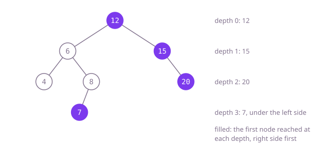

## The question

Given the root of a binary tree, return the value of the rightmost node on each level, from the top level down. A node on the left side of the tree counts when its level has nothing further right.

What makes it harder than it looks: the right edge of the tree, root and then right children, is the tempting answer, and it is wrong whenever the left side reaches deeper than the right. In Example 1 the 7 hangs below the left subtree, yet it is the only node on its level, so it is seen. Any correct answer has to look at every level, not just the right edge.

## How to think about it

The first idea is to write the tree out level by level, as in a level-order traversal, and keep the last value of each level. That is correct and linear, but it stores every value of the tree to keep one per level.

Keeping less is easy with the same queue: walk level by level and remember only the last node taken from each level, so nothing beyond the queue is stored. Turning the walk around gives something shorter still: go depth first, but visit the right child before the left one, carrying the depth. Then the first node reached at each new depth is the rightmost one there, because every node to its right on that level would have been reached earlier. The answer list doubles as the record of which depths have been seen: its size is the next new depth.

Walk Example 1, `[12,6,15,4,8,null,20,null,null,7]`. Start at 12, depth 0, new: keep 12. Right to 15, depth 1, new: keep 15. Right to 20, depth 2, new: keep 20. Back to 6, depth 1, already seen; its right child 8 is at depth 2, seen; 8's child 7 is at depth 3, new: keep 7. Then 4 at depth 2 is already seen. The answer is `[12,15,20,7]`.



## Brute force

Write every level out, left to right, and keep the last value of each. It comes first because it is what you say first, and it fixes the answer to compare against. It is correct because the last value of a level read left to right is by definition the rightmost node of that level.

```java
static List<Integer> rightSideView(TreeNode root) {
    List<List<Integer>> levels = new ArrayList<>();
    ArrayDeque<TreeNode> queue = new ArrayDeque<>();
    if (root != null) queue.add(root);
    while (!queue.isEmpty()) {
        List<Integer> level = new ArrayList<>();
        for (int i = queue.size(); i > 0; i--) { // the size when the level starts
            TreeNode n = queue.poll();
            level.add(n.val);
            if (n.left != null) queue.add(n.left);
            if (n.right != null) queue.add(n.right);
        }
        levels.add(level);
    }
    List<Integer> view = new ArrayList<>();
    for (List<Integer> level : levels) {
        view.add(level.get(level.size() - 1)); // the rightmost of the level
    }
    return view;
}
```

**Complexity:** time O(n); extra space O(n) for every value of every level.

## Better: keep only the last node of each level

The same queue walk, but the only thing remembered from a level is the node taken last.

```java
static List<Integer> rightSideView(TreeNode root) {
    List<Integer> view = new ArrayList<>();
    ArrayDeque<TreeNode> queue = new ArrayDeque<>();
    if (root != null) queue.add(root);
    while (!queue.isEmpty()) {
        TreeNode last = null;
        for (int i = queue.size(); i > 0; i--) {
            last = queue.poll();
            if (last.left != null) queue.add(last.left);
            if (last.right != null) queue.add(last.right);
        }
        view.add(last.val); // the level's rightmost node is taken last
    }
    return view;
}
```

**Complexity:** time O(n); extra space O(w) for the queue, where w is the widest level (about n/2 in a complete tree), on the heap, so any depth is fine.

**Prefer it when:** the depth is not capped. The queue lives on the heap, so a path of 100,000 nodes is no problem, while one call per level would overflow Java's stack.

## Optimal: depth first, right side first

Visit the right child before the left one and pass the depth down; a node whose depth equals the current size of the answer is the first one reached at that depth, so it is the rightmost there. This is the reference solution.

```java
static List<Integer> rightSideView(TreeNode root) {
    List<Integer> view = new ArrayList<>();
    visit(root, 0, view);
    return view;
}

private static void visit(TreeNode node, int depth, List<Integer> view) {
    if (node == null) {
        return;
    }
    if (depth == view.size()) {
        view.add(node.val); // the first node reached at a new depth is the rightmost one there
    }
    visit(node.right, depth + 1, view); // right side first
    visit(node.left, depth + 1, view);
}
```

**Complexity:** time O(n); extra space O(h) for the call stack, where h is the depth; at most 1,000 frames here, but a path of tens of thousands of nodes would overflow Java's default stack.

## Complexity

| Approach | Time | Extra space |
| --- | --- | --- |
| Brute force | O(n) | O(n) |
| Better: keep only the last node of each level | O(n) | O(w), the widest level, on the heap |
| Optimal: depth first, right side first | O(n) | O(h) call stack, safe for depth up to 1,000, overflows on paths of tens of thousands |

## Where it shows up

No coding-round problem is linked to this question. "The first thing met at each depth" is how a renderer decides which element is on top when layers overlap, how a skyline or silhouette is drawn from a side, and how a tree view shows a collapsed summary with one representative per level. The pattern of passing the depth down and using a list's size as the set of depths seen comes up whenever a per-depth answer is built in one walk.

## Follow-up answers

**How would you return the left side view instead?** Swap the order of the two recursive calls so the left child is visited first; the first node reached at each depth is then the leftmost. In the queue version, keep the first node taken from each level instead of the last.

**Why is following right children not enough?** The right edge stops where the right side stops, but the left side can go deeper, and on those levels the rightmost node is somewhere under the left subtree. Example 1 shows it: the right edge ends at 20 on level 2, and level 3 holds only the 7 under 8, which is seen from the right.

**How would you do it without recursion?** Use the queue walk in "Better", which keeps the last node of each level. Or keep the depth-first order with an explicit stack of (node, depth) pairs, pushing the left child before the right one so the right comes off first, and keep a node when its depth equals the answer's size.
