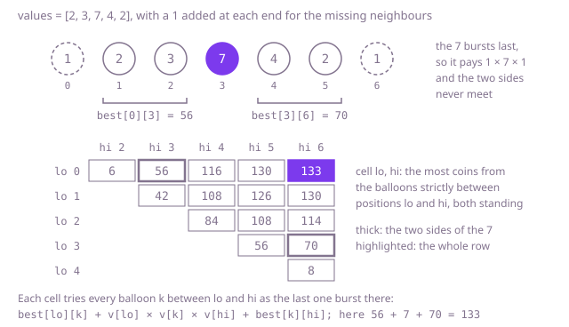

## The question

Given a row of numbered balloons, burst them one at a time in any order; each burst pays its number times the numbers of its nearest unburst neighbours, a missing neighbour counting as 1. Return the most the whole row can pay.

What makes it harder than it looks is that every burst changes who is next to whom. The obvious rules of thumb fail on Example 1: bursting the smallest balloon first gets 70, and always bursting the one that pays most right now gets 130 at best, where 133 is possible. Trying every order is correct but there are n! of them. And the natural way to split the problem, by the first balloon burst, does not split it at all: once that balloon is gone its two neighbours meet, so the two sides still affect each other.

## How to think about it

The first idea is to try every order: burst each balloon in turn, carry on with the rest, and keep the best total. It is correct, and it is hopeless beyond about ten balloons. Remembering the best total for each set of balloons left does not save it either, because the pay of a burst depends on which balloons are still there, and there are 2^n such sets.

What helps is to look at the last balloon instead of the first. Suppose balloon k is the last one burst. When it goes, everything else has gone, so it pays 1 × its number × 1. Before that, k stood the whole time, so the balloons on its left only ever had neighbours on the left of k or k itself, and the same holds on the right. The two sides never meet: each is the same question on a shorter stretch, with a wall at each end that stands until the stretch is cleared. Put a 1 at each end of the row for the missing neighbours, and let `best[lo][hi]` be the most coins from bursting every balloon strictly between positions `lo` and `hi` while both of them stand. Trying every k between them as the last of the stretch, `best[lo][hi]` is the largest of `best[lo][k] + v[lo] × v[k] × v[hi] + best[k][hi]`, and a stretch with no balloon in it pays 0. Each cell reads only shorter stretches, so fill the table by the length of the stretch; filling it row by row with `lo` going up would read `best[k][hi]`, for k past `lo`, before it is filled. The answer is `best[0][n + 1]`.

Walk Example 1. The padded row is 1, 2, 3, 7, 4, 2, 1 at positions 0 to 6. Between the left 1 and the 7 lie the 2 and the 3: bursting the 3 first pays 2 × 3 × 7 = 42 and then the 2 pays 1 × 2 × 7 = 14, so `best[0][3]` = 56. Between the 7 and the right 1 lie the 4 and the 2: the 4 pays 7 × 4 × 2 = 56 and then the 2 pays 7 × 2 × 1 = 14, so `best[3][6]` = 70. With the 7 last, the whole row pays 56 + 1 × 7 × 1 + 70 = 133. Keeping either 2 for last comes to 132, the 4 to 128 and the 3 to 123, so `best[0][6]` = 133.



## Brute force

Try every balloon as the next one to burst, recurse on the rest, and put it back. It comes first because it is the game itself written as code, and it fixes the answers the faster versions must match. It is correct because every order of bursting is one path through the recursion, and each burst is paid with the neighbours it has at that moment.

```java
static int mostCoins(int[] values) {
    List<Integer> row = new ArrayList<>();
    for (int value : values) {
        row.add(value);
    }
    return mostFrom(row);
}

/** The most coins from bursting every balloon left in row, trying each one as the next. */
private static int mostFrom(List<Integer> row) {
    int most = 0;
    for (int k = 0; k < row.size(); k++) {
        int left = k > 0 ? row.get(k - 1) : 1; // a side with nothing left counts as 1
        int right = k + 1 < row.size() ? row.get(k + 1) : 1;
        int value = row.remove(k);
        most = Math.max(most, left * value * right + mostFrom(row));
        row.add(k, value); // put it back before trying the next balloon
    }
    return most;
}
```

**Complexity:** time O(n!): it makes about e × n! calls, and most of them have only a few balloons left, so the list work in each adds only a constant factor; extra space O(n) for the row and the recursion, at most 301 calls deep at 300 balloons, which fits the test thread's stack.

## Better: memoised recursion over stretches

The last-balloon rule written as a recursion, with the answer for each stretch stored the first time it is worked out.

```java
static int mostCoins(int[] values) {
    int n = values.length;
    int[] v = new int[n + 2]; // the row with a 1 at each end for the missing neighbours
    v[0] = 1;
    v[n + 1] = 1;
    System.arraycopy(values, 0, v, 1, n);
    int[][] memo = new int[n + 2][n + 2];
    for (int[] row : memo) {
        Arrays.fill(row, -1); // -1: not worked out yet; every total is 0 or more
    }
    return between(v, 0, n + 1, memo);
}

/** The most coins from bursting every balloon strictly between lo and hi while both stand. */
private static int between(int[] v, int lo, int hi, int[][] memo) {
    if (memo[lo][hi] >= 0) {
        return memo[lo][hi];
    }
    int most = 0; // a stretch with no balloon in it pays nothing
    for (int k = lo + 1; k < hi; k++) {
        // k bursts last between lo and hi, so lo and hi are its neighbours then
        most = Math.max(most, between(v, lo, k, memo) + v[lo] * v[k] * v[hi] + between(v, k, hi, memo));
    }
    memo[lo][hi] = most;
    return most;
}
```

**Complexity:** time O(n³), since each of the about n² / 2 stretches is worked out once and tries every k inside it; extra space O(n²) for the memo, plus the recursion, at most 301 calls deep at 300 balloons, since each call's stretch is shorter than its caller's, which fits the test thread's stack.

**Prefer it when:** you would rather not work out an order in which to fill the table. The recursion asks for each shorter stretch when it needs it, so the rule goes into code as it was found; it still works out every stretch once, the same work as the table.

## Optimal: a table filled by the length of the stretch

The same rule, filled from the shortest stretches to the whole row. This is the reference solution.

```java
static int mostCoins(int[] values) {
    int n = values.length;
    int[] v = new int[n + 2]; // the row with a 1 at each end for the missing neighbours
    v[0] = 1;
    v[n + 1] = 1;
    System.arraycopy(values, 0, v, 1, n);
    // best[lo][hi]: the most coins from the balloons strictly between lo and hi, while both stand
    int[][] best = new int[n + 2][n + 2];
    for (int gap = 2; gap <= n + 1; gap++) { // shorter stretches first: each reads only shorter ones
        for (int lo = 0; lo + gap <= n + 1; lo++) {
            int hi = lo + gap;
            int most = 0;
            for (int k = lo + 1; k < hi; k++) {
                // k bursts last between lo and hi, so lo and hi are its neighbours then
                most = Math.max(most, best[lo][k] + v[lo] * v[k] * v[hi] + best[k][hi]);
            }
            best[lo][hi] = most;
        }
    }
    return best[0][n + 1];
}
```

**Complexity:** time O(n³), about n³ / 6, or 4.5 million steps of the inner loop, at 300 balloons; extra space O(n²), about 360 KB at 300 balloons. No recursion.

## Complexity

| Approach | Time | Extra space |
| --- | --- | --- |
| Brute force | O(n!), about e × n! calls | O(n), recursion at most 301 deep |
| Better: memoised recursion over stretches | O(n³) | O(n²), recursion at most 301 deep |
| Optimal: a table filled by the length of the stretch | O(n³) | O(n²) |

## Where it shows up

Choosing the order in which to multiply a chain of matrices is the same table: the last multiplication splits the chain into two parts whose costs do not affect each other, and NumPy's `multi_dot` picks its order of multiplication that way. Optimal binary search trees for keys with known lookup rates and the CYK parser for context-free grammars fill a table over stretches in the same way, shortest first.

## Follow-up answers

**What if you also had to give an order of bursting that pays the most?** Store, next to each `best[lo][hi]`, the k that gave it. The order for a stretch is the order for the left part, then the order for the right part, then k itself; the two parts can even be interleaved, since they never meet. Unwinding from `(0, n + 1)` lists all n balloons in O(n) after the table, with recursion at most n deep or an explicit stack.

**What if a burst paid the sum of the three numbers instead of their product?** The same split works: a burst still depends only on the balloon and its two neighbours at that moment, and when k is the last of a stretch those are the two ends of the stretch. Replace `v[lo] * v[k] * v[hi]` by the sum and keep everything else. Any pay that depends only on those three numbers works the same way.

**What if the numbers could be negative?** The last-balloon argument never used the signs, so the rule still holds. Two things change: a stretch with balloons in it must burst them even at a loss, so `most` starts at `Integer.MIN_VALUE` rather than 0 for such a stretch, and an empty stretch stays 0. The memo can no longer use -1 for "not worked out", so it needs a separate flag. The range stays the same in size, at most 10^6 per burst either way, so an `int` still holds every total.
