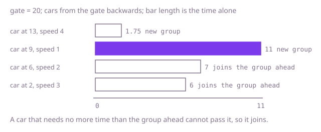

## The question

Cars on a one-lane road drive towards a gate, each at its own constant speed, and none may overtake. A car that catches a slower one ahead falls in behind it, and the cars then travel as one group. Count the groups that reach the gate; a car that would arrive at exactly the same moment as the group ahead counts as part of it.

What makes it harder than it looks: the cars come in no particular order, so "the car ahead" is not the next array entry until you sort by position. The tie at the gate must merge cars, which a strict-versus-non-strict slip gets wrong. Arrival times are fractions: with integer division, 2.5 and 2.1 both become 2 and two separate groups merge. And comparing every car with every car ahead is 10 billion steps at 100,000 cars.

## How to think about it

The first idea is to ask each car whether some car ahead of it will hold it up: a car ahead blocks it when that car arrives at the gate no earlier than this car would alone. Checking every car ahead for every car is quadratic. Notice what matters about the cars ahead: only the slowest arrival time among them. A car is blocked exactly when its own time is no more than that. So sort the cars by position and go from the one nearest the gate backwards, keeping the arrival time of the group at the front of the line. A car whose time is longer than that arrives later than everything ahead, so it leads a new group and its time becomes the new front. A car whose time is shorter or equal is stuck behind the group and joins it.

Walk Example 1, `gate = 20`, `start = [2, 6, 9, 13]`, `speed = [3, 2, 1, 4]`. The times alone are (20 - 2) / 3 = 6, (20 - 6) / 2 = 7, (20 - 9) / 1 = 11 and (20 - 13) / 4 = 1.75. From the gate backwards: the car at 13 takes 1.75, a new group, front 1.75. The car at 9 takes 11, longer, a new group, front 11. The car at 6 takes 7, no more than 11, so it joins. The car at 2 takes 6, no more than 11, so it joins. Two groups.



## Brute force

For each car, look at every other car that starts ahead of it. If one of them arrives at the gate no earlier, this car cannot beat it and joins a group; otherwise it leads a group. The number of cars that lead is the answer. It is what you say first, and it fixes the answer every faster version must agree with. It is correct because a car's real arrival time is the larger of its own time and the real arrival time of the car directly ahead, which unrolls to the largest own time among itself and all the cars ahead. So it arrives together with a group ahead exactly when some car ahead has an own time at least as long as its own, and it leads a group when every car ahead is strictly quicker. Times are compared as fractions by cross-multiplying in `long`, so there is no rounding.

```java
static int groups(int gate, int[] start, int[] speed) {
    int groups = 0;
    for (int i = 0; i < start.length; i++) {
        boolean joinsAGroupAhead = false;
        for (int j = 0; j < start.length && !joinsAGroupAhead; j++) {
            // car j is ahead of car i and arrives no earlier: car i is held up by it
            if (start[j] > start[i]
                    && (long) (gate - start[j]) * speed[i] >= (long) (gate - start[i]) * speed[j]) {
                joinsAGroupAhead = true;
            }
        }
        if (!joinsAGroupAhead) {
            groups++; // nobody ahead holds this car up: it leads a group
        }
    }
    return groups;
}
```

**Complexity:** time O(n²) for n cars, extra space O(1).

## Better: sort by position, then a stack of group times

Sort the cars by start position, then go from the car farthest from the gate to the nearest. Keep a stack of the arrival times of the groups seen so far. For each car, compute its time; every group behind it with a time no longer than this car's is held up by it, so pop those groups, then push this car's time. At the end the stack holds one time per group, and its size is the answer.

```java
static int groups(int gate, int[] start, int[] speed) {
    int n = start.length;
    long[] cars = new long[n];
    for (int i = 0; i < n; i++) {
        cars[i] = ((long) start[i] << 20) | speed[i]; // position in the high bits, so sorting orders by position
    }
    Arrays.sort(cars);
    double[] stack = new double[n]; // arrival times of the groups so far, nearest the gate on top
    int size = 0;
    for (int i = 0; i < n; i++) { // from the car farthest from the gate to the nearest
        int position = (int) (cars[i] >> 20);
        int carSpeed = (int) (cars[i] & 0xFFFFF);
        double time = (double) (gate - position) / carSpeed;
        while (size > 0 && stack[size - 1] <= time) {
            size--; // a group behind that arrives no later is held up by this car
        }
        stack[size++] = time;
    }
    return size;
}
```

**Complexity:** time O(n log n) for the sort and O(n) for the pass, extra space O(n) for the packed cars and the stack.

**Prefer it when:** you need more than the count, for example the arrival time of every group: when the loop ends the stack holds exactly those times. If only the count matters, the next version does the same with one number.

## Optimal: sort, then one pass keeping the slowest time ahead

Sort the cars by position and walk from the car nearest the gate backwards. Keep one number, the arrival time of the group at the front. A car with a strictly longer time starts a new group and replaces that number; a car with a shorter or equal time joins the group, and the number stays. This is the reference solution. Times are `double` values: two equal fractions give the identical `double`, and two different times a / s1 and b / s2 differ by a relative amount of at least 1 / (b * s2), which is at least 10^-12 here, while a correctly rounded division has a relative error of at most about 1.1 * 10^-16, so ties are detected exactly. An integer division would not do: it merges 2.5 and 2.1. (Cross-multiplying in `long`, as the brute force does, needs no such argument.)

```java
static int groups(int gate, int[] start, int[] speed) {
    int n = start.length;
    long[] cars = new long[n];
    for (int i = 0; i < n; i++) {
        cars[i] = ((long) start[i] << 20) | speed[i]; // sorts by start position
    }
    Arrays.sort(cars);
    int groups = 0;
    double slowest = 0; // arrival time of the group at the front
    for (int i = n - 1; i >= 0; i--) { // from the car nearest the gate backwards
        int position = (int) (cars[i] >> 20);
        int carSpeed = (int) (cars[i] & 0xFFFFF);
        double time = (double) (gate - position) / carSpeed;
        if (time > slowest) { // arrives later than the group ahead: a new group
            groups++;
            slowest = time;
        }
    }
    return groups;
}
```

**Complexity:** time O(n log n), extra space O(n) for the packed cars.

## Complexity

| Approach | Time | Extra space |
| --- | --- | --- |
| Brute force | O(n²) | O(1) |
| Better: sort, then a stack of group times | O(n log n) | O(n) |
| Optimal: sort, then one pass with the slowest time | O(n log n) | O(n) |

## Where it shows up

No coding-round problem is linked to this question. It models traffic that cannot pass: vehicles on a single-lane road or trains on a single track form convoys behind the slowest one ahead. The same arithmetic describes requests in a first-in, first-out queue behind a slow consumer: a request cannot finish before the one ahead of it, so its finish time is the larger of its own and the one before it. The running maximum of the latest finish ahead of me is how the finish times in such a queue are computed.

## Follow-up answers

**What changes if cars could overtake one another on a wide road?** Then no car is held up, and every car arrives at its own time `(gate - start) / speed`. The number of groups is the number of distinct arrival times, if cars arriving together are one group, so counting them takes a sort or a hash set of exact fractions. Position order no longer matters.

**How would you also report the time at which each group arrives?** Record the time when a car starts a new group: in the Optimal solution that is the moment `slowest` changes. In the Better solution the stack already holds the group times when the loop ends, from the farthest group at the bottom to the nearest on top.

**Why do you not need a real stack, and when would you want one?** The Optimal pass only ever compares a car with the slowest time ahead, and that is a single number, so the stack would only ever be read at its top and a variable can replace it. You want the stack when you need the times of the groups themselves, or when a car can merge with several groups behind it and you must remember them, as in the Better solution.
