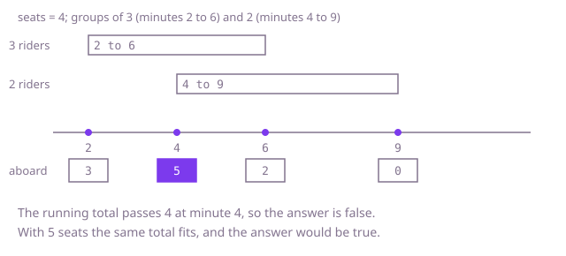

## The question

A shuttle has a fixed number of seats, and you get ride requests that each say how many people board at one minute and leave at a later one. Say whether the shuttle can honour every request without ever carrying more people than seats.

What makes it harder than it looks: the shuttle is checked at every moment, not once per request, and the worst moment can be any of them. People who leave at a minute step off before the people boarding at that minute step on, so processing a boarding before a leaving at the same minute reports a breach that never happens. Times go up to a billion, so you cannot keep a counter per minute. And comparing every request with every other is 10 billion pairs at 100,000 requests.

## How to think about it

The first idea is to take each request's boarding minute and add up the riders of every request aboard at that minute; if any total is over the seats, the answer is no. That is right, because the total can only rise when someone boards, so the worst moment is some boarding minute. But each request scans all the others. What matters is the total aboard, and it changes only at a boarding minute or a leaving minute. So I turn each request into two changes of the total, plus the riders at the boarding minute and minus the riders at the leaving minute, and visit the changes in time order with a running total. Where two changes share a minute, the people leaving must come off first. One way is to sort all the changes with the leaving ones first at a tie. Another way sidesteps the tie: add up all the changes at the same minute into one net change, keep them in a sorted map keyed by minute, and check the total after each minute.

Walk Example 1, `rides = [[3, 2, 6], [2, 4, 9]]`, `seats = 4`. The changes are +3 at minute 2, +2 at minute 4, -3 at minute 6 and -2 at minute 9. The running total is 3 after minute 2, then 5 after minute 4. That is over 4, so the answer is `false` as soon as minute 4 is processed. With 5 seats the total would stay at or below 5 throughout, and the answer would be `true`.



## Brute force

For each request, add up the riders of every request aboard at its boarding minute (a request is aboard from `boardAt` up to but not including `leaveAt`), and return `false` if any total is over the seats. It is what you say first, and it fixes the answer every faster version must agree with. It is correct because the number aboard only rises at a boarding minute, so if it ever exceeds the seats, it does so at some request's boarding minute, and that is a minute this loop checks. The half-open test handles the tie: a group leaving at that minute is not counted.

```java
static boolean canCarry(int[][] rides, int seats) {
    for (int[] mine : rides) {
        int aboard = 0; // riders aboard at the minute this group boards
        for (int[] other : rides) {
            if (other[1] <= mine[1] && mine[1] < other[2]) { // leaving at this minute is already off
                aboard += other[0];
            }
        }
        if (aboard > seats) {
            return false;
        }
    }
    return true;
}
```

**Complexity:** time O(n²), extra space O(1).

## Better: net change per minute in a sorted map

This is a different tool at the same cost as the optimal sweep: both are O(n log n). Put each request's two changes into a `TreeMap` from minute to net change, adding changes that share a minute together. Then walk the map in key order with a running total. At a shared minute the leavers step off first, so the total dips and then rises to the netted value. The total before that minute was already checked, so checking the netted value is enough, and the tie rule is built into the data with no special ordering.

```java
static boolean canCarry(int[][] rides, int seats) {
    TreeMap<Integer, Integer> change = new TreeMap<>(); // minute -> net change in people aboard
    for (int[] ride : rides) {
        change.merge(ride[1], ride[0], Integer::sum);
        change.merge(ride[2], -ride[0], Integer::sum);
    }
    int aboard = 0;
    for (int delta : change.values()) { // in increasing minute order
        aboard += delta;
        if (aboard > seats) {
            return false;
        }
    }
    return true;
}
```

**Complexity:** time O(n log n) (a `TreeMap` is a balanced tree, so this holds in the worst case), extra space O(n).

**Prefer it when:** you want the leaving-first rule to be impossible to get wrong, since there is no ordering to choose. It spends a tree node per distinct minute, so for large inputs the sorted array is leaner.

## Optimal: sort the events, one pass with a running total

Make an array of events, `{minute, change}`, two per request. Sort by minute, and at the same minute by change, which puts the negative changes (people leaving) first. Then walk the events keeping the total aboard, and return `false` the moment it passes the seats. This is the reference solution.

```java
static boolean canCarry(int[][] rides, int seats) {
    int[][] events = new int[rides.length * 2][];
    for (int i = 0; i < rides.length; i++) {
        events[2 * i] = new int[] {rides[i][1], rides[i][0]};      // boards: +riders
        events[2 * i + 1] = new int[] {rides[i][2], -rides[i][0]}; // leaves: -riders
    }
    Arrays.sort(events, (a, b) -> a[0] != b[0]
            ? Integer.compare(a[0], b[0])
            : Integer.compare(a[1], b[1])); // at one minute, leaving first
    int aboard = 0;
    for (int[] event : events) {
        aboard += event[1];
        if (aboard > seats) {
            return false;
        }
    }
    return true;
}
```

**Complexity:** time O(n log n), extra space O(n).

## Complexity

| Approach | Time | Extra space |
| --- | --- | --- |
| Brute force: sum the riders aboard at each boarding minute | O(n²) | O(1) |
| Better: net change per minute in a `TreeMap` | O(n log n) | O(n) |
| Optimal: sort the events, one pass | O(n log n) | O(n) |

## Where it shows up

`hold-exposure` has the same shape. Each hold adds an amount while it is active, and `firstBreach` in `ExposureCalculator` builds two events per hold, sorts them by minute, and keeps a running total, returning the minute at which the total first goes above a limit. Here the amount is a head count and the limit is the seats. Its sort puts the removing event before the adding one at the same minute, which is the rule used here.

In practice the same check decides whether a set of bookings fits a capacity: concurrent video streams against a bandwidth cap, guests across overlapping hotel stays against the number of rooms, or jobs holding memory against a machine's limit.

## Follow-up answers

**How would you report the first minute at which the shuttle is over capacity?** Return the minute of the event at which the running total first exceeds `seats` instead of `false`. Because leaving events sort first at a shared minute, that minute is a real boarding minute and not an artefact of ordering.

**What changes if the shuttle can also refuse some requests and you want to serve as many riders as possible?** The yes or no check becomes an optimisation. It is a weighted interval selection under a capacity, and a simple greedy no longer works in general; with one seat it is weighted interval scheduling, solved by dynamic programming over requests sorted by end time.

**What if the times are tiny, say minutes within one day, rather than up to a billion?** Use a difference array: 1,441 counters, add at the start, subtract at the end, then one running sum. It avoids the sort and is linear.
