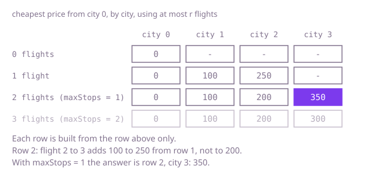

## The question

Given one-way flights between cities, each with a price, find the cheapest trip from one city to another that uses at most a given number of stops, where a trip with `s` stops uses `s + 1` flights. Return -1 if no such trip exists.

What makes it harder than it looks is that this is a cheapest-route problem with a second limit, and the limit changes what has to be remembered. The cheapest way to reach a city may use many flights, while a dearer way with fewer flights is the only one that can still continue to the destination. In Example 1 the cheapest trip overall costs 300 but needs two stops, so with one stop the answer is 350.

## How to think about it

The first idea is to try every trip: from the origin, take each flight, and from there each flight again, until the destination is reached or the flights run out. It is correct and exponential, because the same city is reached again and again by different routes, each continued in full. On a network where every trip uses 16 flights through layers of four cities, that is four to the power fifteen trips.

The usual cure for a shortest-route search is to settle each city once at its cheapest price. That is where the limit bites: if the cheapest way to a city uses three flights and only two are left, that price is useless, and the dearer one-flight way is the one to keep. So a city alone is not the thing to remember. What matters is the pair (city, flights used so far): for each pair, the cheapest price. Searching over those pairs in order of price works, and so does a plainer view: let the trip grow one flight at a time. After round `r`, keep for each city the cheapest price using at most `r` flights. Round `r + 1` follows from round `r`: start from the same prices, since fewer flights are still allowed, then try every flight against the previous round's prices.

The detail that causes wrong answers is where a round reads from. If a round updates prices in place, a flight relaxed early can feed a later flight in the same round, and one round then spends two flights. So each round reads only the previous table and writes a new one.

Walk Example 1 with `maxStops = 1`, which allows two flights. Round 0 knows only city 0, at price 0. Round 1 adds the flights out of city 0: city 1 at 100 and city 2 at 250. Round 2 reads round 1: the flight 1 to 2 gives city 2 the price 100 + 100 = 200, which beats 250; the flight 2 to 3 gives city 3 the price 250 + 100 = 350, using round 1's 250, not the new 200, because 200 has not been earned with only one flight yet. The flight 1 to 3 would give 400, which is worse. City 3 holds 350, the answer. A third round would give 300, which is the answer for `maxStops = 2`.



## Brute force

Try every trip by depth-first search: from the current city, take each flight, add its price, and stop when the destination is reached or no flights are left. Keep the cheapest total. It comes first because it is the question restated, and it fixes the answer the faster versions must match. It is correct because it enumerates every sequence of at most `maxStops + 1` flights.

```java
static int cheapest(int n, int[][] flights, int from, int to, int maxStops) {
    List<List<int[]>> out = new ArrayList<>();
    for (int i = 0; i < n; i++) {
        out.add(new ArrayList<>());
    }
    for (int[] flight : flights) {
        out.get(flight[0]).add(flight);
    }
    long best = explore(out, from, to, maxStops + 1, 0);
    return best == Long.MAX_VALUE ? -1 : (int) best;
}

/** Tries every flight out of city, using at most flightsLeft more flights. */
private static long explore(List<List<int[]>> out, int city, int to, int flightsLeft, long spent) {
    if (city == to) {
        return spent;
    }
    if (flightsLeft == 0) {
        return Long.MAX_VALUE; // out of flights before reaching the destination
    }
    long best = Long.MAX_VALUE;
    for (int[] flight : out.get(city)) {
        best = Math.min(best, explore(out, flight[1], to, flightsLeft - 1, spent + flight[2]));
    }
    return best;
}
```

**Complexity:** with k = `maxStops + 1` flights allowed and up to d flights out of a city, time O(d^k), exponential in the stop limit; extra space O(k) for the recursion.

## Better: Dijkstra over (city, flights used)

Make each pair of a city and the number of flights used a node of its own, and run the cheapest-first search over those. A flight from (city, used) goes to (next city, used + 1) at its price, and pairs with used above the limit are never created. Since prices are positive, the first time the destination comes out of the queue, with any number of flights, is the cheapest trip within the limit.

```java
static int cheapest(int n, int[][] flights, int from, int to, int maxStops) {
    List<List<int[]>> out = new ArrayList<>();
    for (int i = 0; i < n; i++) {
        out.add(new ArrayList<>());
    }
    for (int[] flight : flights) {
        out.get(flight[0]).add(flight);
    }
    int limit = maxStops + 1; // flights allowed
    long[][] best = new long[n][limit + 1]; // best[city][used]: cheapest price to be there after used flights
    for (long[] row : best) {
        Arrays.fill(row, Long.MAX_VALUE);
    }
    best[from][0] = 0;
    PriorityQueue<long[]> queue = new PriorityQueue<>((a, b) -> Long.compare(a[0], b[0]));
    queue.add(new long[] {0, from, 0}); // price, city, flights used
    while (!queue.isEmpty()) {
        long[] state = queue.poll();
        int city = (int) state[1];
        int used = (int) state[2];
        if (state[0] > best[city][used]) {
            continue; // stale entry
        }
        if (city == to) {
            return (int) state[0]; // the cheapest state comes out first
        }
        if (used == limit) {
            continue; // no flights left to continue with
        }
        for (int[] flight : out.get(city)) {
            long price = state[0] + flight[2];
            if (price < best[flight[1]][used + 1]) {
                best[flight[1]][used + 1] = price;
                queue.add(new long[] {price, flight[1], used + 1});
            }
        }
    }
    return -1;
}
```

**Complexity:** with k = `maxStops + 1` and E flights, time O(k × E × log(k × E)), since each of the n × (k + 1) states is expanded once and each flight is tried from each level; extra space O(n × k + k × E). The queue is a binary heap, not a hash map, so this is the worst case.

**Prefer it when:** the network is large and sparse, and the destination is usually reached by cheap trips. It stops as soon as the destination comes out of the queue, while the rounds below always sweep every flight `maxStops + 1` times.

## Optimal: rounds of relaxation, one flight per round

This is Bellman-Ford with a limit. After round `r`, `best[city]` is the cheapest price using at most `r` flights. A round copies the previous table and then, for every flight, offers `best[from] + price` to the target, reading only the previous round. The trip may use `maxStops + 1` flights, so run that many rounds. This is the reference solution.

```java
static int cheapest(int n, int[][] flights, int from, int to, int maxStops) {
    long[] best = new long[n]; // cheapest known price to each city using the flights allowed so far
    Arrays.fill(best, Long.MAX_VALUE);
    best[from] = 0;
    for (int round = 0; round <= maxStops; round++) { // one more flight allowed per round
        long[] next = best.clone(); // prices carry over: fewer flights are still allowed
        for (int[] flight : flights) {
            if (best[flight[0]] != Long.MAX_VALUE && best[flight[0]] + flight[2] < next[flight[1]]) {
                next[flight[1]] = best[flight[0]] + flight[2]; // read only the previous round
            }
        }
        best = next;
    }
    return best[to] == Long.MAX_VALUE ? -1 : (int) best[to];
}
```

**Complexity:** time O(k × E) with k = `maxStops + 1` rounds, extra space O(V) for the two tables. No hashing is involved, so this is a true worst case.

## Complexity

| Approach | Time | Extra space |
| --- | --- | --- |
| Brute force: depth-first over every trip | O(d^k), exponential in the stop limit | O(k) |
| Better: Dijkstra over (city, flights used) | O(k × E × log(k × E)) | O(V × k + k × E) |
| Optimal: rounds of relaxation | O(k × E) | O(V) |

V is the number of cities, E the number of flights, d the most flights out of one city and k = `maxStops + 1`. Plain Dijkstra on price alone, ignoring the limit, is not in the table because it gives wrong answers.

## Where it shows up

`corridor-router` asks for the cheapest route with a limit on hops, and its `cheapest` is exactly the rounds above. It keeps a table `cost[h][v]`, the cheapest fee to `v` using at most `h` corridors, and builds each row from a clone of the previous one while reading only that previous row, which is what stops one round from using two corridors. It also stops early once a round changes nothing, and it keeps for each entry the corridor that produced it, so the route can be read back; among equally cheap routes it takes the one with fewer hops. Its payment network has the same trap: a route settled at its lowest fee may use too many hops to be of any use. Beyond that, the same shape appears in booking travel with a cap on connections, and routing messages through a bounded number of relays.

## Follow-up answers

**How would you return the route itself, not only the price?** Keep a second table per round holding the city each price came from. When you finish, follow those links back from the destination through the rounds, and reverse the result. This needs the tables of every round, so space grows to O(k × V).

**What if a stop limit applied but prices could also be negative?** The round-by-round method still works, because it never relies on a price being final. Negative cycles are no longer a problem either, since the number of rounds is fixed. Dijkstra-based versions would break.

**How does the answer change if you must use exactly that many stops?** Do not carry prices over between rounds. Make each new table start as unreachable and fill it only from the previous round's flights, so that after round `r` it describes trips of exactly `r` flights.
