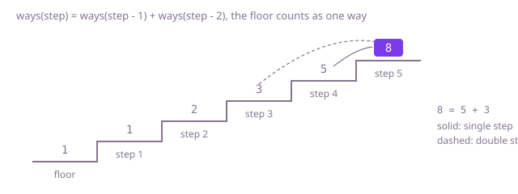

## The question

Each move climbs one or two steps; count the sequences of moves that land exactly on step `n`. The answer is wanted exactly, for staircases up to 91 steps.

What makes it harder than it looks is size in two directions. The obvious recursion is correct but makes about as many calls as the answer, and the answer for 91 steps is about 7.5 × 10^18, so it never finishes. And that number is far past an `int`: the count overflows an `int` from 46 steps on, so the count must be a `long`.

## How to think about it

Look at the last move. Any way to reach step `n` ends with a single step from `n - 1` or a double step from `n - 2`, and no way does both, so `ways(n) = ways(n - 1) + ways(n - 2)`. One way reaches step 1 and two ways reach step 2. Writing that down as a recursion is the first answer, and it is right.

The recursion repeats itself: `ways(n - 1)` calls `ways(n - 2)` again, and every smaller staircase is solved over and over, so the calls grow like the answer. Remembering each result the first time it is computed, in an array indexed by step, makes every staircase cost one addition. That is memoisation.

The memo array still holds every count, but each count only needs the two below it. Going upwards from the floor, with the floor counted as one way (stand still), two variables are enough. For Example 1, `n = 5`: floor 1, step 1 is 1, step 2 is 1 + 1 = 2, step 3 is 2 + 1 = 3, step 4 is 3 + 2 = 5, step 5 is 5 + 3 = 8.



## Brute force

The recursion on the last move is the definition restated, so it comes first and it fixes the answers the faster versions must match. It is correct because every sequence ends with exactly one of the two kinds of move, so the two counts add without overlap.

```java
static long countWays(int n) {
    if (n <= 2) {
        return n; // one way to reach step 1, two ways to reach step 2
    }
    return countWays(n - 1) + countWays(n - 2);
}
```

**Complexity:** time O(φ^n) with φ ≈ 1.618, since the number of calls grows like the answer itself; extra space O(n) for the recursion, which is at most 91 deep, so it does not overflow the stack: it simply never finishes.

## Better: memoised recursion

The same recursion, but each step's count is stored the first time it is computed and read back after that. Every count from 3 to `n` is then computed once. A count is never 0 for a real step, so 0 in the array means not computed yet.

```java
static long countWays(int n) {
    return ways(n, new long[n + 1]);
}

private static long ways(int n, long[] memo) {
    if (n <= 2) {
        return n;
    }
    if (memo[n] == 0) { // not computed yet
        memo[n] = ways(n - 1, memo) + ways(n - 2, memo);
    }
    return memo[n];
}
```

**Complexity:** time O(n), extra space O(n) for the array and the recursion; the recursion is at most 91 deep here, so it does not overflow the stack.

**Prefer it when:** you have already written the recursion and want it fast with the smallest change, or the rule has many cases and the top-down form is easier to get right.

## Optimal: two counts, bottom-up

Go upwards from the floor and keep only the counts for the two steps below the current one. The floor counts as one way and so does step 1; each later step is the sum of the two before it.

```java
static long countWays(int n) {
    long twoBelow = 1; // ways to stand on the floor: do nothing
    long oneBelow = 1; // ways to stand on step 1
    for (int step = 2; step <= n; step++) {
        long here = oneBelow + twoBelow; // last move was a single step or a double step
        twoBelow = oneBelow;
        oneBelow = here;
    }
    return oneBelow;
}
```

**Complexity:** time O(n), extra space O(1).

The counts are the Fibonacci numbers shifted by one, so a closed formula exists, but it needs floating point, which loses the last digits long before 91 steps; the loop is exact.

## Complexity

| Approach | Time | Extra space |
| --- | --- | --- |
| Brute force | O(φ^n), φ ≈ 1.618 | O(n) recursion, at most 91 deep |
| Better: memoised recursion | O(n) | O(n), recursion at most 91 deep |
| Optimal: two counts, bottom-up | O(n) | O(1) |

## Where it shows up

The same count appears whenever something is tiled by pieces of two lengths: the ways to fill a strip with one-unit and two-unit pieces, or to split a message into one-symbol and two-symbol codes. The step from recursion to a table to two variables is the pattern behind most one-dimensional dynamic programming, from counting decodings of a digit string to pricing a schedule day by day.

## Follow-up answers

**What if each move could climb one, two or three steps?** The last move now comes from one of three steps below, so `ways(n) = ways(n - 1) + ways(n - 2) + ways(n - 3)`, and the loop keeps three counts instead of two. Any fixed set of move sizes works the same way, keeping as many counts as the largest move.

**What if n could be as large as 10^18 and the count were wanted modulo 1,000,000,007?** A loop of 10^18 steps is out. The step from one pair of counts to the next is a fixed 2 × 2 matrix, so the answer is that matrix raised to the power n, which repeated squaring computes in O(log n) multiplications, each done modulo 1,000,000,007.

**What if some steps were broken and could not be stood on?** Set the count of a broken step to 0 and keep the same sum; ways through it then vanish automatically. If step `n` itself is broken the answer is 0.
