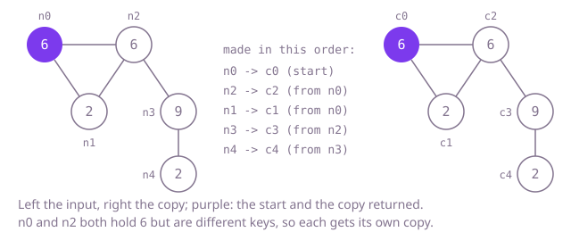

## The question

Given one node of a connected undirected graph, build a new graph with the same values and the same connections, made entirely of new nodes, and return the copy of the given node. Each copied node lists its neighbours in the same order as its original.

What makes it harder than it looks is that the graph has cycles and shared neighbours. Copying a node and then copying its neighbours, naively, goes round a cycle forever or makes two copies of a node reached by two routes. Values do not help: they may repeat, so a copy that matches nodes by value merges different nodes. And a graph of 100,000 nodes in a line is deep enough to overflow a recursive walk.

## How to think about it

Every original node needs exactly one copy, and every neighbour list in the copy must point at copies. So whenever the walk meets a node, it has to ask one question: has this node been copied already, and if so, where is its copy? Answer that and cycles stop being a problem, because a node met for the second time is simply looked up.

The first idea is to keep the originals met so far in a list, with their copies in a second list at the same positions, and search the first list for each node met. It is correct, and it is slow: each lookup scans everything copied so far. A hash map from original to copy answers the same question in constant time on average. `GraphNode` does not override `equals`, so a `HashMap` compares nodes by identity, which is exactly what is needed when values repeat.

The walk itself can be depth first or breadth first. Recursion is the shortest to write: copy the node, record it, then copy each neighbour. Its depth is the length of the longest path it follows, so a long chain overflows the stack. A queue does the same work in a loop. The one ordering rule: record a node's copy the moment it is created, before its list is filled, so that a cycle leading back to it finds the copy.

Walk Example 1: the triangle of nodes 0, 1 and 2 holding 6, 2 and 6, with a tail from node 2 to node 3 (9) and node 4 (2), starting at node 0. Copy node 0 and queue it. Take node 0: its list is node 2, then node 1, neither copied, so copy both, queue them and add their copies to the copy of node 0 in that order. Take node 2: node 3 is new, so copy and queue it; nodes 1 and 0 are already copied, so their copies are added as they are. Take node 1: nodes 0 and 2 are copied. Take node 3: node 4 is new, so copy it; node 2 is copied. Take node 4: node 3 is copied. Five new nodes, each original copied once, though two hold 6 and two hold 2.



## Brute force

Keep the originals met so far in one list and their copies at the same positions in another, and search the first list, by identity, for each node met. The list of originals doubles as the queue. It comes first because it needs nothing but lists, and it fixes the answer the faster versions must agree with. It is correct because each original is added once, the first time it is met, and every neighbour list is filled with the copy at the matching position.

```java
static GraphNode copy(GraphNode start) {
    if (start == null) {
        return null;
    }
    List<GraphNode> originals = new ArrayList<>(); // originals.get(i) is copied as copies.get(i)
    List<GraphNode> copies = new ArrayList<>();
    originals.add(start);
    copies.add(new GraphNode(start.val));
    for (int i = 0; i < originals.size(); i++) { // the list doubles as the queue
        for (GraphNode next : originals.get(i).neighbors) {
            int at = -1;
            for (int k = 0; k < originals.size() && at < 0; k++) {
                if (originals.get(k) == next) { // by identity: values may repeat
                    at = k;
                }
            }
            if (at < 0) {
                at = originals.size();
                originals.add(next);
                copies.add(new GraphNode(next.val));
            }
            copies.get(i).neighbors.add(copies.get(at));
        }
    }
    return copies.get(0);
}
```

**Complexity:** time O(V × (V + E)) in the worst case for V nodes and E connections, since each of the 2E list entries may scan all V originals; extra space O(V).

## Better: recursive depth-first copy with a map

Map each original to its copy. To copy a node: if it is in the map, return its copy; otherwise make the copy, record it, then fill its list by copying each neighbour in turn.

```java
static GraphNode copy(GraphNode start) {
    return start == null ? null : copy(start, new HashMap<>());
}

private static GraphNode copy(GraphNode node, Map<GraphNode, GraphNode> copyOf) {
    GraphNode twin = copyOf.get(node);
    if (twin != null) {
        return twin; // met before: a cycle or a second route, reuse the copy
    }
    twin = new GraphNode(node.val);
    copyOf.put(node, twin); // recorded before the neighbours, so a cycle back here finds it
    for (GraphNode next : node.neighbors) {
        twin.neighbors.add(copy(next, copyOf));
    }
    return twin;
}
```

**Complexity:** time O(V + E) on average, extra space O(V) for the map and a recursion depth of up to V, which overflows the call stack on a chain of 100,000 nodes. The map uses identity hash codes, which rarely collide; in the worst case, a crowded bucket of keys that are not `Comparable` is searched one entry at a time, O(V) per lookup.

**Prefer it when:** the graph is known to be shallow, such as an object graph a few levels deep; it is the shortest correct code, and it is how a deep-copy routine for objects is usually written.

## Optimal: breadth-first copy with a queue and a map

Copy the start node, record it and queue it. Take nodes off the queue; for each neighbour, look up its copy, making, recording and queueing it if it is new, and add the copy to the current node's copied list. This is the reference solution.

```java
static GraphNode copy(GraphNode start) {
    if (start == null) {
        return null;
    }
    Map<GraphNode, GraphNode> copyOf = new HashMap<>(); // original -> its copy; GraphNode keys compare by identity
    ArrayDeque<GraphNode> queue = new ArrayDeque<>();
    copyOf.put(start, new GraphNode(start.val));
    queue.add(start);
    while (!queue.isEmpty()) {
        GraphNode node = queue.poll();
        GraphNode twin = copyOf.get(node);
        for (GraphNode next : node.neighbors) {
            GraphNode nextTwin = copyOf.get(next);
            if (nextTwin == null) { // first time we meet next: copy it now, wire it later
                nextTwin = new GraphNode(next.val);
                copyOf.put(next, nextTwin);
                queue.add(next);
            }
            twin.neighbors.add(nextTwin); // same order as the original's list
        }
    }
    return copyOf.get(start);
}
```

**Complexity:** time O(V + E) on average, O(V) per lookup in the worst case for a crowded bucket, as above; extra space O(V) for the map and the queue, with no recursion.

## Complexity

| Approach | Time | Extra space |
| --- | --- | --- |
| Brute force: parallel lists, linear search | O(V × (V + E)) worst case | O(V) |
| Better: recursive copy with a map | O(V + E) average, O(V) per lookup worst | O(V), recursion depth up to V, which overflows on a 100,000-node chain |
| Optimal: breadth-first copy with a map | O(V + E) average, O(V) per lookup worst | O(V) |

V is the number of nodes and E the number of connections.

## Where it shows up

No coding-round problem is linked to this question. The same walk with an "original to copy" map is how deep-copy and serialisation libraries handle objects that refer to each other, how a document editor duplicates a group of shapes joined by connectors, and how a build tool copies a dependency graph before rewriting it.

## Follow-up answers

**What changes if the graph may be disconnected and you are given a list of all its nodes?** Run the same walk from every node in the list that is not yet in the map, sharing one map across the walks. Each part of the graph is then copied once, and the map gives the copy of any node asked for.

**How would you copy a directed graph where some nodes cannot reach the start?** Following connections from the start only finds what the start can reach, so the walk alone cannot copy the rest; you need a list of all nodes, as above. The copying itself is unchanged: an edge is copied into the list of the node it leaves from, and the map handles nodes reached by several edges.

**How would you check that a copy is really deep, sharing no node with the original?** Collect the original nodes in an identity set, then walk the original and the copy in lockstep, pairing each original with the copy found at the same position of the same list. Fail if a copy node is in the original set, if values or list sizes differ, or if one original pairs with two different copies or two originals with one copy. The tests here do exactly that.
