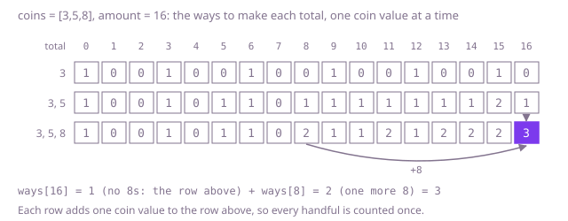

## The question

Given coin values, each available as often as you like, and an amount, count the different handfuls of coins that add up to exactly the amount. Two handfuls are the same when they hold the same number of coins of each value; an amount of 0 has one way, the empty handful.

What makes it harder than it looks is that the natural counting counts orders, not handfuls. "Choose the next coin, then pay the rest" finds 13 ways for Example 1, one for every order the coins could drop out in, where only 3 handfuls exist. The table version has the same trap: with the totals on the outer loop and the coins inside it counts orders again, and only the other nesting counts handfuls. The counts for smaller totals can pass the `int` range, and even the `long` range, while the answer fits: with the twenty even values from 2 to 40 and an amount of 4999 the answer is 0, but the count for 4998 has 30 digits. And the number of handfuls explodes with the amount, so listing them is out.

## How to think about it

The first idea that counts handfuls rather than orders is to decide the values one at a time: some number of coins of the first value, then some number of the second, and so on. Each handful is reached along exactly one path, because the decisions come in a fixed order of values. As a recursion: the ways to pay what is left with the values from position `i` on are the ways without any more coins of value `i`, plus the ways after taking one more coin of value `i`, which may be taken again. It is correct and it repeats itself: the same value position and the same amount left are reached along many paths.

There are only k × (amount + 1) such pairs, so store each answer, or fill a table: `ways[i][t]`, the handfuls of the first `i` values that make total `t`, is `ways[i - 1][t]` plus `ways[i][t - coin]`. Each row reads only the row above and itself, so one array does it: for each value in turn, run the totals upwards from the value and add `ways[t - coin]` into `ways[t]`. Upwards matters, because `ways[t - coin]` must already include handfuls that use this value, so that it can repeat. Running the totals downwards would use each value at most once.

The only arithmetic is addition, and Java's `int` addition wraps around modulo 2^32, so every entry of the table is right modulo 2^32 even where its true count is far larger. The answer is below 2^31, so its entry is exact. Checked addition, such as `Math.addExact`, would throw on valid input; plain `int` or `long` addition is what you want here.

Walk Example 1, `coins = [3,5,8]`, `amount = 16`. With only 3s, the totals 0, 3, 6, 9, 12 and 15 have one way each. Adding 5s, total 15 gains the way through 10, which is 5 + 5 + 5, so it has 2, and total 16 gets the one way through 11, which is 5 + 5 + 3 + 3. Adding 8s, total 8 has 2 (8, and 5 + 3), and total 16 becomes its count without 8s, 1, plus the count for 8 with 8s allowed, 2: 3 ways, which are 8 + 8, 8 + 5 + 3 and 5 + 5 + 3 + 3.



## Brute force

Decide the values in order: stop using value `i` and move on, or take one more coin of it. It comes first because it is the definition of a handful written as code, and it fixes the answers the faster versions must match. It is correct because every handful is one choice of how many coins of each value, made in index order, and the recursion makes exactly those choices: each path through it is one handful.

```java
static int ways(int[] coins, int amount) {
    return from(coins, 0, amount);
}

/** Ways to pay rest with the coin values from position i on. */
private static int from(int[] coins, int i, int rest) {
    if (rest == 0) {
        return 1; // the handful is complete
    }
    if (i == coins.length) {
        return 0; // every value decided, and something is still owed
    }
    int ways = from(coins, i + 1, rest); // no more coins of value i
    if (coins[i] <= rest) {
        ways += from(coins, i, rest - coins[i]); // one more coin of value i, which may be used again
    }
    return ways;
}
```

**Complexity:** time exponential, at least one call per handful and far more for the dead ends, which keep growing when nothing adds up; extra space O(amount / smallest value + k) for the recursion, at most 5,300 deep, which fits in the stack: it simply never finishes on a large amount.

## Better: memoised recursion

The same recursion, with the answer for each value position and amount left stored the first time it is worked out.

```java
static int ways(int[] coins, int amount) {
    int[][] memo = new int[coins.length][amount + 1];
    for (int[] row : memo) {
        Arrays.fill(row, -1); // -1: not worked out yet; the counts stored are 0 or more
    }
    return from(coins, 0, amount, memo);
}

private static int from(int[] coins, int i, int rest, int[][] memo) {
    if (rest == 0) {
        return 1;
    }
    if (i == coins.length) {
        return 0;
    }
    if (memo[i][rest] < 0) {
        int ways = from(coins, i + 1, rest, memo);
        if (coins[i] <= rest) {
            ways += from(coins, i, rest - coins[i], memo);
        }
        memo[i][rest] = ways;
    }
    return memo[i][rest];
}
```

**Complexity:** time O(k × amount), extra space O(k × amount) for the memo, about 6 MB at 300 values and 5,000, plus the recursion, at most 5,300 deep here, which fits in the stack.

**Prefer it when:** only a few totals can be reached from the amount, as with a handful of large values: the recursion visits only those, where the table fills every total for every value. It also never wraps: each count it stores is the ways to finish one partly paid handful, so it is at most the answer.

## Optimal: one array, values outside

One count per total, starting with one way to make 0. For each value in turn, run the totals upwards from that value and add the count for the total one coin smaller. This is the reference solution.

```java
static int ways(int[] coins, int amount) {
    int[] ways = new int[amount + 1]; // ways[t]: handfuls of the values seen so far that make t
    ways[0] = 1; // the empty handful
    for (int coin : coins) { // values on the outside: each handful is built in one fixed order of values
        for (int t = coin; t <= amount; t++) {
            // upwards, so ways[t - coin] already counts handfuls with this value and it can repeat;
            // totals the answer never draws on may wrap, which leaves every entry right modulo 2^32
            ways[t] += ways[t - coin];
        }
    }
    return ways[amount];
}
```

**Complexity:** time O(k × amount), extra space O(amount). Entries other than the answer may wrap around; the answer is exact because it is below 2^31.

## Complexity

| Approach | Time | Extra space |
| --- | --- | --- |
| Brute force | exponential, at least one call per handful | O(amount / smallest value + k) recursion, at most 5,300 deep |
| Better: memoised recursion | O(k × amount) | O(k × amount), recursion at most 5,300 deep |
| Optimal: one array, values outside | O(k × amount) | O(amount) |

## Where it shows up

Counting the ways to make a total from parts that can repeat has this shape: how many ways a vending machine or a till can pay out change, how many different orders of standard pack sizes fill a delivery exactly, or how many ways a budget splits into fixed-price items. In mathematics it is the number of partitions of a number into allowed parts, and the one-array loop is the classic way to tabulate them.

## Follow-up answers

**What if the order of the coins mattered, so that 5 + 3 and 3 + 5 counted as two ways?** Swap the loops: totals on the outside and the values inside, so every total adds the counts for itself minus each value. Each sequence is then built one coin at a time from the front, in every order. Those counts grow much faster, so the range to guarantee changes; the cost stays O(k × amount).

**What if each coin value could be used at most once?** Run the totals downwards from the amount to the value. Then `ways[t - coin]` has not yet been updated for this value, so it counts handfuls without it, and the value is used once at most. This is the counting version of the 0/1 knapsack, at the same cost.

**What if the machine held only a limited number of coins of each value?** For a value c with at most m coins, the new count for total t is the sum of the old counts for t, t − c, …, t − m·c. Within each remainder class modulo c those are sliding windows, so keep a running sum per class: as t moves up by c, add the old count for t and drop the one that falls m + 1 steps behind. That keeps it O(k × amount) instead of O(k × amount × m).
