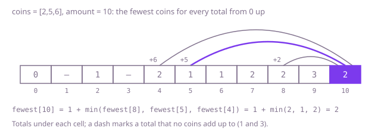

## The question

Given coin values, each available as often as you like, and an amount, return the fewest coins that add up to exactly that amount, or −1 if no combination does. An amount of 0 takes no coins.

What makes it harder than it looks is that the way a cashier pays, largest coin first, is wrong for arbitrary coin values. With `[2,5,6]` and 10 it hands over 6, 2 and 2 where two 5s would do; with `[4,7]` and 15 it hands over two 7s, is left owing 1 and gives up, though 4 + 4 + 7 works. The coin values go up to 2^31 − 1, so adding a coin to anything can overflow, and so can adding 1 to an "impossible" marker of `Integer.MAX_VALUE`. And the number of ways to hand over coins grows exponentially with the amount.

## How to think about it

The first idea is to choose the first coin, pay the rest as well as possible, and keep the best choice: fewest(a) is 1 + fewest(a − c), minimised over the coins c that fit. It is correct, but it pays the same rest again and again: with `[2,5,6]` and a larger amount, a rest of 30 is reached after handing over 6 + 2 + 2, after 2 + 6 + 2, after 5 + 5 and in many other ways, and each time it is worked out from scratch.

There are only amount + 1 different rests, from 0 to the amount. Remember the answer for each the first time it is computed and the exponential search becomes amount × coins steps. Or turn it around and fill a table from 0 upwards: the fewest coins for a total is one more than the best of the totals one coin smaller, so each entry needs only entries already filled. Totals that nothing adds up to keep a marker; choosing the marker as amount + 1, more coins than any real answer can use, means adding 1 to it never overflows. Checking `coin <= total` before subtracting keeps the index in range and never adds a huge coin to anything.

Walk Example 1, `coins = [2,5,6]`, `amount = 10`. Total 0 takes 0 coins; 1 and 3 cannot be paid; 2 and 4 take one and two 2s; 5 and 6 take one coin each; 7 is 5 + 2 and 8 is 6 + 2, two coins each; 9 takes three, 5 + 2 + 2. At 10 the candidates are one more than total 8 (2 coins), total 5 (1 coin) and total 4 (2 coins), so 10 takes 1 + 1 = 2 coins: 5 + 5.



## Brute force

Try every coin as the first one, pay the rest recursively, and keep the fewest. It comes first because it is the definition of "fewest" written as code, and it fixes the answers the faster versions must match. It is correct because every way of paying starts with some coin and pays the rest somehow, so trying each first coin with the best way to pay its rest finds the best way overall; a rest that cannot be paid comes back as −1 and is skipped.

```java
static int fewestCoins(int[] coins, int amount) {
    if (amount == 0) {
        return 0;
    }
    int best = -1;
    for (int coin : coins) {
        if (coin <= amount) { // hand over this coin first, then pay the rest as well as possible
            int rest = fewestCoins(coins, amount - coin);
            if (rest >= 0 && (best < 0 || rest + 1 < best)) {
                best = rest + 1;
            }
        }
    }
    return best;
}
```

**Complexity:** time exponential, up to about k^(amount / smallest coin) calls for k coin values, since every order of handing over the same coins is tried separately; extra space O(amount / smallest coin) for the recursion, at most 5,000 deep, which fits in the stack: it simply never finishes on a large amount.

## Better: memoised recursion

The same recursion, with the answer for each rest stored the first time it is computed. Two markers are needed: one for "not worked out yet" and the real answer −1 for "cannot be paid", so a rest that cannot be paid is not searched again.

```java
static int fewestCoins(int[] coins, int amount) {
    int[] memo = new int[amount + 1];
    Arrays.fill(memo, -2); // -2: not worked out yet; -1 is a real answer, "no combination"
    return fewest(coins, amount, memo);
}

private static int fewest(int[] coins, int rest, int[] memo) {
    if (rest == 0) {
        return 0;
    }
    if (memo[rest] == -2) {
        int best = -1;
        for (int coin : coins) {
            if (coin <= rest) {
                int after = fewest(coins, rest - coin, memo);
                if (after >= 0 && (best < 0 || after + 1 < best)) {
                    best = after + 1;
                }
            }
        }
        memo[rest] = best;
    }
    return memo[rest];
}
```

**Complexity:** time O(amount × k), extra space O(amount) for the memo and the recursion, at most 5,000 deep here, which fits in the stack; an amount of 10,000 with a coin of 1 would overflow it.

**Prefer it when:** few rests can be reached from the amount, for example a handful of large coin values: the recursion only visits rests that the amount minus some coins can reach, where the table fills every total from 1 up.

## Optimal: table from 0 up

Fill the fewest coins for every total from 1 to the amount, each from the totals one coin smaller, with amount + 1 as the "cannot be paid" marker. This is the reference solution.

```java
static int fewestCoins(int[] coins, int amount) {
    // more than any real answer, which uses at most amount coins of value 1 or more,
    // and small enough that adding 1 cannot overflow
    int unreachable = amount + 1;
    int[] fewest = new int[amount + 1];
    Arrays.fill(fewest, unreachable);
    fewest[0] = 0;
    for (int total = 1; total <= amount; total++) {
        for (int coin : coins) {
            // coin <= total keeps the index in range; coin is never added to anything
            if (coin <= total && fewest[total - coin] + 1 < fewest[total]) {
                fewest[total] = fewest[total - coin] + 1;
            }
        }
    }
    return fewest[amount] == unreachable ? -1 : fewest[amount];
}
```

**Complexity:** time O(amount × k) for k coin values, extra space O(amount).

## Complexity

| Approach | Time | Extra space |
| --- | --- | --- |
| Brute force | exponential, up to about k^(amount / smallest coin) | O(amount / smallest coin) recursion, at most 5,000 deep |
| Better: memoised recursion | O(amount × k) | O(amount), recursion at most 5,000 deep |
| Optimal: table from 0 up | O(amount × k) | O(amount) |

## Where it shows up

Making change in any system whose coins or notes are not "canonical", where largest-first is not always fewest, has this shape, and so does filling an order exactly from pack sizes that cannot be split, such as packs of 4, 10 and 25, with as few packs as possible. It is an unbounded knapsack: the same table, maximising a price per piece instead of minimising a count of pieces, decides how to cut a bar into lengths that sell at different prices.

## Follow-up answers

**What if you had to count the different combinations of coins that make the amount instead?** Keep a table of counts with one way to pay 0, and loop over the coins on the outside and the totals on the inside, adding the count for `total - coin` to `total`. Putting the coins outside counts each combination once, in one fixed order of values, instead of once per order of handing them over. It costs O(amount × k) time and O(amount) space.

**What if each coin value could be used at most once?** That is the 0/1 knapsack: for each coin, run the totals downwards from the amount to the coin's value, so the entry it reads, `total - coin`, has not yet been updated with this coin. The cost stays O(amount × k).

**What if you also had to say which coins to hand over?** Store, for each total, the coin that gave its best answer. From the amount, hand over that coin, step down by its value and repeat until 0; the list has exactly the answer's number of coins.
