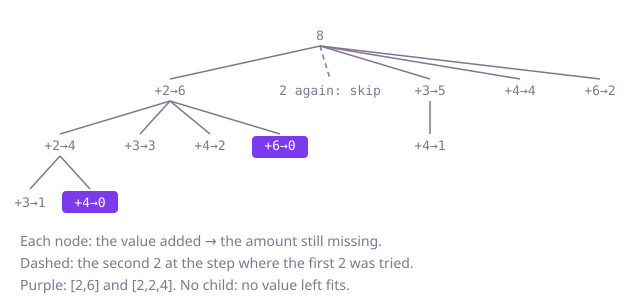

## The question

Given positive values that may repeat and a target, list every distinct combination of values, each position used at most once, whose values add up to the target. Two combinations are the same when they hold the same values the same number of times.

What makes it harder than it looks is the repeats in the input. Take-or-leave over positions treats each copy as different, so the same combination comes out once per way of picking its copies, and a set to clean up afterwards does not save the work: 80 copies of 1 with target 32 have one answer but an astronomical number of position choices under the target. Skipping a value equal to the one before it fixes this, but only after sorting, and only at the same step of the search; skipping it at every depth loses combinations like `[5, 5]`.

## How to think about it

The first idea is to take or leave each position, stop a branch when a value overshoots what is missing, and put each finished combination, sorted, into a set. It is correct and fixes the answer to compare against, but every repeat in the input multiplies the work.

What decides a distinct combination is how many copies of each value it holds, so build combinations in a way that can make each count only once. Sort the values, and grow a combination by choosing which position comes next, from the current one on. At one step, picking the first 2 or the second 2 as the next value leads to the same combinations, so try only the first copy. Taking the second 2 after the first is still possible one step deeper, where it is the first choice offered. Sorting also gives the early stop: once a value is larger than what is missing, so is every value after it, and the loop can end. The next position after a choice is i + 1, since each position is used at most once.

Walk Example 1, `candidates = [4, 2, 6, 2, 3]`, `target = 8`, sorted to `[2, 2, 3, 4, 6]`. Take the first 2, 6 missing. Take the second 2, 4 missing; 3 leaves 1 and nothing fits; 4 leaves 0, the answer `[2, 2, 4]`; 6 is too big. Back at 6 missing, 3 leaves 3 (nothing fits), 4 leaves 2 (nothing fits), 6 leaves 0, the answer `[2, 6]`. Back at the top, the second 2 equals the 2 just tried here, so skip it. 3 leaves 5, and 4 then leaves 1; 4 leaves 4, and only 6 is left; 6 leaves 2 with nothing after it.



## Brute force

Take or leave each position in turn; skip taking a value larger than what is missing, and when nothing is missing, sort the chosen values and add them to a set. It comes first because it is the plain reading of "each position at most once", and it fixes the answer the faster versions must agree with. It is correct because every combination of positions that reaches the target is visited, and equal combinations sort to equal lists, so the set keeps each once.

```java
static List<List<Integer>> find(int[] candidates, int target) {
    Set<List<Integer>> seen = new HashSet<>();
    decide(candidates, 0, target, new ArrayList<>(), seen);
    return new ArrayList<>(seen);
}

// Takes or leaves each position in turn; equal values at different positions are tried separately.
private static void decide(int[] candidates, int i, int left, List<Integer> chosen, Set<List<Integer>> seen) {
    if (left == 0) {
        List<Integer> combination = new ArrayList<>(chosen);
        combination.sort(null); // the same values from other positions sort to the same list
        seen.add(combination);
        return;
    }
    if (i == candidates.length) {
        return;
    }
    if (candidates[i] <= left) { // values are positive, so a value above left can never fit
        chosen.add(candidates[i]);
        decide(candidates, i + 1, left - candidates[i], chosen, seen);
        chosen.remove(chosen.size() - 1);
    }
    decide(candidates, i + 1, left, chosen, seen);
}
```

**Complexity:** time O(2^n · n) in the worst case (every choice of positions that stays at or under the target, each finished one sorted and hashed), average for the set; worse if many lists share a hash bucket (a `List` is not `Comparable`, so a treeified bucket is still scanned in O(C) for C stored combinations). Extra space O(n) for the recursion and the working list, plus the set of all distinct combinations.

## Better: choose a count for each distinct value

Count the copies of each value, then recurse over the distinct values in ascending order: for a value with c copies, take 0, 1, … copies, as many as fit in what is missing and no more than c, and move on. Each distinct combination is one choice of counts, so each is built once, and the ascending order lets a branch stop as soon as the next value is too big.

```java
static List<List<Integer>> find(int[] candidates, int target) {
    TreeMap<Integer, Integer> copies = new TreeMap<>();
    for (int v : candidates) {
        copies.merge(v, 1, Integer::sum);
    }
    List<Map.Entry<Integer, Integer>> groups = new ArrayList<>(copies.entrySet()); // ascending values
    List<List<Integer>> result = new ArrayList<>();
    take(groups, 0, target, new ArrayList<>(), result);
    return result;
}

// Chooses how many copies of groups[g] onward go into chosen; left is what chosen still lacks.
private static void take(List<Map.Entry<Integer, Integer>> groups, int g, int left, List<Integer> chosen, List<List<Integer>> result) {
    if (left == 0) {
        result.add(new ArrayList<>(chosen));
        return;
    }
    if (g == groups.size() || groups.get(g).getKey() > left) {
        return; // no value left, or every remaining value is too big
    }
    int value = groups.get(g).getKey();
    int count = groups.get(g).getValue();
    take(groups, g + 1, left, chosen, result); // no copy of this value
    int k = 0;
    while (k < count && value * (k + 1) <= left) {
        k++;
        chosen.add(value); // k copies
        take(groups, g + 1, left - value * k, chosen, result);
    }
    for (int j = 0; j < k; j++) {
        chosen.remove(chosen.size() - 1);
    }
}
```

**Complexity:** time O(n log n) to count plus O(d · t · P) for the search in the worst case, where d is the number of distinct values, t the target and P the number of distinct partial combinations at or under the target: each partial combination is reached through at most d levels of "no copy", and each node tries at most t counts; extra space O(d) for the groups and a recursion depth of at most d, beyond the output.

**Prefer it when:** the input already comes as values with counts, such as so many notes of each size; the search never touches individual copies.

## Optimal: sort, skip equal values at the same step, stop at the first value too big

Sort a copy. Grow the combination by choosing the next position from the current one on, skip a value equal to the one just tried at this step, end the loop at the first value larger than what is missing, and move to i + 1 after a choice. This is the reference solution.

```java
static List<List<Integer>> find(int[] candidates, int target) {
    int[] sorted = candidates.clone();
    Arrays.sort(sorted); // equal values side by side, and the first value too big ends a loop
    List<List<Integer>> result = new ArrayList<>();
    extend(sorted, 0, target, new ArrayList<>(), result);
    return result;
}

// Adds one more value from sorted[start] onward to chosen; left is what chosen still lacks.
private static void extend(int[] sorted, int start, int left, List<Integer> chosen, List<List<Integer>> result) {
    if (left == 0) {
        result.add(new ArrayList<>(chosen));
        return;
    }
    for (int i = start; i < sorted.length && sorted[i] <= left; i++) {
        if (i > start && sorted[i] == sorted[i - 1]) {
            continue; // the same value in the same slot would rebuild combinations already listed
        }
        chosen.add(sorted[i]);
        extend(sorted, i + 1, left - sorted[i], chosen, result); // i + 1: each position once
        chosen.remove(chosen.size() - 1);
    }
}
```

**Complexity:** time O(n log n) to sort plus, for the search, O(n) per node, where every node is a distinct partial combination still at or under the target, so repeats in the input no longer multiply the work; in the worst case that is O(n · P) for P distinct partial combinations. Extra space O(n) for the sorted copy and a recursion depth of at most t (the target, since every value is at least 1), beyond the output; at `target <= 32` the depth is no risk.

## Complexity

| Approach | Time | Extra space (beyond the output) |
| --- | --- | --- |
| Brute force: take or leave each position, then a set | O(2^n · n) worst case, average for the set, worse with crowded hash buckets | O(n) plus the set of all distinct combinations |
| Better: a count per distinct value | O(n log n + d · t · P) worst case | O(d), recursion depth up to d |
| Optimal: sort, skip equal values, stop at too big | O(n log n + n · P) worst case | O(n), recursion depth up to t |

Here d is the number of distinct values, t the target and P the number of distinct partial combinations at or under the target.

## Where it shows up

No coding-round problem is linked to this question. Picking items from a stock with repeats to hit an exact amount is the same search: paying an exact sum from the notes in a till, filling an order of exact weight from the packs on a shelf, or choosing invoices that add up to a payment received when several invoices share an amount. The same-step skip is how any backtracking search over sorted input avoids listing the same answer twice.

## Follow-up answers

**Can the work depend on the number of distinct combinations rather than on every choice of positions?** Yes: the Better and Optimal versions only build distinct partial combinations, because a repeated copy is never tried in the same slot as its twin. The brute force cannot, since it decides each position separately and only finds out at the end that two choices were the same.

**How would you only count the distinct combinations?** Use a table `ways[s]` over amounts up to the target and process each distinct value with its c copies, adding `ways[s - k * value]` for k from 1 to c into `ways[s]`, going through s from high to low so each value is counted from the previous row. Summed over the values the copies add up to n, so that is O(t · (d + n)) = O(t · n) time and O(t) space, with no search.

**What changes if values may be negative?** The early stop breaks: a value larger than what is missing may still be part of an answer, because a later negative value can bring the sum back down, and reaching the target no longer ends a branch, since a later positive and negative pair can return to it. The search then has to run to the end of the array on every branch, saving each time the sum equals the target, so its cost goes back towards 2^n.
