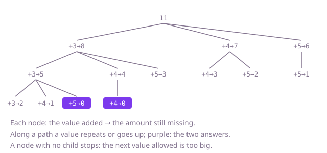

## The question

Given distinct positive values and a target, list every distinct combination of values that adds up to the target, where each value may be used any number of times. Two combinations are the same when they use each value the same number of times.

What makes it harder than it looks is the repeats. Building a combination by "pick any value next" reaches `[3, 3, 5]` three times, as 3-3-5, 3-5-3 and 5-3-3, and a set to clean that up costs a lot of wasted work: with 30 small values and a target of 40 there are tens of millions of orderings behind a few thousand combinations. The second trap is the early stop: ending the loop at the first value that is too big is only right when the values are sorted.

## How to think about it

The first idea is to build sequences: pick any value, subtract it from what is missing, repeat until nothing is missing, then sort each finished sequence and keep it in a set so each combination is listed once. It is correct, and it fixes the answer to compare against, but it explores every ordering of every combination.

What is repeated is the ordering, so fix one. If the values inside a combination never go down, each combination has exactly one way to be built. In code that means each step may choose the current value again or a later one in the list, never an earlier one: pass the current index down, not the next one, and the loop starts from it. Nothing then needs removing. One more cut comes free: sort the values first, and as soon as one is larger than what is missing, every later one is too, so the loop can stop.

Walk Example 1, `candidates = [3, 5, 4]`, `target = 11`, sorted to `[3, 4, 5]`. Take 3, 8 left. Take 3 again, 5 left. Take 3, 2 left: nothing fits, back. Take 4, 1 left: nothing, back. Take 5: 0 left, the answer `[3, 3, 5]`. Back to 8 left after one 3: take 4, 4 left; take 4 again, 0 left, the answer `[3, 4, 4]`; 5 is bigger than 4, stop. Take 5 after the 3: 3 left, and 5 is too big. Starting from 4 or from 5 never reaches 0.



## Brute force

Try every value at every step, and when nothing is missing, sort the sequence and add it to a set. It comes first because it is the plain reading of the question, and it fixes the answer the faster versions must agree with. It is correct because every combination is reached (in each of its orderings) and sorting makes all orderings of one combination equal, so the set keeps it once.

```java
static List<List<Integer>> find(int[] candidates, int target) {
    Set<List<Integer>> seen = new HashSet<>();
    build(candidates, target, new ArrayList<>(), seen);
    return new ArrayList<>(seen);
}

// Tries every value at every step, so each combination is reached once per ordering of it.
private static void build(int[] candidates, int left, List<Integer> sequence, Set<List<Integer>> seen) {
    if (left == 0) {
        List<Integer> combination = new ArrayList<>(sequence);
        combination.sort(null); // every ordering of one combination sorts to the same list
        seen.add(combination);
        return;
    }
    for (int value : candidates) {
        if (value <= left) {
            sequence.add(value);
            build(candidates, left - value, sequence, seen);
            sequence.remove(sequence.size() - 1);
        }
    }
}
```

**Complexity:** time O(n^d · d log d) average, where d = target / (smallest candidate) is the longest combination: up to n^d sequences, each sorted and hashed at its end; worse if many lists land in one hash bucket (a `List` is not `Comparable`, so a treeified bucket is still scanned in O(k) for k stored combinations). Extra space O(d) for the recursion plus the set, which holds every combination.

## Better: build in non-decreasing order

Pass an index down the recursion: a step may choose the value at that index or any later one, and the recursive call starts from the chosen index, so the same value can repeat. Each combination is now built exactly once, with its values in list order, and no set is needed.

```java
static List<List<Integer>> find(int[] candidates, int target) {
    List<List<Integer>> result = new ArrayList<>();
    extend(candidates, 0, target, new ArrayList<>(), result);
    return result;
}

// Adds values from candidates[start] onward; left is what chosen still lacks.
private static void extend(int[] candidates, int start, int left, List<Integer> chosen, List<List<Integer>> result) {
    if (left == 0) {
        result.add(new ArrayList<>(chosen));
        return;
    }
    for (int i = start; i < candidates.length; i++) {
        if (candidates[i] > left) {
            continue; // unsorted: a later value may still fit
        }
        chosen.add(candidates[i]);
        extend(candidates, i, left - candidates[i], chosen, result); // i, not i + 1: it may repeat
        chosen.remove(chosen.size() - 1);
    }
}
```

**Complexity:** time O(n^d · d) in the worst case, the same bound as the brute force but over combinations instead of orderings, up to d! times fewer leaves; extra space O(d) for the recursion and the working list, beyond the output.

**Prefer it when:** the input must not be copied or reordered and is short, so scanning past the values that are too big costs little.

## Optimal: sort, build in non-decreasing order, stop at the first value too big

Sort a copy of the values, then run the same recursion, but end the loop at the first value larger than what is missing, since every later value is larger still. This is the reference solution.

```java
static List<List<Integer>> find(int[] candidates, int target) {
    int[] sorted = candidates.clone();
    Arrays.sort(sorted); // ascending, so the first value that is too big ends the loop
    List<List<Integer>> result = new ArrayList<>();
    extend(sorted, 0, target, new ArrayList<>(), result);
    return result;
}

// Adds values from sorted[start] onward to chosen; left is what chosen still lacks.
private static void extend(int[] sorted, int start, int left, List<Integer> chosen, List<List<Integer>> result) {
    if (left == 0) {
        result.add(new ArrayList<>(chosen));
        return;
    }
    for (int i = start; i < sorted.length && sorted[i] <= left; i++) {
        chosen.add(sorted[i]);
        extend(sorted, i, left - sorted[i], chosen, result); // i, not i + 1: the same value may come again
        chosen.remove(chosen.size() - 1);
    }
}
```

**Complexity:** time O(n log n) for the sort plus O(n^d · d) in the worst case for the search, which in practice visits only nodes that can still fit a value; extra space O(n) for the sorted copy and O(d) for the recursion, beyond the output. With target 40 and values at least 2, d is at most 20, so the depth is no risk.

## Complexity

| Approach | Time | Extra space (beyond the output) |
| --- | --- | --- |
| Brute force: every ordering, then a set | O(n^d · d log d) average, worse with crowded hash buckets | O(d) plus the set of all combinations |
| Better: non-decreasing order | O(n^d · d) worst case, up to d! fewer leaves | O(d) |
| Optimal: sorted, stop at the first too big | O(n log n + n^d · d) worst case | O(n + d) |

Here d = target / (smallest candidate), the length of the longest combination.

## Where it shows up

No coding-round problem is linked to this question. The same search lists ways to make an amount from coin or note sizes, ways to fill a delivery van's weight limit with standard box sizes, or ways to build a time slot from meeting lengths. When only the number of ways matters, it turns into the coin-change counting table instead.

## Follow-up answers

**What if you only needed the number of combinations, not the combinations themselves?** Use a table `ways[s]` for every amount up to the target, start with `ways[0] = 1`, and for each value in turn add `ways[s - value]` into `ways[s]` for s from the value upward. Taking the values in an outer loop counts each combination once, not each ordering. That is O(n · target) time and O(target) space, with no search at all.

**How would you return only the combinations that use the fewest values?** First find the fewest values needed with a table `fewest[s]` (the minimum over values of `fewest[s - value] + 1`), then run the same backtracking but cut any branch whose length plus `fewest[left]` exceeds that minimum. `fewest` is computed over all values while a branch may only use values from its index on, so the cut is a lower bound, not exact: some branches survive it and still fail. It never cuts a shortest combination, though, so the leaves the search reaches are exactly the shortest ones.

**What changes if each value may be used at most once?** The recursive call moves on to `i + 1` instead of staying at `i`. If the input can also hold repeated values, equal values must be skipped at the same level so the same combination is not built twice; that is the question Combination Sum II.
