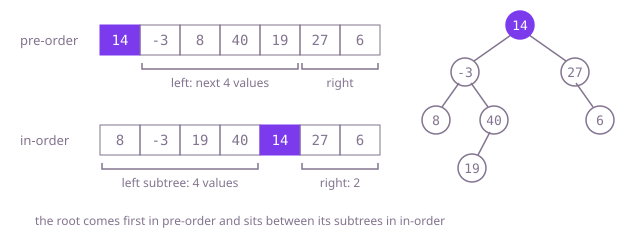

## The question

Given the pre-order and in-order sequences of a binary tree with distinct values, rebuild the tree and return its root. Pre-order puts each node before its subtrees; in-order puts it between them.

What makes it harder than it looks: the split is easy to see on paper, but the code juggles four boundaries per call, two in each array, and an off-by-one in where the right subtree starts in pre-order rebuilds a wrong tree or runs off the array. The other cost is hidden: finding each root in in-order by scanning reads the same values again and again.

## How to think about it

Pre-order's first value is the root. Find that value in in-order: everything before it is the left subtree, everything after it the right subtree. If the left subtree has `L` values, the next `L` pre-order values are its pre-order and the rest belong to the right subtree. Each part is the same problem again, so the whole thing is a recursion on two ranges.

The first version finds the root by scanning in-order. That scan reads the root's whole left subtree each time, which adds up to n times the depth on a tree leaning left. Remembering each value's in-order position in a map makes the split a lookup, and the build linear.

The last step drops the map. Both arrays are read strictly left to right: pre-order hands out the roots in the order the recursion creates them, and in-order says when a subtree is finished. A left subtree's in-order run ends exactly at its parent, so the recursion can carry "stop when in-order reaches this value" instead of a range, and needs no lookup at all.

Walk Example 1. Pre-order starts with 14; in in-order `[8,-3,19,40 | 14 | 27,6]` it has four values on its left, so `[-3,8,40,19]` is the left subtree's pre-order and `[27,6]` the right one's. Inside the left part, -3 is the root, with `[8]` on its left and `[19,40]` on its right; 40 is the root of that last part, with 19 as its left child. On the right, 27 has nothing before it and 6 after it.



## Brute force

Recurse on ranges and find each root in in-order with a scan. It comes first because it is the split written down directly, and it fixes the answer to compare against. It is correct because pre-order's first value in a range is that subtree's root, and the in-order values before it are exactly its left subtree.

```java
static TreeNode buildTree(int[] preorder, int[] inorder) {
    return build(preorder, 0, inorder, 0, inorder.length - 1);
}

private static TreeNode build(int[] preorder, int preStart, int[] inorder, int lo, int hi) {
    if (lo > hi) {
        return null;
    }
    TreeNode node = new TreeNode(preorder[preStart]); // pre-order puts the root first
    int at = lo;
    while (inorder[at] != node.val) {
        at++; // find the root in in-order by scanning
    }
    int leftSize = at - lo;
    node.left = build(preorder, preStart + 1, inorder, lo, at - 1);
    node.right = build(preorder, preStart + 1 + leftSize, inorder, at + 1, hi); // skip the root and the left subtree
    return node;
}
```

**Complexity:** time O(n·h), where h is the depth: each scan reads the root's left subtree, and a node is in at most h of those; that is O(n²) on an unbounded path, 10^8 steps at this question's limits. Extra space O(h) for the call stack, at most 1,000 frames here.

## Better: a map from value to in-order position

Record every value's in-order position once, then split with a lookup. The recursion is the same.

```java
static TreeNode buildTree(int[] preorder, int[] inorder) {
    Map<Integer, Integer> position = new HashMap<>();
    for (int i = 0; i < inorder.length; i++) {
        position.put(inorder[i], i); // distinct values: one position each
    }
    return build(preorder, 0, 0, inorder.length - 1, position);
}

private static TreeNode build(int[] preorder, int preStart, int lo, int hi, Map<Integer, Integer> position) {
    if (lo > hi) {
        return null;
    }
    TreeNode node = new TreeNode(preorder[preStart]);
    int at = position.get(node.val);
    node.left = build(preorder, preStart + 1, lo, at - 1, position);
    node.right = build(preorder, preStart + 1 + (at - lo), at + 1, hi, position);
    return node;
}
```

**Complexity:** time O(n) on average; O(n log n) in the worst case, when hash buckets crowd and Java turns them into trees with O(log n) lookups. Extra space O(n) for the map plus O(h) for the call stack, at most 1,000 frames here.

**Prefer it when:** you want the version that is easiest to check: each call names the exact in-order range it owns, so a wrong tree is quick to trace. The same map also serves the post-order variant, read from the back.

## Optimal: read both arrays once, stopping at the parent

Keep two cursors, one in each array, shared by the whole recursion. Building a subtree takes the next pre-order value as its root, builds the left side until in-order reaches that root, steps in-order past the root, and builds the right side until in-order reaches whatever ended this subtree. When in-order already shows the stop value, the subtree is empty. This is the reference solution.

```java
static TreeNode buildTree(int[] preorder, int[] inorder) {
    return new Walk(preorder, inorder).build(Long.MAX_VALUE); // no stop value: the whole tree
}

private static final class Walk {
    private final int[] preorder;
    private final int[] inorder;
    private int pre; // next value in preorder: the root of the next subtree to build
    private int in; // next value in inorder not yet placed

    Walk(int[] preorder, int[] inorder) {
        this.preorder = preorder;
        this.inorder = inorder;
    }

    TreeNode build(long stop) {
        if (pre == preorder.length || inorder[in] == stop) {
            return null; // in-order has reached the parent: this side is empty
        }
        TreeNode node = new TreeNode(preorder[pre++]);
        node.left = build(node.val); // the left run ends at the node itself
        in++; // in-order now reads the node
        node.right = build(stop); // the right run ends where this subtree's run ends
        return node;
    }
}
```

The cursors live in a fresh `Walk` per call, not in static fields, so a second call starts from the beginning. `stop` is a `long` so that "no stop" can never equal a value.

**Complexity:** time O(n): each value is read once in each array; no hashing. Extra space O(h) for the call stack, at most 1,000 frames here; a path of tens of thousands of nodes would overflow Java's default stack.

## Complexity

| Approach | Time | Extra space |
| --- | --- | --- |
| Brute force | O(n·h), O(n²) on an unbounded path | O(h) call stack, at most 1,000 frames here |
| Better: a map from value to in-order position | O(n) average, O(n log n) worst case | O(n) map plus O(h) call stack |
| Optimal: read both arrays once, stopping at the parent | O(n) | O(h) call stack, overflows on paths of tens of thousands |

## Where it shows up

No coding-round problem is linked to this question. Rebuilding a structure from two flat listings is how some tree formats are stored and shipped: a compiler or a document store can write a tree as one traversal plus enough extra order to recover the shape. The same split reasoning sits behind recovering a search tree from its pre-order alone, since a search tree's in-order is just its values sorted.

## Follow-up answers

**How would you rebuild the tree from its post-order and in-order sequences instead?** Post-order puts the root last, so read post-order from the back: each value taken is the root of the next subtree, and building the right subtree before the left keeps the order right. The in-order split works the same way, with the map or with a stop value reading in-order from the back too.

**Why do pre-order and post-order together not pin down the tree?** They say which node is the parent but not which side a lone child is on. A root 1 with only a left child 2 and a root 1 with only a right child 2 both give pre-order `[1,2]` and post-order `[2,1]`. In-order is what places a child to the left or right of its parent.

**What goes wrong if values may repeat?** A value no longer marks one position in in-order, so the split is ambiguous: two equal values on a path can be arranged in more than one tree with the same two sequences. The map would keep only one position, and the stop-value walk could stop at the wrong copy. You would need node identities, such as indexes, instead of values.
