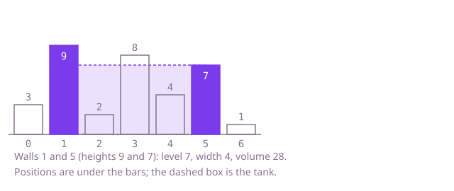

## The question

Walls of different heights stand one unit apart along a line. Pick two of them: the tank between them is as wide as the distance between them and as full as the shorter wall allows. Return the largest volume any pair can hold.

What makes it harder than it looks is that two things pull against each other. A wider pair is better only if its shorter wall is not much shorter, and the tallest walls are often not the best pair. Walls in between do not count at all. And with 200,000 walls, measuring every pair is about 20 billion volumes.

## How to think about it

The first idea is to measure every pair and keep the largest. It repeats a lot of work, because most pairs are obviously poor: a pair that is narrow and has a short wall is beaten by almost anything. A better question is the reverse one. For a wall of height `h`, the best partner is the farthest wall that is at least `h` tall, because any such partner gives level `h` and the widest possible tank. Asking that for every height at once is a sweep over heights. But there is a way to ask it with no bound on the heights at all. Start with the widest pair, the two outer walls. Say the left one is shorter. Every tank that keeps the left wall and uses a closer right wall is narrower and has a level no higher than the left wall, so it cannot beat the tank just measured. The left wall is finished: drop it and move that end in. The same holds for the right wall when it is the shorter one.

Walk Example 1, `heights = [3, 9, 2, 8, 4, 7, 1]`. Walls 0 and 6 are 3 and 1: level 1, width 6, volume 6. The right wall is shorter, so it goes. Walls 0 and 5 are 3 and 7: 3 times 5 is 15, and now the left wall goes. Walls 1 and 5 are 9 and 7: 7 times 4 is 28, the best so far, and the right wall goes. Walls 1 and 4 give 4 times 3 is 12, walls 1 and 3 give 8 times 2 is 16, walls 1 and 2 give 2. The ends meet, and the best is 28.



## Brute force

Measure the tank of every pair of walls and keep the largest. It is what you say first, and it fixes the answer every faster version must agree with. It is correct because it considers every pair there is, and the volume of a pair is exactly width times the shorter height.

```java
static int maxVolume(int[] heights) {
    int best = 0;
    for (int i = 0; i < heights.length; i++) {
        for (int j = i + 1; j < heights.length; j++) { // every pair of walls once
            int level = Math.min(heights[i], heights[j]); // the shorter wall sets the level
            best = Math.max(best, level * (j - i));
        }
    }
    return best;
}
```

**Complexity:** time O(n²), extra space O(1).

## Better: the widest tank for each water level

Fix a level `h`. The widest tank whose two walls are both at least `h` tall runs from the leftmost wall of height at least `h` to the rightmost one, and its volume is at least `h` times that width. At the level of the real tank's shorter wall the two are equal, so the best over all levels is the answer. Sweep the levels from the tallest down, so the set of walls "at least `h` tall" only grows, and keep its leftmost and rightmost position. The heights are small whole numbers, so the first and last wall of each exact height go in two arrays of size 10,001.

```java
static int maxVolume(int[] heights) {
    final int MAX = 10_000; // from the constraints
    int[] first = new int[MAX + 1]; // leftmost wall of each exact height
    int[] last = new int[MAX + 1]; // rightmost wall of each exact height
    Arrays.fill(first, Integer.MAX_VALUE);
    Arrays.fill(last, -1);
    for (int i = 0; i < heights.length; i++) {
        first[heights[i]] = Math.min(first[heights[i]], i);
        last[heights[i]] = i; // i only grows, so the last write is the rightmost
    }
    int left = Integer.MAX_VALUE; // leftmost wall at least as tall as the level
    int right = -1; // rightmost wall at least as tall as the level
    int best = 0;
    for (int level = MAX; level >= 1; level--) { // walls of this height join the set
        left = Math.min(left, first[level]);
        right = Math.max(right, last[level]);
        if (right > left) {
            best = Math.max(best, level * (right - left));
        }
    }
    return best;
}
```

**Complexity:** time O(n + H), extra space O(H), where H is the largest possible height (10,000 here).

**Prefer it when:** the heights are small whole numbers and you want the widest tank for every level, not just the best one: `right - left` at each level is that width. It needs the height bound for its arrays, which the next version does not.

## Optimal: two walls moving inwards

Start with the two outer walls. Measure the tank, then move in the end that has the shorter wall: that wall can do no better with any narrower tank, so it is finished. When the walls are equal, either can go. Each step removes one position, so the loop ends after n steps with the walls meeting, and the best volume seen is the answer. This is the reference solution.

```java
static int maxVolume(int[] heights) {
    int left = 0;
    int right = heights.length - 1;
    int best = 0;
    while (left < right) {
        int level = Math.min(heights[left], heights[right]);
        best = Math.max(best, level * (right - left));
        if (heights[left] < heights[right]) {
            left++; // the shorter wall can never do better with a narrower tank
        } else {
            right--;
        }
    }
    return best;
}
```

**Complexity:** time O(n), extra space O(1).

## Complexity

| Approach | Time | Extra space |
| --- | --- | --- |
| Brute force | O(n²) | O(1) |
| Better: widest tank for each level | O(n + H), H the largest height | O(H) |
| Optimal: two walls moving inwards | O(n) | O(1) |

## Where it shows up

No coding-round problem is linked to this question. Choosing two boundaries where the weaker side limits the outcome shows up in capacity planning and layout: picking two points on a line where the shorter of two limits sets the usable height, or the narrower of two links sets the throughput. Starting wide and discarding the side that cannot improve is the same move as in the sorted pair search.

## Follow-up answers

**Can you do it in O(n) time with O(1) extra memory?** Yes: the two walls moving inwards, as in the optimal solution. It needs no bound on the heights, unlike the level sweep, and uses a few integers.

**Why is it safe to move the shorter wall and never the taller one?** With the shorter wall fixed, every narrower tank has a level no higher than that wall, so none can beat the tank just measured. All tanks that include the shorter wall are therefore covered, and it can be dropped. The taller wall may still be part of a better tank with a wall that is taller than the one we dropped.

**How would you also return the two wall positions?** Keep the positions of the best tank when `best` is updated, and return those two numbers instead of the volume, or along with it.
