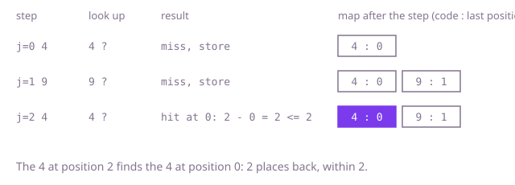

## The question

You get a list of codes and a distance `gap`. Say whether any code appears at two positions that are at most `gap` places apart.

What makes it harder than it looks: a code can repeat many times, and only the closest pair of equal positions can satisfy the gap, so a structure that remembers the first position of each code would reject pairs it should accept. A gap of 0 can never match, because two different positions are at least 1 apart. And comparing every position with the next `gap` positions is about 10 billion steps when both are 100,000.

## How to think about it

The first idea is to compare each position with the next `gap` positions. It is correct, but it re-reads the same stretch of the list over and over. Look at what actually matters for the code at position `j`: the only earlier position worth comparing with is the nearest earlier one with the same code. If that one is more than `gap` places back, every older one is further still. So per code I only need to remember the last position where I saw it, and a hash map from code to position answers "where was it last?" in one step. A lighter variant remembers only the codes still inside the window: the last `gap` codes in a set, dropping the oldest as the window slides, where a failed insert means a repeat. Which of the two I pick depends on whether memory or the position of the match matters.

Walk Example 1, `codes = [4, 9, 4]`, `gap = 2`. At position 0 the code 4 is not in the map: store 4 at 0. At position 1 the code 9 is not in the map: store 9 at 1. At position 2 the code 4 is in the map at position 0, and 2 - 0 = 2 is at most 2, so the answer is `true`. The map is updated after the check, and on every step, so a later repeat compares with the closest position.



## Brute force

For each position, compare its code with the codes at the next `gap` positions, stopping at the end of the list. It is what you say first, and it fixes the answer every faster version must agree with. It is correct because every pair `i < j` with `j - i <= gap` is examined exactly when `i` is the left position. With a gap of 0 the inner loop runs zero times, so the answer is `false`, as it should be.

```java
static boolean repeatsNearby(int[] codes, int gap) {
    for (int i = 0; i < codes.length; i++) {
        int last = Math.min(codes.length - 1, i + gap); // far end of the window, clipped to the list
        for (int j = i + 1; j <= last; j++) {
            if (codes[i] == codes[j]) {
                return true;
            }
        }
    }
    return false;
}
```

**Complexity:** time O(n times min(n, gap)), extra space O(1).

## Better: a hash set holding the last gap codes

Keep a set of the codes at the `gap` positions just before the current one. At position `j`, first drop the code that has just fallen out of range, which is `codes[j - gap - 1]`, then try to add `codes[j]`: if it is already in the set, that code sits within `gap` places, so the answer is `true`. A repeat of a code inside the window would already have been caught, so the set never holds two copies and removing by value is safe.

```java
static boolean repeatsNearby(int[] codes, int gap) {
    Set<Integer> window = new HashSet<>(); // codes at the previous `gap` positions
    for (int j = 0; j < codes.length; j++) {
        if (j > gap) {
            window.remove(codes[j - gap - 1]); // this position is now gap + 1 places back
        }
        if (!window.add(codes[j])) {
            return true;
        }
    }
    return false;
}
```

**Complexity:** time O(n) on average, O(n log n) in the worst case (Java's `HashMap` and `HashSet` turn a crowded bucket of `Integer` keys into a tree), extra space O(min(n, gap)).

**Prefer it when:** memory is the concern and `gap` is much smaller than `n`: it never holds more than `gap` codes, so it also works on a stream that cannot be kept whole. It cannot say where the matching position was.

## Optimal: a map from each code to its last position

Walk the list once with a map from code to the last position where it was seen. At position `j`, look the code up: if it is present and `j - last <= gap`, return `true`. Whether or not it matched, store `j` as the new last position, so the next occurrence compares with the closest one. This is the reference solution.

```java
static boolean repeatsNearby(int[] codes, int gap) {
    Map<Integer, Integer> lastSeen = new HashMap<>();
    for (int j = 0; j < codes.length; j++) {
        Integer last = lastSeen.get(codes[j]);
        if (last != null && j - last <= gap) {
            return true;
        }
        lastSeen.put(codes[j], j); // always the latest, so the next match is the closest
    }
    return false;
}
```

**Complexity:** time O(n) on average, O(n log n) in the worst case (the tree fallback for crowded buckets), extra space O(n).

## Complexity

| Approach | Time | Extra space |
| --- | --- | --- |
| Brute force: compare with the next `gap` positions | O(n times min(n, gap)) | O(1) |
| Better: hash set of the last `gap` codes | O(n) average, O(n log n) worst | O(min(n, gap)) |
| Optimal: map from code to last position | O(n) average, O(n log n) worst | O(n) |

## Where it shows up

`duplicate-order-detector` has `suspectedDuplicates(windowMinutes)`. It keeps a map from an order's key (customer, SKU and amount) to the latest minute that key was seen. For each order, `put` returns the previous minute and stores the new one in the same call, and the order is flagged when `order.minute() - previous < windowMinutes`. Two differences are worth saying aloud. The comparison there is on order minutes, not on positions in the log, so orders far apart in the list can still be close in time. And it is strict: an order exactly `windowMinutes` after the previous one is not flagged, where this question's `<= gap` would count it. The shape is the same: a map from key to last seen, updated on every step so the match is always against the closest earlier one.

In practice the same check flags a card charged twice within a short time, a sensor that reports the same reading twice within a few samples, and a user who clicks the same button again within a debounce window.

## Follow-up answers

**How would you do it keeping only the last gap values in memory?** Use a set as a window. Before adding each code, remove the code that left the window, which is `codes[j - gap - 1]`. If adding a code finds it already present, that is a repeat within range. Memory is at most `gap` codes.

**How would you return the closest pair of equal positions instead of a yes or no?** Keep the map of last positions and a best distance. At each position where the code is present, compare `j - last` with the best so far, then store `j`. The smallest distance ever seen is the answer.

**What changes if two values count as repeats when they differ by at most a small amount?** A plain map no longer finds neighbours. Bucket the values by their size divided by the allowed difference plus one; then a match can only be in the same bucket or the two next to it, and each bucket holds the latest value inside the window.
