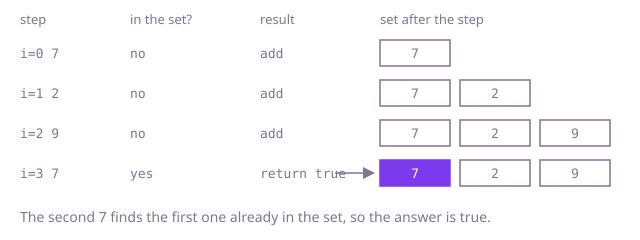

## The question

Given an array of integers, say whether any value shows up at two or more positions. The answer is a single yes or no, and you may stop at the first repeat you find.

What makes it harder than it looks is only the size. With 300,000 values there are about 45 billion pairs, so the obvious "compare everything with everything" is far too slow, and the real question is how to avoid asking each value about every other value.

## How to think about it

The first idea is to compare every pair of positions. That is right, but look at what it wastes: at each value it rescans the rest of the array to ask "do I appear again?". What I actually need, standing on a value, is one fact: have I met this exact value before? Sorting makes that fact cheap to read, because equal values end up side by side and a neighbour check finds them. Remembering is stronger still: keep the values already passed in a hash set, and "have I met it?" becomes one lookup on average, with no ordering work at all.

Walk Example 1, `nums = [7, 2, 9, 7]`. At 7: the set is empty, add it. At 2: not there, add it. At 9: not there, add it. At the second 7: already in the set, so the answer is `true`. The `add` of a Java `HashSet` reports whether the value was new, so the check and the insert are one call.



## Brute force

Compare every position with every later position. It is what you say first, and it fixes the answer every faster version must agree with. It is correct because it looks at every pair of positions, so a repeat cannot hide, and `j` starts after `i`, so a position is never compared with itself.

```java
static boolean hasDuplicate(int[] nums) {
    for (int i = 0; i < nums.length; i++) {
        for (int j = i + 1; j < nums.length; j++) { // j > i: never the same position
            if (nums[i] == nums[j]) {
                return true;
            }
        }
    }
    return false;
}
```

**Complexity:** time O(n²), extra space O(1).

## Better: sort, then compare neighbours

After sorting, equal values are adjacent, so a repeat exists exactly when two neighbours are equal. Sort a copy so the caller's array keeps its order.

```java
static boolean hasDuplicate(int[] nums) {
    int[] sorted = nums.clone(); // the caller's array stays as it was
    Arrays.sort(sorted);
    for (int i = 1; i < sorted.length; i++) {
        if (sorted[i] == sorted[i - 1]) { // equal values are adjacent after sorting
            return true;
        }
    }
    return false;
}
```

**Complexity:** time O(n log n), extra space O(n) for the copy (O(1) if you may sort the caller's array in place).

**Prefer it when:** you may reorder the input and memory is tight. Sorting in place needs no set at all, and a flat `int[]` is much smaller than a `HashSet<Integer>`, which spends tens of bytes per entry on nodes and boxed values.

## Optimal: one pass with a hash set

Walk the array once, keeping the values seen so far. If the current value is already in the set, return `true`; otherwise add it. This is the reference solution.

```java
static boolean hasDuplicate(int[] nums) {
    Set<Integer> seen = new HashSet<>();
    for (int value : nums) {
        if (!seen.add(value)) { // add returns false when the value was already there
            return true;
        }
    }
    return false;
}
```

**Complexity:** time O(n) on average, O(n log n) in the worst case (Java's `HashMap`-backed set turns a crowded bucket of `Integer` keys into a tree), extra space O(n).

## Complexity

| Approach | Time | Extra space |
| --- | --- | --- |
| Brute force | O(n²) | O(1) |
| Better: sort, then compare neighbours | O(n log n) | O(n) with a copy, O(1) in place |
| Optimal: one pass with a hash set | O(n) average, O(n log n) worst | O(n) |

## Where it shows up

`duplicate-order-detector` starts here: its `exactRepeats` walks the order log with a `HashSet` of order keys and reports an order when `seen.add(key)` returns false, which is this question once an order is turned into a key. The same "set of keys already seen" walk sits in any import or ingest step that must reject repeated records, and in event pipelines that drop a message delivered twice.

## Follow-up answers

**What if memory is tight and you may reorder the array?** Sort in place and compare each element with its neighbour. That is O(n log n) time and no extra set, at the price of changing the caller's array.

**How would you report which values repeat, not just whether any does?** Keep a second set, or a map from value to count, and collect a value the first time it is seen a second time. Do not stop early.

**What if you only care about repeats that are within k positions of each other?** Keep only the last k values in the set: after adding position i, remove the value at position i minus k. Memory then stays O(k). A map from value to its last position works too.
