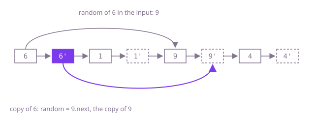

## The question

Every node of a singly linked list has a second link, `random`, to any node of the list or to nothing; build a new list with the same values and the same `next` and `random` shape, made only of new nodes. The input must look the same afterwards.

What makes it harder than it looks: `random` can point forwards to a node whose copy does not exist yet, and values repeat, so "the copy of the node holding 9" is not a well-defined thing to look up. The neat constant-space trick changes the input while it runs, so it has to put every `next` link back before it returns.

## How to think about it

Copying values and `next` links is one walk. For `random`, the first idea is positional: for each original node, find how far its `random` target is from the head, then walk the copy the same number of steps. That is correct but walks the list once per node.

What the walk keeps rediscovering is one fact per node: "this original's copy is that node". Store it once. A hash map from original node to copy (keyed by the node, not its value) answers it in one lookup, so two passes do the job: make all copies, then wire `next` and `random` through the map.

The map can live inside the list itself. Insert each copy directly after its original, so the copy of any node `x` is `x.next`. Then the copy of `x.random` is `x.random.next`, which sets every copy's `random` in one pass. A last pass unweaves the two lists, restoring each original's `next`.

Walk Example 1, `[[6,2],[1,null],[9,0],[4,3]]`. After weaving, the list is 6, 6', 1, 1', 9, 9', 4, 4'. 6's random is 9, so 6'.random = 9.next = 9'. 1's random is null, so 1'.random stays null. 9's random is 6, so 9'.random = 6'. 4's random is 4 itself, so 4'.random = 4'. Unweaving gives back 6, 1, 9, 4 and the copy 6', 1', 9', 4' with links to positions 2, null, 0, 3.



## Brute force

Copy the values and `next` links, then for each original `random` walk both lists from the head in step until the original side reaches the target; the copy side is then on the target's copy. It comes first because it is what you say first, and it fixes the answer to compare against. It is correct because walking both lists the same number of steps lands on nodes at the same position, and the copy has the same positions as the original.

```java
static Node copy(Node head) {
    Node dummy = new Node(0);
    Node tail = dummy;
    for (Node n = head; n != null; n = n.next) {
        tail.next = new Node(n.val);
        tail = tail.next;
    }
    Node twin = dummy.next;
    for (Node n = head; n != null; n = n.next, twin = twin.next) {
        if (n.random == null) {
            continue;
        }
        // walk both lists in step from the front until the original reaches the random target
        Node a = head;
        Node b = dummy.next;
        while (a != n.random) {
            a = a.next;
            b = b.next;
        }
        twin.random = b;
    }
    return dummy.next;
}
```

**Complexity:** time O(n²), extra space O(1) besides the new nodes.

## Better: a map from node to copy

Make every copy first and remember which copy belongs to which original, keyed by the original node itself. A second pass sets each copy's `next` and `random` by looking up the copies of the original's `next` and `random`. The map's `get(null)` returns `null`, which covers the last node and missing random links.

```java
static Node copy(Node head) {
    Map<Node, Node> twin = new HashMap<>(); // keyed by node identity: Node does not override equals
    for (Node n = head; n != null; n = n.next) {
        twin.put(n, new Node(n.val));
    }
    for (Node n = head; n != null; n = n.next) {
        twin.get(n).next = twin.get(n.next);
        twin.get(n).random = twin.get(n.random);
    }
    return twin.get(head);
}
```

**Complexity:** time O(n) on average, O(n²) in the worst case (if many nodes share a hash, a tree bin cannot order keys that are not `Comparable`, so a lookup scans them), extra space O(n) for the map.

**Prefer it when:** the input may not be changed even briefly, for example because another thread reads it while you copy, or when the clearer code matters more than the memory.

## Optimal: weave the copies into the list

Put each copy right after its original, set every copy's `random` from its original's `random.next`, then split the two lists apart. This is the reference solution.

```java
static Node copy(Node head) {
    // place each copy right after its original: A, A', B, B', ...
    for (Node n = head; n != null; n = n.next.next) {
        Node twin = new Node(n.val);
        twin.next = n.next;
        n.next = twin;
    }
    // the copy of n.random is the node right after it
    for (Node n = head; n != null; n = n.next.next) {
        n.next.random = n.random == null ? null : n.random.next;
    }
    // unweave: restore the input and chain the copies
    Node dummy = new Node(0);
    Node tail = dummy;
    for (Node n = head; n != null; n = n.next) {
        tail.next = n.next;
        tail = tail.next;
        n.next = tail.next;
    }
    return dummy.next;
}
```

**Complexity:** time O(n), extra space O(1) besides the new nodes.

## Complexity

| Approach | Time | Extra space |
| --- | --- | --- |
| Brute force | O(n²) | O(1) besides the new nodes |
| Better: a map from node to copy | O(n) average, O(n²) worst case | O(n) |
| Optimal: weave the copies into the list | O(n) | O(1) besides the new nodes |

## Where it shows up

No coding-round problem is linked to this question. Copying a structure whose objects point at each other in arbitrary ways is what deep-clone and serialization code does: it keeps an "already copied" table from original object to copy so shared references and cycles come out right. Undo snapshots of an editor's object graph and copying a game state with entities that target each other are the same problem.

## Follow-up answers

**What if the random links could also point into other lists?** Then there is no single list to weave through and positions mean nothing, so the map is the general tool: copy every node reachable from the head through `next` and `random`, looking each one up in the original-to-copy map before making a new copy. That is exactly the graph-clone pattern.

**How would you copy the list if it could contain a cycle through next?** Walking `next` until `null` would never end, so stop when you reach a node you have already copied: with the map, check `containsKey` before making a copy and link to the existing copy instead. The weaving trick also needs a stop condition, such as the length found first with a cycle check.

**Why must the map be keyed by node rather than by value?** Two nodes can hold the same value, as in `[[5,1],[5,0]]`, and a value-keyed map would send both random links to the same copy. Keying by the node object (Java's default `equals` and `hashCode` are identity) keeps every original distinct.
