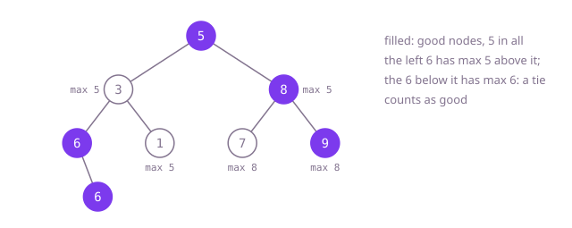

## The question

Given the root of a binary tree, count the nodes whose value is at least every value on the path from the root down to them. Ties count, and the root is always good.

What makes it harder than it looks: "good" depends on every ancestor, not on the parent, so a node that beats its parent can still be outranked further up, as the 5 in `[10,2,null,5]` is. And the obvious starting point for a running maximum, 0, is wrong when values are negative: in Example 2 it would make even the root look bad.

## How to think about it

The first idea is to judge each node on its own: keep the path from the root to the current node, and at each node scan that path for a larger value. That is correct, but it reads the whole path again at every node, which costs up to the depth per node.

What the scan computes is one number: the largest value on the path above. That number changes in a simple way going down, it becomes the larger of itself and the current node's value, so it can be passed down instead of recomputed. A node is good when its value is at least the number it was handed. Starting the number at the root's own value makes the root good automatically, whatever its sign.

Walk Example 1, `[5,3,8,6,1,7,9,null,6]`. The root 5 gets 5 and is good; it passes 5 down. 3 is below 5: not good, passes 5. Its children: 6 is at least 5, good, passes 6; 1 is not. The 6 below that 6 gets 6, a tie: good. On the right, 8 gets 5, good, passes 8; 7 is not good, 9 is. Five good nodes.



## Brute force

Keep the path from the root as a list and scan it at every node. It comes first because it is what you say first, and it fixes the answer to compare against. It is correct because the list holds exactly the values above the current node, so the scan checks the definition directly.

```java
static int goodNodes(TreeNode root) {
    return count(root, new ArrayList<>());
}

private static int count(TreeNode node, List<Integer> path) {
    if (node == null) {
        return 0;
    }
    boolean good = true;
    for (int v : path) { // every value above this node
        if (v > node.val) {
            good = false;
            break;
        }
    }
    path.add(node.val);
    int total = (good ? 1 : 0) + count(node.left, path) + count(node.right, path);
    path.remove(path.size() - 1); // leaving this node: it is no longer above anything
    return total;
}
```

**Complexity:** time O(n·h), where h is the depth, since each node may scan its whole path; extra space O(h) for the path and the call stack, at most 1,000 frames here.

## Better: an explicit stack of node and maximum

Pass the maximum down instead of the path, and walk with a stack of (node, maximum above it) pairs instead of recursion.

```java
static int goodNodes(TreeNode root) {
    int good = 0;
    ArrayDeque<Object[]> stack = new ArrayDeque<>();
    stack.push(new Object[] {root, root.val});
    while (!stack.isEmpty()) {
        Object[] top = stack.pop();
        TreeNode node = (TreeNode) top[0];
        int maxAbove = (Integer) top[1];
        if (node.val >= maxAbove) good++;
        int max = Math.max(maxAbove, node.val); // what the children see above them
        if (node.left != null) stack.push(new Object[] {node.left, max});
        if (node.right != null) stack.push(new Object[] {node.right, max});
    }
    return good;
}
```

**Complexity:** time O(n); extra space O(h) for the stack, which holds at most the current path's waiting siblings, one per level, on the heap, so any depth is fine.

**Prefer it when:** the depth is not capped: a path of 100,000 nodes is no problem for a heap stack, while one call per level would overflow Java's stack.

## Optimal: recursion that carries the maximum

Hand each child the larger of the maximum above and the node's own value; count the node when its value is at least what it was handed. This is the reference solution.

```java
static int goodNodes(TreeNode root) {
    return count(root, root.val); // the root has nothing above it, so it is good
}

private static int count(TreeNode node, int maxAbove) {
    if (node == null) {
        return 0;
    }
    int good = node.val >= maxAbove ? 1 : 0; // a tie still counts
    int max = Math.max(maxAbove, node.val);
    return good + count(node.left, max) + count(node.right, max);
}
```

**Complexity:** time O(n); extra space O(h) for the call stack, where h is the depth; at most 1,000 frames here, but a path of tens of thousands of nodes would overflow Java's default stack.

## Complexity

| Approach | Time | Extra space |
| --- | --- | --- |
| Brute force | O(n·h) | O(h) path and call stack, at most 1,000 frames here |
| Better: an explicit stack of node and maximum | O(n) | O(h) stack on the heap, any depth |
| Optimal: recursion that carries the maximum | O(n) | O(h) call stack, safe for depth up to 1,000, overflows on paths of tens of thousands |

## Where it shows up

No coding-round problem is linked to this question. Carrying a running maximum down a tree is how a permission system checks that no enclosing folder holds a stricter rule, how a hierarchy of budgets flags a team that spends more than any group above it allows, and how a file-system walk tracks the newest timestamp on the way down. The pattern, a value folded along the root-to-node path and handed to the children, is the top-down twin of the bottom-up height computation.

## Follow-up answers

**What changes if a tie no longer counts as good?** Only the comparison: `node.val > maxAbove`. The root then needs its own case, since it is compared with its own value: start the maximum below every possible value, `Integer.MIN_VALUE`, or count the root separately and start its children with its value. The cost does not change.

**How would you do it without recursion?** Use the explicit stack of (node, maximum above it) pairs from "Better", or a queue of the same pairs, which visits level by level. Each node is pushed once with the maximum of its own path, so the count is the same.

**How would you return the good nodes themselves rather than their number?** Add the node to a list where the count is incremented, in whatever order the walk visits. Time stays O(n); the list adds space for the answer only.
