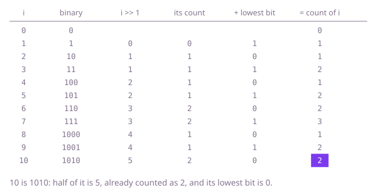

## The question

Given `n`, return a table of `n + 1` entries in which entry `i` is the number of 1 bits of `i`, for every `i` from 0 to `n`. Each entry on its own is the count of one number's bits; the question is whether the table can be filled faster than by counting each number from scratch.

What makes it harder than it looks: the table has `n + 1` entries, 0 and `n` both included, so an array of length `n` is one short, and `n = 0` still needs the single entry for 0, which rules out setting entry 1 before the loop. Counting each number's bits separately is correct, but it does the same work again and again: 38 and 19 share all of their bits but the last, and the count for 19 is already in the table when 38 comes along.

## How to think about it

The first idea is to count each number's bits with a loop that shifts it right until it is 0. That costs one step per binary digit, about log2 n for the larger numbers, so O(n log n) for the table, and it ignores the table it is building, where the counts of all smaller numbers already are. Look at the table in blocks: the numbers from 8 to 15 are 8 plus each of the numbers 0 to 7, so their counts are those of 0 to 7, one higher; the numbers from 16 to 31 repeat the counts of 0 to 15, one higher, and so on. That fills each entry with one addition, O(n) in all, at the price of one more variable: the power of two the current block starts at.

A smaller number that needs no such variable is `i >> 1`. Shifting `i` right by one drops only its lowest bit, `i & 1`, and gives a number that is already in the table. So the count for `i` is the count for `i >> 1` plus that bit: again one addition per entry, and nothing to carry from one step to the next.

Walk Example 1, `n = 10`. Entry 0 is 0. For 1, half is 0 and the lowest bit is 1, so 1. For 2 (10), half is 1, count 1, lowest bit 0, so 1. For 3 (11), half is 1 and the bit is 1, so 2. Going on the same way, 7 (111) gets the count of 3 plus 1, which is 3, 8 (1000) the count of 4 plus 0, which is 1, and 10 (1010) the count of 5 plus 0, which is 2: `[0, 1, 1, 2, 1, 2, 2, 3, 1, 2, 2]`.



## Brute force

Count the bits of each number from 0 to `n` with a shift loop. It comes first because it uses only the count of a single number, which is the obvious part of the question, and it fixes the table every faster version must agree with. It is correct because the loop looks at every binary digit of `i` and adds the ones that are 1.

```java
static int[] build(int n) {
    int[] ones = new int[n + 1]; // entries 0 to n, both included
    for (int i = 0; i <= n; i++) {
        for (int rest = i; rest != 0; rest >>>= 1) { // one step per binary digit of i
            ones[i] += rest & 1;
        }
    }
    return ones;
}
```

**Complexity:** time O(n log n), about log2 n steps for each of the larger numbers; extra space O(1) beyond the table that is returned.

## Better: each block repeats the table before it, plus one

Keep `high`, the largest power of two that is at most `i`. Then `i` is `high` plus `i - high`, a smaller number whose count is already in the table, and the 1 bit of `high` adds one. `high` doubles exactly when `i` reaches the next power of two.

```java
static int[] build(int n) {
    int[] ones = new int[n + 1];
    int high = 1; // the largest power of two that is at most i
    for (int i = 1; i <= n; i++) {
        if (i == 2 * high) { // i is the next power of two: a new block starts
            high = i;
        }
        ones[i] = 1 + ones[i - high]; // the 1 bit of high, plus the count of the rest
    }
    return ones;
}
```

**Complexity:** time O(n), extra space O(1) beyond the table.

**Prefer it when:** you want the block structure in plain view: each block from 2^k to 2^(k+1) - 1 is the whole table below it with one added, which is the fact the last follow-up uses to count without a table at all. It costs the same as the Optimal; the Optimal only needs no variable carried from step to step.

## Optimal: half the number, plus its lowest bit

Fill the table from 1 upwards with `ones[i] = ones[i >> 1] + (i & 1)`: `i >> 1` is `i` without its lowest bit and is already filled in. This is the reference solution.

```java
static int[] build(int n) {
    int[] ones = new int[n + 1]; // entries 0 to n, both included; ones[0] stays 0
    for (int i = 1; i <= n; i++) {
        ones[i] = ones[i >> 1] + (i & 1); // i is i >> 1 with its lowest bit put back
    }
    return ones;
}
```

**Complexity:** time O(n), extra space O(1) beyond the table.

## Complexity

| Approach | Time | Extra space |
| --- | --- | --- |
| Brute force: count each number's bits | O(n log n) | O(1) beyond the table |
| Better: each block repeats the table before it, plus one | O(n) | O(1) beyond the table |
| Optimal: half the number, plus its lowest bit | O(n) | O(1) beyond the table |

## Where it shows up

No coding-round problem is linked to this question. Tables like this one are how bit counts were made fast before processors had an instruction for them: a table of the 256 byte values, built once, turns the count of a word into a few lookups. Error-correcting codes use the same count: the weight of a code word is its number of 1 bits, and in a linear code the smallest weight of a nonzero word is the least number of bits in which two of its words differ. The step itself, filling each entry from a smaller one that is already known, is the pattern of one-dimensional dynamic programming.

## Follow-up answers

**Can you fill the table in O(n) time?** Yes, by building each entry from one already filled: `ones[i] = ones[i >> 1] + (i & 1)`, as in the Optimal, or `ones[i] = 1 + ones[i - high]` with the block's power of two, as in the Better. A third form drops the lowest 1 bit instead, `ones[i] = ones[i & (i - 1)] + 1`, since `i & (i - 1)` is smaller than `i` and has exactly one 1 bit fewer.

**How would you use a small table like this to count the 1 bits of any 32-bit value?** Build the table for 0 to 255 once, then split the value into its four bytes with `>>>` and `& 0xff` and add their four entries. The shift must be `>>>` or the mask must come after it, so that a negative value does not bring copies of its sign bit into the top byte. A table of 65,536 entries needs only two lookups, at the cost of a larger table.

**How would you find the total number of 1 bits from 0 to n without building the table?** Count by blocks: the numbers from 0 to 2^k - 1 have k · 2^(k - 1) one bits in all, since each of the k positions is 1 in half of them. For any `n`, take the largest power of two `2^k <= n`: the numbers from 0 to 2^k - 1 give k · 2^(k - 1), the numbers from 2^k to n each have that top bit, which gives n - 2^k + 1 more, and the rest of their bits are the total from 0 to n - 2^k, the same question for a smaller number. That takes O(log n) steps, one per 1 bit of `n`.
