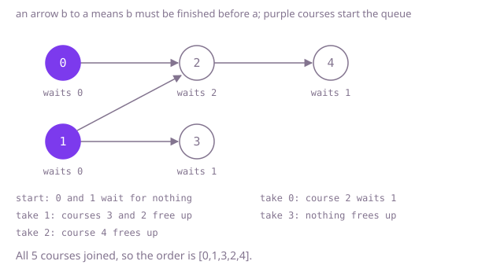

## The question

Courses are numbered from 0, and each pair `[a, b]` says course `b` must be finished before course `a`. Return every course once in an order that respects all the pairs, or an empty array when no such order exists.

What makes it harder than it looks is that a half-right answer is easy to produce. When some courses sit on a loop, the others can still be ordered, but the answer must be empty, not that partial list. A depth-first search finishes a course only after everything it unlocks, so listing courses as they finish gives the order backwards. Many orders are usually valid, so the tests check the rules rather than one fixed array. And a chain of 100,000 courses rules out rescanning the plan per course and a search that recurses once per course.

## How to think about it

The first idea is to act it out: in each pass, append every course whose prerequisites are all in the list already, and stop when a pass adds nothing. If every course was added, the list is an order; otherwise the remaining courses are stuck on a loop and the answer is empty. It is correct, but each pass rescans every pair, and on a chain each pass adds one course.

The pass recomputes, for every course, how many of its prerequisites are still missing, and that number only changes when one of them is added. So count once, and when a course is added, lower the count of each course that needs it; a course whose count reaches zero is ready, and goes into a queue. The order in which courses leave the queue is a valid order, because a course enters only after its last prerequisite left. That is Kahn's algorithm, and the order array can serve as the queue itself. A depth-first search that lists courses in reverse of the order they finish also works, but it recurses once per course on a chain.

Walk Example 1, `numCourses = 5`, `[[2,0],[2,1],[4,2],[3,1]]`. Courses 0 and 1 wait for nothing, so the order starts `0, 1`. Taking 0 lowers course 2 to one. Taking 1 frees course 3 and then course 2, which waited for 0 and 1. Taking 3 frees nothing, and taking 2 frees course 4. The order is `[0,1,3,2,4]`, and since all five courses are in it, it is the answer.



## Brute force

Repeat passes over the pairs: mark every course not yet in the list that waits for a course not yet in the list, append every unmarked course, and stop when a pass appends nothing. Return the list if it holds every course, and an empty array otherwise. It comes first because it is the rule a student would follow, and it fixes the answer to compare against. It is correct because a course is appended only after all its prerequisites, and when a pass appends nothing, every remaining course waits for another remaining course, which can only happen around a loop.

```java
static int[] findOrder(int numCourses, int[][] prerequisites) {
    boolean[] taken = new boolean[numCourses];
    int[] order = new int[numCourses];
    int count = 0;
    while (true) {
        boolean[] blocked = new boolean[numCourses];
        for (int[] pair : prerequisites) {
            if (!taken[pair[1]]) {
                blocked[pair[0]] = true; // still waiting for a course not taken yet
            }
        }
        int before = count;
        for (int course = 0; course < numCourses; course++) {
            if (!taken[course] && !blocked[course]) {
                taken[course] = true;
                order[count++] = course;
            }
        }
        if (count == before) {
            return count == numCourses ? order : new int[0]; // a pass that frees nothing: done, or stuck
        }
    }
}
```

**Complexity:** time O(V × (V + E)) for V courses and E pairs, since a chain adds one course per pass; extra space O(V).

## Better: depth-first search in reverse finishing order

Walk forward from each course along "this course unlocks that one", marking a course as on the current path while the search is inside it. Reaching a course on the current path is a loop, and the answer is empty. When the search leaves a course, everything it unlocks has already been finished, so the course belongs in front of all of them: push it onto the front of a list, and the list ends up in a valid order. Starting from every unvisited course covers courses no other course leads to.

```java
static int[] findOrder(int numCourses, int[][] prerequisites) {
    List<List<Integer>> unlocks = new ArrayList<>();
    for (int i = 0; i < numCourses; i++) {
        unlocks.add(new ArrayList<>());
    }
    for (int[] pair : prerequisites) {
        unlocks.get(pair[1]).add(pair[0]);
    }
    int[] state = new int[numCourses]; // 0 not seen, 1 on the current path, 2 finished
    ArrayDeque<Integer> order = new ArrayDeque<>();
    for (int course = 0; course < numCourses; course++) {
        if (state[course] == 0 && !place(unlocks, state, order, course)) {
            return new int[0];
        }
    }
    return order.stream().mapToInt(Integer::intValue).toArray();
}

/** Places the course and everything it unlocks; returns false on a loop. */
private static boolean place(List<List<Integer>> unlocks, int[] state, ArrayDeque<Integer> order, int course) {
    state[course] = 1;
    for (int after : unlocks.get(course)) {
        if (state[after] == 1) {
            return false; // back on the current path: a loop
        }
        if (state[after] == 0 && !place(unlocks, state, order, after)) {
            return false;
        }
    }
    state[course] = 2;
    order.push(course); // in front of every course it unlocks, which finished first
    return true;
}
```

**Complexity:** time O(V + E); extra space O(V + E) for the lists, plus a recursion as deep as the longest chain, up to V = 100,000 calls, which overflows the call stack on the chain tests.

**Prefer it when:** the chains are known to be short and you are already running a depth-first search over the same plan, for example to report a loop, since the same pass produces the order.

## Optimal: Kahn's algorithm

Count each course's prerequisites, one per pair, and link each pair to its prerequisite. Put the courses that wait for nothing at the front of the order array, then walk the array from the front: for each course, lower the count of every course that needs it, and append a course when its count reaches zero. The array is both the queue and the answer. If fewer than all courses were appended, the rest sit on or behind a loop, and the answer is an empty array. This is the reference solution.

```java
static int[] findOrder(int numCourses, int[][] prerequisites) {
    int[] waiting = new int[numCourses]; // prerequisites each course still waits for, one per pair
    int[] first = new int[numCourses]; // the pairs whose prerequisite is course b, as a linked list per b
    int[] next = new int[prerequisites.length];
    Arrays.fill(first, -1);
    for (int i = 0; i < prerequisites.length; i++) {
        int course = prerequisites[i][0];
        int before = prerequisites[i][1];
        waiting[course]++;
        next[i] = first[before];
        first[before] = i;
    }
    int[] order = new int[numCourses]; // doubles as the queue: courses are taken in the order they free up
    int tail = 0;
    for (int course = 0; course < numCourses; course++) {
        if (waiting[course] == 0) {
            order[tail++] = course;
        }
    }
    for (int head = 0; head < tail; head++) {
        for (int pair = first[order[head]]; pair != -1; pair = next[pair]) {
            int course = prerequisites[pair][0];
            if (--waiting[course] == 0) {
                order[tail++] = course; // its last prerequisite was just taken
            }
        }
    }
    return tail == numCourses ? order : new int[0]; // courses on a loop never free up
}
```

**Complexity:** time O(V + E), since every course is appended at most once and every pair is followed once; extra space O(V + E). Nothing recurses, so a chain of 100,000 courses is no problem.

## Complexity

| Approach | Time | Extra space |
| --- | --- | --- |
| Brute force: repeated passes | O(V × (V + E)) | O(V) |
| Better: depth-first search in reverse finishing order | O(V + E) | O(V + E), recursion up to V deep, which overflows on a 100,000-course chain |
| Optimal: Kahn's algorithm | O(V + E) | O(V + E) |

V is the number of courses and E the number of pairs.

## Where it shows up

An order that puts every item after the items it depends on is a topological order. Build tools compute one to decide which modules to compile first, package managers to decide installation order, database migration tools to apply schema changes in dependency order, and spreadsheets to recalculate cells after the cells they read from.

## Follow-up answers

**Can you build the order in time linear in the number of courses and pairs?** Yes. Kahn's algorithm appends each course once and follows each pair once, so it runs in O(V + E), with the answer array doubling as the queue.

**How would you return the smallest order in dictionary order when several are valid?** Replace the queue with a min-heap of ready courses, so the smallest ready course is always taken next. That gives the smallest order and costs O((V + E) log V).

**How would you group the courses into terms, taking every ready course each term?** Process the queue one level at a time: the courses ready at the start form term 1, the courses freed while taking them form term 2, and so on. The number of terms is the length of the longest chain of prerequisites.
