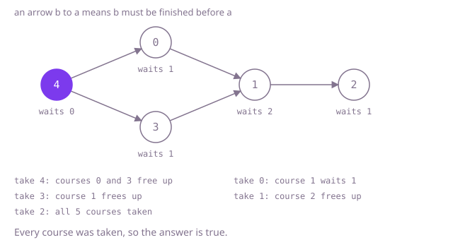

## The question

Courses are numbered from 0, and each pair `[a, b]` says course `b` must be finished before course `a`. Return whether some order lets a student finish every course.

What makes it harder than it looks is that the answer is about loops, and loops hide. A course can depend on itself, a loop can sit in a part of the plan no search from course 0 ever reaches, and two separate routes to the same course look like a loop to a search that only remembers "seen before". Size matters too: a chain of 100,000 courses, each needing the one before it, is too slow for anything that rescans the plan once per course, and too deep for a search that recurses once per course.

## How to think about it

The first idea is to act it out: find every course whose prerequisites are all taken, take them, and repeat until a pass frees nothing. If every course was taken the answer is true; otherwise the courses left are stuck, because each waits for a course that is also stuck. It is correct, but each pass rescans every pair, and on a chain each pass frees only one course.

What a pass recomputes is how many unfinished prerequisites each course has, and that number changes only when one of its prerequisites is taken. So count them once, and when a course is taken, lower the count of each course that needs it; a course whose count reaches zero goes into a queue of courses ready to take. That is Kahn's algorithm. A course on a loop never reaches zero, so the answer is true exactly when every course passes through the queue. A depth-first search that marks the courses on its current path finds loops in the same time, but it recurses once per course on a chain.

Walk Example 1, `numCourses = 4`, `[[1,0],[2,1],[3,1],[3,2]]`. Course 0 waits for nothing, 1 and 2 wait for one course each and 3 waits for two. The queue starts with 0. Taking 0 drops 1 to zero. Taking 1 drops 2 to zero and 3 to one. Taking 2 drops 3 to zero. Taking 3 frees nothing. Four courses passed through the queue, so the answer is true.



## Brute force

Repeat passes over the pairs: mark every untaken course that still waits for an untaken prerequisite, take every course left unmarked, and stop when a pass takes nothing. It comes first because it is the rule a student would follow, and it fixes the answer to compare against. It is correct because a course is taken only after all its prerequisites, and when a pass takes nothing, every remaining course waits for another remaining course, which can only happen around a loop.

```java
static boolean canFinish(int numCourses, int[][] prerequisites) {
    boolean[] taken = new boolean[numCourses];
    int count = 0;
    while (true) {
        boolean[] blocked = new boolean[numCourses];
        for (int[] pair : prerequisites) {
            if (!taken[pair[1]]) {
                blocked[pair[0]] = true; // still waiting for a course not taken yet
            }
        }
        int before = count;
        for (int course = 0; course < numCourses; course++) {
            if (!taken[course] && !blocked[course]) {
                taken[course] = true;
                count++;
            }
        }
        if (count == before) {
            return count == numCourses; // a pass that frees nothing: done, or stuck on a loop
        }
    }
}
```

**Complexity:** time O(V × (V + E)) for V courses and E pairs, since a chain frees one course per pass; extra space O(V).

## Better: depth-first search with three states

Walk forward from each course along "this course unlocks that one", marking a course as on the current path when the search enters it and as done when the search leaves it. Reaching a course that is on the current path means the search went round a loop. Reaching a course that is done is fine: it was already searched and found loop-free, which is what keeps two routes to the same course from looking like a loop. Starting a search from every unvisited course reaches loops far from course 0.

```java
static boolean canFinish(int numCourses, int[][] prerequisites) {
    List<List<Integer>> unlocks = new ArrayList<>();
    for (int i = 0; i < numCourses; i++) {
        unlocks.add(new ArrayList<>());
    }
    for (int[] pair : prerequisites) {
        unlocks.get(pair[1]).add(pair[0]);
    }
    int[] state = new int[numCourses]; // 0 not seen, 1 on the current path, 2 done
    for (int course = 0; course < numCourses; course++) {
        if (state[course] == 0 && hasLoop(unlocks, state, course)) {
            return false;
        }
    }
    return true;
}

private static boolean hasLoop(List<List<Integer>> unlocks, int[] state, int course) {
    state[course] = 1;
    for (int after : unlocks.get(course)) {
        if (state[after] == 1) {
            return true; // back on the current path: a loop
        }
        if (state[after] == 0 && hasLoop(unlocks, state, after)) {
            return true;
        }
    }
    state[course] = 2; // everything reachable from here is loop-free
    return false;
}
```

**Complexity:** time O(V + E); extra space O(V + E) for the lists, plus a recursion as deep as the longest chain, up to V = 100,000 calls, which overflows the call stack on the chain tests.

**Prefer it when:** the chains of prerequisites are known to be short, and you want to go on to report a loop, since the courses in state 1 are exactly the current path and a loop is the part of it from the repeated course on.

## Optimal: Kahn's algorithm

Count each course's prerequisites, one per pair, and link each pair to its prerequisite so that taking a course can find the courses waiting for it. Queue the courses that wait for nothing, then take courses from the queue, lowering the count of each course that needs the one taken and queueing it when the count reaches zero. The answer is whether every course passed through the queue. Counting per pair, not per distinct course, keeps repeated pairs consistent, and a course that lists itself never reaches zero. This is the reference solution.

```java
static boolean canFinish(int numCourses, int[][] prerequisites) {
    int[] waiting = new int[numCourses]; // prerequisites each course still waits for, one per pair
    int[] first = new int[numCourses]; // the pairs whose prerequisite is course b, as a linked list per b
    int[] next = new int[prerequisites.length];
    Arrays.fill(first, -1);
    for (int i = 0; i < prerequisites.length; i++) {
        int course = prerequisites[i][0];
        int before = prerequisites[i][1];
        waiting[course]++;
        next[i] = first[before];
        first[before] = i;
    }
    int[] ready = new int[numCourses]; // courses with nothing left to wait for, in the order they freed up
    int tail = 0;
    for (int course = 0; course < numCourses; course++) {
        if (waiting[course] == 0) {
            ready[tail++] = course;
        }
    }
    for (int head = 0; head < tail; head++) {
        for (int pair = first[ready[head]]; pair != -1; pair = next[pair]) {
            int course = prerequisites[pair][0];
            if (--waiting[course] == 0) {
                ready[tail++] = course; // its last prerequisite was just taken
            }
        }
    }
    return tail == numCourses; // a course on a loop never reaches zero
}
```

**Complexity:** time O(V + E), since every course is queued at most once and every pair is followed once; extra space O(V + E). Nothing recurses, so a chain of 100,000 courses is no problem.

## Complexity

| Approach | Time | Extra space |
| --- | --- | --- |
| Brute force: repeated passes | O(V × (V + E)) | O(V) |
| Better: depth-first search with three states | O(V + E) | O(V + E), recursion up to V deep, which overflows on a 100,000-course chain |
| Optimal: Kahn's algorithm | O(V + E) | O(V + E) |

V is the number of courses and E the number of pairs.

## Where it shows up

Checking that "must come before" rules have no loop is what build tools do before compiling modules that depend on each other, what package managers do when resolving dependencies, what spreadsheets do to report a circular reference between cells, and what job schedulers do before running a pipeline of tasks with dependencies.

## Follow-up answers

**Can you answer in time linear in the number of courses and pairs?** Yes. Kahn's algorithm touches each course once when it is queued and each pair once when its prerequisite is taken, so it runs in O(V + E), and it needs no recursion.

**How would you report one loop of courses that blocks the plan?** Run the three-state depth-first search and keep the current path; when it reaches a course already on the path, the loop is the part of the path from that course to the end. With Kahn's algorithm, the courses never queued contain every loop: start at any of them and keep stepping to an unqueued prerequisite until a course repeats.

**What if a student can take at most k courses per term and you want the fewest terms?** With no limit, take every ready course each term, and the number of terms is the length of the longest chain. With a limit of k, choosing which ready courses to take first matters, and the general problem is hard; for small numbers of courses it is solved with a search over sets of courses taken.
