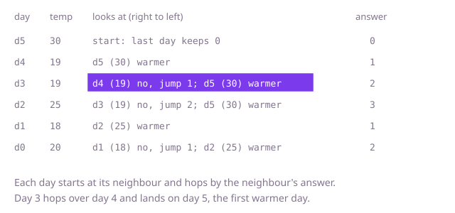

## The question

Given the temperature for each day, report for every day how many days pass until a strictly warmer day, or 0 if none comes. The input array is read-only.

What makes it harder than it looks: "strictly" matters, since an equal temperature does not answer the question and must be skipped. A long run of equal or falling days, with one warm day at the end, makes the obvious scan walk far for every day: 200,000 days is about 20 billion steps. And the answer is a distance in days, not the warmer temperature, so you need positions, not only values.

## How to think about it

The first idea is to look forward from each day until a warmer one shows up. It repeats work: days 3 and 4 in the same cold spell both walk over the same days to find the same warm one. The days that are still waiting for an answer have a pattern. A day is still waiting only because every day after it has been no warmer, so going from the oldest waiting day to the newest, temperatures never rise. A new day can answer only waiting days that are colder than it, and since the newest are the coldest, those sit at the newest end; it stops at the first waiting day that is not colder, because everything older is at least as warm. That is a stack of waiting days.

With the stack, walk Example 1, `temps = [20, 18, 25, 19, 19, 30]`. Day 0 (20) has nothing to answer and waits. Day 1 (18) is colder than 20, so it waits above it. Day 2 (25) is warmer than 18: day 1 waits one day. It is also warmer than 20: day 0 waits two days. Then day 2 waits. Day 3 (19) waits above 25. Day 4 (19) is not warmer than the 19 below it, so it waits too. Day 5 (30) is warmer than all three waiting days: day 4 waits one day, day 3 two days, day 2 three days. Day 5 and anything left waiting get 0. The answer is `[2, 1, 3, 2, 1, 0]`.

The stack costs memory for every waiting day, yet the answers it writes already link each day to the next warmer one. So walk from the right instead: a day starts at its neighbour, and while that neighbour is not warmer it jumps ahead by the neighbour's own answer, which skips days that cannot beat it either. On Example 1, day 5 keeps 0 and day 4 sees day 5 at once. Day 3 sees day 4 (19, not warmer), jumps its answer of 1 to day 5 (30) and gets 2. Day 2 sees day 3 (19), jumps 2 to day 5 and gets 3. Day 1 sees day 2 (25) and gets 1. Day 0 sees day 1 (18), jumps 1 to day 2 (25) and gets 2: the same `[2, 1, 3, 2, 1, 0]` with no stack.



## Brute force

For each day, look at the following days one by one and stop at the first strictly warmer one. It is what you say first, and it fixes the answer every faster version must agree with. It is correct because the nearest later warmer day is by definition the first one met, and a day that never meets one keeps its 0.

```java
static int[] daysToWarmer(int[] temps) {
    int[] answer = new int[temps.length]; // zero means no warmer day follows
    for (int day = 0; day < temps.length; day++) {
        for (int later = day + 1; later < temps.length; later++) {
            if (temps[later] > temps[day]) { // strictly warmer: equal does not count
                answer[day] = later - day;
                break;
            }
        }
    }
    return answer;
}
```

**Complexity:** time O(n²) in the worst case, such as a long run of equal days (every day scans to the end), extra space O(1) beyond the answer array.

## Better: a stack of waiting days

This is the same O(n) time, a different tool: it spends O(n) memory to make the idea easy to see. Go through the days in order, keeping a stack of positions of days still waiting for a warmer one, with temperatures that do not rise toward the top. For each new day, while the day on top is strictly colder, pop it and record `day - popped`; then push the new day. Equal days stay on the stack, because equal is not warmer. Whatever is on the stack at the end keeps 0.

```java
static int[] daysToWarmer(int[] temps) {
    int[] answer = new int[temps.length]; // zero means no warmer day follows
    int[] waiting = new int[temps.length]; // positions of days still waiting
    int size = 0;
    for (int day = 0; day < temps.length; day++) {
        while (size > 0 && temps[waiting[size - 1]] < temps[day]) { // strictly colder
            int earlier = waiting[--size];
            answer[earlier] = day - earlier;
        }
        waiting[size++] = day;
    }
    return answer;
}
```

**Complexity:** time O(n), extra space O(n) (the stack can hold every day, for example when temperatures fall or stay equal).

**Prefer it when:** you want the invariant that is easiest to defend aloud, or the question changes shape: the same stack answers the next greater element in a circular row or returns the warmer temperature instead of the distance.

## Optimal: walk from the right and jump through earlier answers

Fill the answers from the last day to the first. For a day, start at the next day. While that day is not warmer, jump forward by its own answer, which is the distance to the next day that is warmer than it: the jump from a day that is not warmer than today lands on the first day warmer than it, so every day skipped is no warmer than that day, and therefore not warmer than today. Stop when you reach a warmer day, or when the day you stand on has answer 0, meaning nothing warmer follows it, and then nothing warmer follows this day either. This is the reference solution.

```java
static int[] daysToWarmer(int[] temps) {
    int n = temps.length;
    int[] answer = new int[n];
    for (int day = n - 2; day >= 0; day--) { // the last day always keeps 0
        int next = day + 1;
        while (temps[next] <= temps[day] && answer[next] != 0) {
            next += answer[next]; // skip to the first day warmer than the one we stand on
        }
        if (temps[next] > temps[day]) {
            answer[day] = next - day;
        }
    }
    return answer;
}
```

**Complexity:** time O(n) (each jump passes over days that no earlier day will have to look at again), extra space O(1) beyond the answer array.

## Complexity

| Approach | Time | Extra space |
| --- | --- | --- |
| Brute force | O(n²) | O(1) |
| Better: a stack of waiting days | O(n) | O(n) |
| Optimal: walk from the right and jump | O(n) | O(1) |

## Where it shows up

No coding-round problem is linked to this question. The pattern, "the next element to the right that is larger", is the next greater element, and it appears wherever each event waits for the next one that exceeds it: the next day a stock closes higher than today, the next sample in a load trace that exceeds the current one, or the next taller building in a skyline. The stack of waiting items is also the core of the histogram and rain-water questions.

## Follow-up answers

**Can you solve it without a stack of waiting days?** Yes, by walking from the right and jumping through the answers already filled in, as in the Optimal solution: the answers of later days link each day to the next warmer one, so the jump follows a chain that the stack would otherwise hold. It uses no memory beyond the answer array.

**How would you return the warmer temperature itself instead of the number of days?** In the stack version (Better), write `temps[day]` instead of `day - earlier` when a waiting day is popped. For days that never find a warmer one, use a marker that cannot be a temperature in the data, or keep the 0 if 0 cannot occur.

**How would you handle a circular week, where the days after the last one wrap around to the first?** Walk positions 0 to 2n - 1, reading day `i mod n`, with the stack version. Pop and answer as before, with the distance `i - popped`, but push only during the first n steps. A day then waits at most n - 1 days for its answer, and a day that is the warmest of all never finds one and keeps 0.
