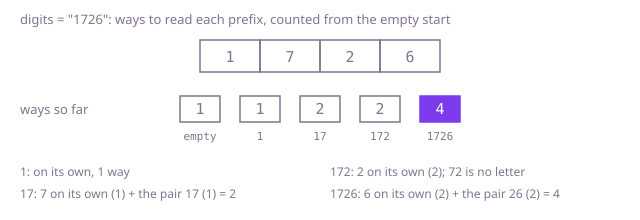

## The question

Each capital letter of a message was sent as its position in the alphabet, `A` as `1` up to `Z` as `26`, with no separators. Given the digits that arrived, count the messages that could have produced them.

What makes it harder than it looks is the zero. It is never a letter on its own, so it must belong to the digit before it, and only `10` and `20` exist: `"2101"` has a single reading and `"507"` has none. A pair like `05` is not a letter either, and neither is anything above 26, while `17` to `19` are. And the count grows like the Fibonacci numbers: 45 alternating twos and ones already have 1,836,311,903 readings, so trying them one by one is out.

## How to think about it

The first idea is to read the message from the front. Its first letter used either one digit, if that digit is not 0, or two, if they form 10 to 26; try both and count the readings of the rest. It is correct, but the rest is counted again for every way the front was read: in `"12121..."` the count from position 10 on is worked out once for each of the 89 readings of the first ten digits.

That count depends only on where the rest starts, so there are only n + 1 different questions. Remember each answer the first time it is computed and every position costs constant work. Or go forwards: the ways to read the first i digits are the ways for the first i − 1, if digit i is a letter on its own, plus the ways for the first i − 2, if the last two digits form a letter. Each step needs only the two counts before it, so two variables carry the whole string. Starting from one way to read nothing makes the first letter fit the same rule.

Walk Example 1, `digits = "1726"`. The empty start has 1 way. After `1`: it stands alone, 1 way. After `7`: `7` alone keeps the 1, and `17` adds the 1 from before the `1`, so 2. After `2`: `2` alone keeps the 2, and `72` is no letter, so still 2. After `6`: `6` alone keeps the 2, and `26` adds the 2 from before the `2`, so 4.



## Brute force

Read the first letter as one digit or as two, and count the readings of what is left. It comes first because it is the rule of the question written as code, and it fixes the counts every faster version must match. It is correct because every reading starts with a letter of one digit or of two, and the two branches cover exactly those that are letters: a remaining part that starts with 0 has no reading at all, and the pair is parsed only after that check, so its first digit is never 0.

```java
static int messages(String digits) {
    return readings(digits, 0);
}

/** How many ways the digits from position i to the end can be read. */
private static int readings(String digits, int i) {
    if (i == digits.length()) {
        return 1; // nothing left: the letters chosen so far are one message
    }
    if (digits.charAt(i) == '0') {
        return 0; // no letter is written starting with 0
    }
    int total = readings(digits, i + 1); // one digit, 1 to 9
    if (i + 1 < digits.length() && Integer.parseInt(digits.substring(i, i + 2)) <= 26) {
        total += readings(digits, i + 2); // two digits, 10 to 26: the first is not 0
    }
    return total;
}
```

**Complexity:** time O(φ^n) with φ ≈ 1.618, since a string where every neighbour pair is a letter branches like the Fibonacci numbers; extra space O(n) for the recursion, at most 100 deep, which fits in the stack: it simply never finishes on the long tests.

## Better: memoised recursion

The same recursion, with the count for each starting position stored the first time it is computed, so each position is worked out once.

```java
static int messages(String digits) {
    int[] memo = new int[digits.length()];
    Arrays.fill(memo, -1); // -1: not worked out yet; real counts are never negative
    return readings(digits, 0, memo);
}

private static int readings(String digits, int i, int[] memo) {
    if (i == digits.length()) {
        return 1;
    }
    if (memo[i] < 0) {
        int total = 0;
        if (digits.charAt(i) != '0') {
            total = readings(digits, i + 1, memo);
            if (i + 1 < digits.length() && Integer.parseInt(digits.substring(i, i + 2)) <= 26) {
                total += readings(digits, i + 2, memo);
            }
        }
        memo[i] = total;
    }
    return memo[i];
}
```

**Complexity:** time O(n), extra space O(n) for the memo and the recursion, at most 100 deep here, which fits in the stack; a string of ten thousand digits would already overflow it.

**Prefer it when:** you already have the recursion and want it fast with the least change, or you will walk the stored counts afterwards, for example to pick out the k-th message in alphabetical order without listing the ones before it.

## Optimal: two running counts

Walk the digits once, keeping the number of ways to read everything seen so far and everything but the last digit. Each new digit adds the first if it stands alone and the second if it pairs with the digit before it. This is the reference solution.

```java
static int messages(String digits) {
    int beforeLast = 0; // ways to read all but the last digit seen; unused until a second digit
    int last = 1; // ways to read the digits seen so far: one, the empty message, before the first
    for (int i = 0; i < digits.length(); i++) {
        int here = 0;
        if (digits.charAt(i) != '0') {
            here = last; // digit i is a letter on its own, 1 to 9
        }
        if (i > 0 && isLetterPair(digits.charAt(i - 1), digits.charAt(i))) {
            here += beforeLast; // digits i - 1 and i are one letter, 10 to 26
        }
        beforeLast = last;
        last = here;
    }
    return last;
}

/** Whether two digits form 10 to 26; a first digit of 0 never does. */
private static boolean isLetterPair(char first, char second) {
    return first == '1' || (first == '2' && second <= '6');
}
```

**Complexity:** time O(n), extra space O(1). The count for a prefix can pass the `int` range even when the answer does not, when the end of the string has no reading (98 alternating ones and twos followed by `50`); the code only adds, and Java's `int` addition wraps around exactly, so the final count is right whenever it fits, as the constraints promise.

## Complexity

| Approach | Time | Extra space |
| --- | --- | --- |
| Brute force | O(φ^n), φ ≈ 1.618 | O(n) recursion, at most 100 deep |
| Better: memoised recursion | O(n) | O(n), recursion at most 100 deep |
| Optimal: two running counts | O(n) | O(1) |

## Where it shows up

Any input written without separators in a code where pieces have different lengths has this shape: counting or choosing the ways to split a hashtag or a run of text without spaces into dictionary words, or checking whether a stream in a code that is not prefix-free can be split into code words at all, and in how many ways. Speech and handwriting recognisers do the same over a lattice of possible pieces, keeping the best score instead of the count.

## Follow-up answers

**What if some digits were unreadable and could stand for any digit from 1 to 9?** Keep the same two counts, but multiply by how many letters each choice can be. An unreadable digit alone is 9 letters; a `1` before it makes 9 pairs (11 to 19), a `2` makes 6 (21 to 26), and two unreadable digits make 15; an unreadable digit before a known one makes 2 pairs if that digit is 0 to 6 and 1 if it is 7 to 9. The counts grow quickly, so they are usually reported modulo a prime.

**What if you had to list every message, not just count them?** Then the output is the cost: up to about 2.1 billion messages under these constraints. Backtrack from the front, building the letters in one buffer, and use the stored counts for each starting position to skip any branch whose rest has no reading, so no time is spent on dead ends.

**What if the digit string were a million digits long?** The counts no longer fit any fixed-width number, so the question would ask for them modulo a prime such as 1,000,000,007; the two running counts work unchanged with the remainder taken after each addition, in O(n) time and O(1) space. The recursive versions would overflow the stack at that depth.
