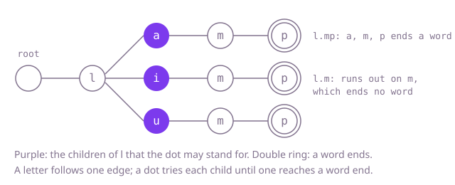

## The question

Build a dictionary that stores words and answers whether some stored word fits a pattern, where a dot in the pattern stands for exactly one unknown letter. A fit needs the same length and agreement at every position that is not a dot.

What makes it harder than it looks is that the dot breaks the usual shortcuts. A hash set answers plain lookups at once but has no idea what `l.mp` could be, and a prefix tree follows one edge per letter until it meets a dot, where it has no single edge to follow. Two smaller traps sit beside that: a dot never stands for zero letters (`ox.` does not fit `ox`), and reaching the end of the pattern only counts if a stored word ends there too (`l.m` fits nothing when only `lamp`, `limp` and `lump` are stored).

## How to think about it

The first idea is a list of words and a scan per search, comparing the pattern with each word of the same length. It is correct and it is what you say first, but with 50,000 words and 50,000 searches it makes billions of comparisons, nearly all against words that share nothing with the pattern.

The dots are few, at most two per pattern. That suggests the next step: keep a hash set and, for a pattern with dots, try every letter in each dot and look the result up. Two dots mean at most 26 × 26 = 676 lookups, which no longer depends on how many words are stored. It is still blind, though: it builds and hashes `lzmp` even when no stored word continues `lz`.

The step that removes the blindness is a trie, the tree with one edge per letter and a mark where a word ends. A plain letter follows one edge, as in an ordinary trie. A dot follows every edge that exists at that node and succeeds if any of them works out, so it only ever tries letters that continue some stored word. When the pattern runs out, the answer is whether the node is marked.

Walk Example 1. The words `lamp`, `limp` and `lump` share the node for `l`, which has three children: a, i and u, each followed by m and a marked p. For `l.mp`, the `l` follows one edge; the dot tries a first, then m and p follow single edges, and the p node is marked, so the answer is true without looking at i or u. For `l.m`, every branch ends on an m node with no mark, so the answer is false.



## Brute force

Keep the words in a list and compare the pattern with each one: lengths must be equal, and every position that is not a dot must hold the same letter. It comes first because it is the definition of a fit written as code, and it fixes the answer the faster versions must agree with. It is correct because it checks every stored word.

```java
private final List<String> words = new ArrayList<>();

void addWord(String word) {
    words.add(word); // a repeat is harmless: search only asks whether some word fits
}

boolean search(String pattern) {
    for (String word : words) { // compare against every stored word
        if (fits(word, pattern)) {
            return true;
        }
    }
    return false;
}

private static boolean fits(String word, String pattern) {
    if (word.length() != pattern.length()) {
        return false; // a dot stands for exactly one letter
    }
    for (int i = 0; i < word.length(); i++) {
        char ch = pattern.charAt(i);
        if (ch != '.' && ch != word.charAt(i)) {
            return false;
        }
    }
    return true;
}
```

**Complexity:** `addWord` O(1) amortized; `search` O(n × L) in the worst case for n stored words and a pattern of length L; extra space O(T) for T stored letters.

## Better: a hash set, filling in the dots

Store the words in a `HashSet`. A pattern without dots is one lookup. For a dot, put each letter from `a` to `z` in its place and continue with the rest of the pattern, so a pattern with d dots becomes at most 26^d plain lookups.

```java
private final Set<String> words = new HashSet<>();

void addWord(String word) {
    words.add(word);
}

boolean search(String pattern) {
    return fill(pattern.toCharArray(), 0);
}

// Tries every letter in the first dot at or after from, then the dots after it.
private boolean fill(char[] pattern, int from) {
    int dot = from;
    while (dot < pattern.length && pattern[dot] != '.') {
        dot++;
    }
    if (dot == pattern.length) {
        return words.contains(new String(pattern)); // no dots left: one plain lookup
    }
    boolean found = false;
    for (char ch = 'a'; ch <= 'z' && !found; ch++) {
        pattern[dot] = ch;
        found = fill(pattern, dot + 1);
    }
    pattern[dot] = '.'; // put the dot back for the caller's other letters
    return found;
}
```

**Complexity:** `addWord` O(L) on average; `search` O(26^d × L) on average for d dots, at most 676 lookups here; in the worst case each lookup costs O(L log n), because Java's `HashMap` turns a crowded bucket of `String` keys into a tree; extra space O(T).

**Prefer it when:** patterns rarely have dots and most searches are plain lookups. It is a few lines over a standard set, and its memory is one entry per word, where a trie spends 26 slots per node.

## Optimal: a trie that branches at dots

Store the words in a trie with 26 child slots per node and an end-of-word mark. Search recursively: a letter follows its one child, a dot tries every child that exists, and when the pattern runs out the node must be marked. This is the reference solution.

```java
private static final class Node {
    final Node[] children = new Node[26]; // one slot per letter
    boolean endsWord; // true when a stored word finishes at this node
}

private final Node root = new Node();

void addWord(String word) {
    Node node = root;
    for (int i = 0; i < word.length(); i++) {
        int slot = word.charAt(i) - 'a';
        if (node.children[slot] == null) {
            node.children[slot] = new Node();
        }
        node = node.children[slot];
    }
    node.endsWord = true;
}

boolean search(String pattern) {
    return matches(root, pattern, 0);
}

// True if some word below node spells pattern[i..] exactly; the depth is at most 20.
private static boolean matches(Node node, String pattern, int i) {
    if (i == pattern.length()) {
        return node.endsWord; // the pattern is used up: a word must end exactly here
    }
    char ch = pattern.charAt(i);
    if (ch != '.') {
        Node next = node.children[ch - 'a'];
        return next != null && matches(next, pattern, i + 1);
    }
    for (Node next : node.children) { // a dot: try every letter that continues some word
        if (next != null && matches(next, pattern, i + 1)) {
            return true;
        }
    }
    return false;
}
```

**Complexity:** `addWord` O(L) in the worst case; `search` O(L) in the worst case without dots and O(26^d × L) in the worst case with d dots, at most 676 paths here, and only paths that continue stored words are followed; extra space O(T × 26) in the worst case for the nodes, and a recursion depth of L, at most 20.

## Complexity

| Approach | `addWord` | `search` | Extra space |
| --- | --- | --- | --- |
| Brute force: list and scan | O(1) amortized | O(n × L) worst case | O(T) |
| Better: hash set, filling in the dots | O(L) average | O(26^d × L) average, O(26^d × L log n) worst | O(T) |
| Optimal: trie that branches at dots | O(L) worst case | O(26^d × L) worst case, O(L) without dots | O(T × 26) worst case, recursion depth L |

Here n is the number of stored words, L the length of the word or pattern, d the number of dots (at most 2) and T the total number of stored letters.

## Where it shows up

No coding-round problem is linked to this question. The same search runs in crossword and word-game helpers that fill in known letters, in spell checkers that look for every stored word one substitution away from a typo (try each position as a dot), and in lookup tables for codes with wildcard positions, such as matching part numbers where some characters are unknown.

## Follow-up answers

**What does a pattern made only of dots cost, and how would you make it cheap?** In the trie it visits every node at depths up to L, which can be most of the dictionary. Since only the length matters for such a pattern, keep a count of stored words per length and answer it with one lookup; more generally, store at each node the set of word lengths found below it and skip children that cannot reach the pattern's length.

**How would you also support a symbol that matches any run of letters, including none?** At that symbol, the search has two moves: let it match nothing and continue with the rest of the pattern at the same node, or let it swallow one more letter by moving to any child while staying on the symbol. Memoising on (node, pattern position) keeps this from repeating work.

**How would you count the stored words that match a pattern instead of answering yes or no?** Let the search return a count instead of a boolean: a marked node at the end of the pattern counts one, and a dot adds up the counts of all its children instead of stopping at the first success. Every matching path must now be walked, so the early exit is lost.
