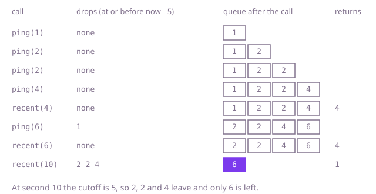

## The question

Build a small counter that records pings and, on request, says how many of them fall in the last `window` seconds ending at the current second. Calls arrive in non-decreasing time order.

What makes it harder than it looks: the window edge is half-open, so a ping exactly `window` seconds old is already out, and an off-by-one there is invisible until a test lands on it. Several pings can share one second, and a `recent` call can arrive many times without any new ping. And keeping every ping and scanning the whole list on each `recent` is quadratic over 200,000 calls.

## How to think about it

The first idea is to store every ping time in a list and count the recent ones on each `recent` call. It is correct and trivially so, but each query re-reads pings that are far too old to matter. Calls come in time order, so a ping that is too old now is too old for every later call too. That is the key: old pings can be thrown away for good, and the ones I keep are always the newest. Since the list is already in time order, a binary search can find the first recent ping without removing anything; that keeps the full history, which costs memory but answers a query in O(log n). Dropping the old pings instead leaves a queue with the oldest at the front, so each ping is added once and removed at most once, and the size of the queue is the answer.

Walk Example 1, with `window = 5`. Pings at 1, 2, 2 and 4 are stored. `recent(4)`: the cutoff is 4 - 5 = -1, nothing is at or before it, and the queue holds 4 pings, so the answer is 4. `ping(6)`: the cutoff is 1, so the ping at 1 leaves from the front, and 6 joins: the queue holds 2, 2, 4, 6. `recent(6)` is 4. `recent(10)`: the cutoff is 5, so 2, 2 and 4 leave, and only 6 is left: the answer is 1.



## Brute force

Keep every ping time in a list. On each `recent`, count the times with `now - window < t <= now`. It is what you say first, and it fixes the answer every faster version must agree with. It is correct because it applies the definition of recent to every ping ever recorded.

```java
class Pings {
    private final int window;
    private final List<Integer> times = new ArrayList<>(); // every ping ever recorded

    Pings(int window) {
        this.window = window;
    }

    void ping(int second) {
        times.add(second);
    }

    int recent(int second) {
        int count = 0;
        for (int time : times) {
            if (time > second - window && time <= second) { // the window is (second - window, second]
                count++;
            }
        }
        return count;
    }
}
```

**Complexity:** time O(1) per `ping` and O(p) per `recent` for p pings recorded so far, so O(n²) over n calls, extra space O(p).

## Better: keep the full history and binary-search it

Calls come in time order, so the stored times are sorted. Every stored ping is at or before `second`, so the recent ones are exactly the stored times after `second - window`, and they are a suffix of the list. A binary search finds where that suffix starts, and the count is the list size minus that position. Nothing is ever removed.

```java
class Pings {
    private final int window;
    private final List<Integer> times = new ArrayList<>(); // sorted, because calls come in time order

    Pings(int window) {
        this.window = window;
    }

    void ping(int second) {
        times.add(second);
    }

    int recent(int second) {
        int lo = 0, hi = times.size();
        while (lo < hi) { // first time later than second - window
            int mid = (lo + hi) >>> 1;
            if (times.get(mid) <= second - window) lo = mid + 1; else hi = mid;
        }
        return times.size() - lo;
    }
}
```

**Complexity:** time O(1) amortised per `ping` and O(log p) per `recent`, extra space O(p) for every ping ever recorded.

**Prefer it when:** you need the full history anyway, for example to answer a count for an earlier time (the third follow-up, which needs a second search for the end of the range), or to audit later. The queue cannot do that, because it has forgotten the old pings.

## Optimal: a queue that forgets old pings

Keep the ping times in a queue. Before recording a ping and before answering `recent`, remove from the front every time that is at or before `second - window`; those are out of the window for this call and every later one. What is left is exactly the recent pings, so `recent` returns the size. This is the reference solution.

```java
class Pings {
    private final int window;
    private final Deque<Integer> times = new ArrayDeque<>();

    Pings(int window) {
        this.window = window;
    }

    void ping(int second) {
        drop(second);
        times.addLast(second);
    }

    int recent(int second) {
        drop(second);
        return times.size();
    }

    private void drop(int second) {
        // the window is (second - window, second], so a time equal to second - window is out
        while (!times.isEmpty() && times.peekFirst() <= second - window) {
            times.removeFirst();
        }
    }
}
```

The subtraction `second - window` can go negative, which is fine for an `int` because both are at most a billion.

**Complexity:** time O(1) amortised per call (each ping is added once and removed at most once, though a single call may remove many), extra space O(number of pings inside the window).

## Complexity

| Approach | Time | Extra space |
| --- | --- | --- |
| Brute force: list of all pings, scan on `recent` | O(1) per `ping`, O(p) per `recent` | O(p) |
| Better: sorted history, binary search on `recent` | O(1) amortised per `ping`, O(log p) per `recent` | O(p) |
| Optimal: queue, drop from the front | O(1) amortised per call | O(pings inside the window) |

## Where it shows up

`rate-limiter-audit` uses this structure. Its `rejections` method walks one client's requests in time order with a deque of accepted times, drops every time at or before `at - windowMs` from the front, and rejects the request when the deque already holds `limit` times. It differs in what it stores: only accepted requests enter the deque, where this counter stores every ping. The window edge is the same half-open one, and its slow `countInWindow` is the brute force here, a scan of every time with `at > endMs - windowMs && at <= endMs`.

In practice the same structure backs a dashboard's "requests in the last minute", a login throttle ("no more than 5 attempts in 10 minutes"), and any metric that is a count over a sliding stretch of time.

## Follow-up answers

**What if a million pings arrive in the same second?** Store a count per second instead of one entry per ping: a queue of pairs of second and count, plus a running total. Adding a ping to the latest second is one increment, and dropping the oldest seconds subtracts their counts from the total. Space is bounded by the number of distinct seconds in the window.

**What if the counter must be safe to call from many threads?** The simple answer is to make the two methods synchronized, since both touch the queue. If that becomes a bottleneck, use a ring of per-second counters with atomic increments, which gives an approximate edge at the window boundary, and say so.

**How would you answer for an arbitrary earlier time, not only the latest?** Keep all the times in a sorted list and answer with two binary searches: the position of the first time greater than `second - window` and of the first greater than `second`, and subtract. That costs O(log n) per query but keeps all the history, which is the Better approach above with a second search.
