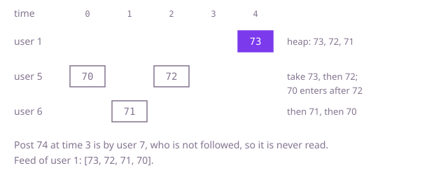

## The question

Design a small social app: users post, follow and unfollow each other, and ask for a feed of the ten newest posts by themselves and the people they follow. The feed reflects who they follow at the moment they ask.

What makes it harder than it looks: the easy feed walks the whole history of posts backwards until it has found ten it may show, and that is fast only while the people you follow post often. When the newest 100,000 posts are by strangers, every feed request walks past all of them. The small traps are in the rules: following yourself must not list your posts twice, unfollowing yourself must not hide them, and following someone twice is still one follow.

## How to think about it

The first design keeps one global list of posts in the order they were made, and a set of followees per user. A feed walks the list from the newest end and keeps each post whose author is the user or someone they follow, stopping at ten. It is correct and short, and it fixes the answer to compare against, but its cost depends on how many posts it has to skip.

The posts a feed can show come only from a few authors: the user and their followees. So keep the posts per author, in order. A feed is then "the ten newest among F + 1 ordered lists". A first way: take the last ten posts of each list, since nothing older can make the top ten, sort them all and keep ten. That never looks at a stranger's post.

That still sorts about ten posts per author to keep ten in total. Merging ordered lists is a heap's job: put the newest post of each author in a max-heap ordered by time, take the top, and replace it with the next older post by the same author. Ten pops later the feed is complete. This is the same shape as merging k sorted lists.

Walk Example 2. User 1 follows 5 and 6. In time order, 5 posts 70, 6 posts 71, 5 posts 72, 7 posts 74 and 1 posts 73. The visible lists are user 1: [73], user 5: [70, 72], user 6: [71]. The heap starts with each list's newest: 73, 72 and 71. Take 73; user 1 has nothing older. Take 72; user 5's next older post, 70, goes in. Take 71, then 70. The feed is `[73, 72, 71, 70]`, and post 74 was never looked at.



## Brute force

One list of all posts in posting order, and a set of followees per user. A feed walks the list backwards and keeps the posts by the user or a followee, up to ten. It comes first because it is the rules restated as code, and it fixes the answer to compare against. It is correct because it visits posts exactly newest first and checks each against who the user follows right now; the check `post[0] == userId` shows your own posts whatever the follow set holds, and each post is visited once, so following yourself cannot list it twice.

```java
class Twitter {
    private static final int FEED_SIZE = 10;
    private final List<int[]> timeline = new ArrayList<>(); // every post, {userId, tweetId}, oldest first
    private final Map<Integer, Set<Integer>> following = new HashMap<>();

    void postTweet(int userId, int tweetId) {
        timeline.add(new int[] {userId, tweetId});
    }

    List<Integer> getNewsFeed(int userId) {
        Set<Integer> authors = following.getOrDefault(userId, Set.of());
        List<Integer> feed = new ArrayList<>();
        for (int i = timeline.size() - 1; i >= 0 && feed.size() < FEED_SIZE; i--) {
            int[] post = timeline.get(i);
            if (post[0] == userId || authors.contains(post[0])) { // newest first, visible only
                feed.add(post[1]);
            }
        }
        return feed;
    }

    void follow(int followerId, int followeeId) {
        following.computeIfAbsent(followerId, u -> new HashSet<>()).add(followeeId);
    }

    void unfollow(int followerId, int followeeId) {
        Set<Integer> set = following.get(followerId);
        if (set != null) {
            set.remove(followeeId);
        }
    }
}
```

**Complexity:** `getNewsFeed` O(P) for P posts in total, since it may skip every post by a stranger; `postTweet` O(1) amortized, for the list append; `follow` and `unfollow` O(1) on average and O(log n) in the worst case, where Java turns a crowded hash bucket into a tree. Extra space O(P + E) for P posts and E follow links.

## Better: the last ten posts of each visible author, sorted

Keep each author's posts in their own list, oldest first, stamped with a global counter, and the followee sets as in the Optimal below. For a feed, collect the last ten posts of the user and of each followee, sort them newest first, and keep ten. This `getNewsFeed` and its helper drop into the Optimal class in place of its own.

```java
List<Integer> getNewsFeed(int userId) {
    List<int[]> candidates = new ArrayList<>(); // {time, tweetId}
    addRecent(candidates, userId);
    for (int author : following.getOrDefault(userId, Set.of())) {
        addRecent(candidates, author);
    }
    candidates.sort((a, b) -> Integer.compare(b[0], a[0])); // newest first
    List<Integer> feed = new ArrayList<>();
    for (int i = 0; i < Math.min(FEED_SIZE, candidates.size()); i++) {
        feed.add(candidates.get(i)[1]);
    }
    return feed;
}

private void addRecent(List<int[]> out, int author) {
    List<int[]> list = posts.getOrDefault(author, List.of());
    out.addAll(list.subList(Math.max(0, list.size() - FEED_SIZE), list.size())); // older ones cannot make the top ten
}
```

**Complexity:** `getNewsFeed` O(F log F) for F followees, sorting up to 10(F + 1) posts; the other calls as in the Optimal. Extra space O(F) per feed.

**Prefer it when:** you want the shortest code that is independent of strangers' posts: it is a collect-and-sort that anyone can check at a glance. It handles up to ten posts per author where the heap handles about one, so it does several times the work per feed, which matters only when users follow many people.

## Optimal: per-author lists merged with a heap

Each post gets a time from a counter and goes on its author's list. The follow sets never contain the user itself, so following yourself is ignored and your own list is always read. A feed puts one cursor per visible author into a max-heap by time, at that author's newest post; each pop adds a post to the feed and pushes the same author's next older post. This is the reference solution.

```java
class Twitter {
    private static final int FEED_SIZE = 10;
    private final Map<Integer, List<int[]>> posts = new HashMap<>(); // per user, {time, tweetId}, oldest first
    private final Map<Integer, Set<Integer>> following = new HashMap<>(); // never holds the user itself
    private int clock = 0;

    void postTweet(int userId, int tweetId) {
        posts.computeIfAbsent(userId, u -> new ArrayList<>()).add(new int[] {clock++, tweetId});
    }

    List<Integer> getNewsFeed(int userId) {
        // one cursor per author, {time, author, index}: the newest unread post of each on top
        PriorityQueue<int[]> newest = new PriorityQueue<>((a, b) -> Integer.compare(b[0], a[0]));
        addLatest(newest, userId);
        for (int author : following.getOrDefault(userId, Set.of())) {
            addLatest(newest, author);
        }
        List<Integer> feed = new ArrayList<>();
        while (feed.size() < FEED_SIZE && !newest.isEmpty()) {
            int[] top = newest.poll();
            List<int[]> list = posts.get(top[1]);
            feed.add(list.get(top[2])[1]);
            if (top[2] > 0) { // that author's next older post
                newest.add(new int[] {list.get(top[2] - 1)[0], top[1], top[2] - 1});
            }
        }
        return feed;
    }

    void follow(int followerId, int followeeId) {
        if (followerId != followeeId) {
            following.computeIfAbsent(followerId, u -> new HashSet<>()).add(followeeId);
        }
    }

    void unfollow(int followerId, int followeeId) {
        Set<Integer> set = following.get(followerId);
        if (set != null) {
            set.remove(followeeId);
        }
    }

    private void addLatest(PriorityQueue<int[]> newest, int author) {
        List<int[]> list = posts.get(author);
        if (list != null) {
            int last = list.size() - 1;
            newest.add(new int[] {list.get(last)[0], author, last});
        }
    }
}
```

**Complexity:** `getNewsFeed` O(F log F) to fill the heap with F + 1 cursors plus O(log F) for each of at most ten pops; `postTweet` O(1) amortized and average, O(log n) worst case from the hash map; `follow` and `unfollow` O(1) on average and O(log n) in the worst case, from the hash maps and sets. Each hash lookup in a feed has the same average and worst case. Extra space O(P + E) overall and O(F) per feed.

## Complexity

| Approach | getNewsFeed | Other calls | Extra space |
| --- | --- | --- | --- |
| Brute force | O(P), all posts in the worst case | postTweet O(1) amortized; follow, unfollow O(1) average, O(log n) worst case | O(P + E) |
| Better: last ten per author, sorted | O(F log F), about 10(F + 1) posts sorted | O(1) amortized and average, O(log n) worst case | O(P + E), O(F) per feed |
| Optimal: per-author lists and a heap | O(F log F + 10 log F) | O(1) amortized and average, O(log n) worst case | O(P + E), O(F) per feed |

## Where it shows up

No coding-round problem is linked to this question. The feed is a k-way merge of per-source streams, which is how real timelines are read when they are built at request time ("fan-out on read"), how an email client shows one inbox over several accounts, and how a log viewer interleaves the newest lines from many servers by timestamp. The same heap of cursors merges sorted runs on disk in external sorting.

## Follow-up answers

**What if some users had millions of followers and feeds had to load instantly?** Merging at read time costs work per followee on every request. The alternative is to do the work at write time ("fan-out on write"): each post is pushed into a stored, capped feed for each follower, so reading is a single lookup. That makes posting cost one write per follower, which is ruinous for an account with millions of followers, so large systems mix the two: fan out on write for ordinary accounts and merge the few very large accounts in at read time.

**How would you let a user page further back, ten posts at a time?** Keep the heap's idea, but let the caller pass where the last page ended, as the time of its last post. Each author's list is ordered, so binary search it for the first post older than that time, start a cursor there, and merge ten more. Each page then costs O(F log P) to place the cursors, plus the merge, and nothing is stored between requests.

**How would you add deleting a post?** Keep a map from tweet id to its author and position, and mark the post as deleted rather than shifting the list. The merge then skips marked posts and keeps popping until it has ten live ones. If many posts are deleted, compact an author's list now and then so the skips stay cheap.
