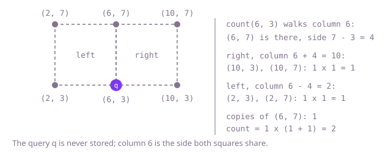

## The question

Store points on a grid, repeats included, and for a query point count the ways to choose three stored points that finish a square with it, sides along the axes and longer than 0. Each copy of a corner is a separate choice, so the counts multiply.

What makes it harder than it looks: the copies multiply fast, three corners added 2,000 times each give 8 billion ways, past what an `int` holds. Copies of the query point itself make no square, because the side would be 0, and a square whose far side would lie past the edge of the grid must be skipped, not looked up. And with tens of thousands of stored points and as many `count` calls, a `count` that looks at every stored point does billions of steps.

## How to think about it

A square with sides along the axes is fixed once you know the query corner and the corner diagonally opposite it. So the first idea is to try every stored point as that opposite corner: it must be off by the same amount, not 0, in x and in y; then the two remaining corners are known, and the number of ways is the copies of the opposite corner times the copies of each remaining corner. Keeping every copy in a list makes those copies a scan of the list, so a `count` can cost a scan per diagonal partner. Keeping the copies in a map from point to count makes each lookup O(1), and a `count` costs one pass over the distinct points.

That pass is still the waste: almost every stored point is nowhere near a diagonal of the query. Start from a different corner instead. A stored point in the query's own column, `(x, other)`, fixes the side, `side = other - y`, and then the square can only lie to the right, in column `x + side`, or to the left, in column `x - side`, with its far corners at heights `y` and `other`. That is two lookups per side, and only the query's column has to be walked. So keep the points by column: the copies of each point, and the list of distinct heights stored in each column. The coordinates stop at 1000, so the copies fit a 1001 x 1001 grid, with a column's array made when its first point arrives.

Walk Example 1. `count(6, 3)` walks column 6, which holds (6, 7): side 4. To the right, column 10 holds (10, 3) and (10, 7), one copy each: 1 way. To the left, column 2 holds (2, 3) and (2, 7): 1 way. (6, 7) has one copy, so the count is 1 × (1 + 1) = 2. `count(6, 7)` walks column 6 and finds only its own height, side 0, so it is 0.



## Brute force

Keep every added point in a list, copies included. For a query, take each listed point that is off by the same non-zero amount in x and in y as the opposite corner, and multiply the copies of the two remaining corners, found by scanning the list. It is what you say first, because it is the definition, and it fixes the answer the faster versions must agree with. It is correct because every square with the query as a corner has exactly one opposite corner, each copy of it is visited once, and each copy of the other two corners is counted by the scans.

```java
public class SquareFinder {
    private final List<int[]> points = new ArrayList<>(); // every added point, copies included

    void add(int x, int y) {
        points.add(new int[] {x, y});
    }

    long count(int x, int y) {
        long ways = 0;
        for (int[] far : points) { // each copy of the corner diagonally opposite the query
            int dx = far[0] - x;
            int dy = far[1] - y;
            if (dx != 0 && Math.abs(dx) == Math.abs(dy)) { // a square, not a line or a rectangle
                ways += copiesOf(far[0], y) * copiesOf(x, far[1]); // the two corners left to choose
            }
        }
        return ways;
    }

    private long copiesOf(int x, int y) {
        long copies = 0;
        for (int[] p : points) {
            if (p[0] == x && p[1] == y) {
                copies++;
            }
        }
        return copies;
    }
}
```

**Complexity:** `add` O(1) amortized; `count` O(N + D · N) for N stored copies of which D lie on the query's diagonals, O(N²) in the worst case; extra space O(N).

## Better: count the copies, try every point as the far corner

Keep a map from each point, packed as `1001 * x + y`, to its number of copies. A `count` walks the distinct points once, keeps those on a diagonal of the query, and looks up the copies of the two remaining corners in the map.

```java
public class SquareFinder {
    private final Map<Integer, Integer> copies = new HashMap<>(); // 1001 * x + y -> times added

    void add(int x, int y) {
        copies.merge(1001 * x + y, 1, Integer::sum);
    }

    long count(int x, int y) {
        long ways = 0;
        for (Map.Entry<Integer, Integer> far : copies.entrySet()) { // every distinct point as the far corner
            int fx = far.getKey() / 1001;
            int fy = far.getKey() % 1001;
            if (fx != x && Math.abs(fx - x) == Math.abs(fy - y)) {
                ways += (long) far.getValue() * copies.getOrDefault(1001 * fx + y, 0) * copies.getOrDefault(1001 * x + fy, 0);
            }
        }
        return ways;
    }
}
```

**Complexity:** `add` O(1) on average; `count` O(P) on average for P distinct points, O(P log P) in the worst case (Java's `HashMap` turns a crowded bucket of `Integer` keys into a tree); extra space O(P).

**Prefer it when:** the squares may be tilted. Trying every point as the opposite corner already covers every square with the query as a corner; only the formula for the two remaining corners changes (see the follow-up answers), where the column walk only ever finds squares with a vertical side.

## Optimal: walk the query's column

Index the points by column: a grid of copies, with a column's array made on its first point, and for each column the list of distinct heights stored in it. A `count` walks the query's column; each stored height fixes the side, and the two possible squares, to the right and to the left, need two lookups each. This is the reference solution.

```java
public class SquareFinder {
    private static final int SIZE = 1001; // coordinates run from 0 to 1000
    private final int[][] copies = new int[SIZE][]; // copies[x][y]: how often (x, y) was added; column x made on its first point
    private final int[][] ys = new int[SIZE][]; // ys[x]: the distinct y values stored in column x
    private final int[] distinct = new int[SIZE]; // distinct[x]: how many entries of ys[x] are in use

    void add(int x, int y) {
        if (copies[x] == null) {
            copies[x] = new int[SIZE];
            ys[x] = new int[SIZE];
        }
        if (copies[x][y]++ == 0) { // a new point joins its column's list once
            ys[x][distinct[x]++] = y;
        }
    }

    long count(int x, int y) {
        long ways = 0;
        for (int i = 0; i < distinct[x]; i++) {
            int other = ys[x][i];
            int side = other - y; // a stored point above or below the query fixes the side
            if (side != 0) { // side 0 is the query's own position, not a square
                ways += copies[x][other] * (farSide(x + side, y, other) + farSide(x - side, y, other));
            }
        }
        return ways;
    }

    private long farSide(int column, int y1, int y2) {
        if (column < 0 || column >= SIZE || copies[column] == null) {
            return 0;
        }
        return (long) copies[column][y1] * copies[column][y2];
    }
}
```

**Complexity:** `add` O(1); `count` O(K) for the K distinct points in the query's column, at most 1001; extra space O(1001 · C) for the C columns that hold a point, at most about two million `int`s (8 MB).

## Complexity

| Approach | Time | Extra space |
| --- | --- | --- |
| Brute force: a list of every copy | `add` O(1) amortized; `count` O(N + D · N), O(N²) worst case | O(N) |
| Better: copies per point, every point as the far corner | `add` O(1) average; `count` O(P) average, O(P log P) worst case | O(P) |
| Optimal: walk the query's column | `add` O(1); `count` O(K), K at most 1001 | O(1001 · C), at most 8 MB |

## Where it shows up

No coding-round problem is linked to this question. Bucketing points by column, or by grid cell, so that a query looks only at the points that can matter is spatial hashing, the index behind collision checks in games, snapping in drawing and CAD tools, and "what is near me" lookups in maps. Counting squares and rectangles among stored points is also a standard step in reading grid-like images, such as finding the corners of the cells of a scanned form.

## Follow-up answers

**What if the coordinates could be as large as 10^9?** The grid of copies no longer fits. Replace it with a hash map from column to a map from height to copies, or one map keyed by the point packed into a `long` (mix the two halves into the hash, or columns and rows collide). `count` still walks only the query's column, now O(K) on average per call, and the memory becomes O(P) for P distinct points.

**How would you also count squares tilted at any angle?** Use the Better shape: try every stored point p as the corner opposite the query q. The other two corners are the centre of qp plus and minus half of qp turned by 90 degrees: with dx = px - x and dy = py - y, they are ((x + px - dy) / 2, (y + py + dx) / 2) and ((x + px + dy) / 2, (y + py - dx) / 2), grid points only when those sums are even. Multiply the copies as before; that is O(P) per call, and for an axis-aligned square the same formula gives the corners used above.

**How would you support removing a point?** Decrement its copies. When they reach 0, take its height out of the column's list in O(1) by moving the column's last height into its place, which needs the position of each height in the list, kept in a second 1001-entry array per column. Leaving a dead height in the list also works, since it contributes 0 copies, but then a column that once held many points stays slow to walk.
