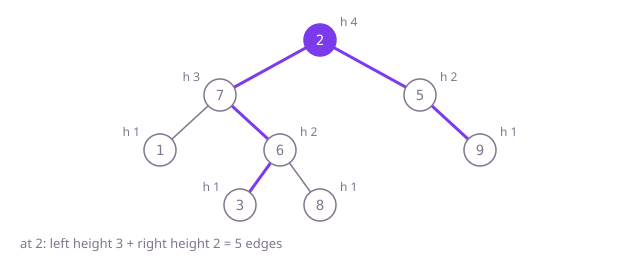

## The question

Given the root of a binary tree, return the number of edges on its longest path, where a path runs along parent-child links between any two nodes. The path may turn at any node, not only at the root.

What makes it harder than it looks: the natural first answer, left height plus right height at the root, is only the longest path that turns at the root. In Example 2 the best path turns at a child of the root and the root-only answer is one short. Counting nodes instead of edges is the other slip: a single node is a path of length 0. And recomputing heights at every node costs O(n·h), far more work than the answer needs.

## How to think about it

Every path has one highest node, where it turns from climbing to descending. The longest path that turns at a node goes as deep as possible into the left subtree and as deep as possible into the right one, so its length in edges is the height of the left subtree plus the height of the right subtree, with heights counted in nodes. The answer is the largest of those sums over all nodes.

The first idea computes those two heights from scratch at every node. That is correct, but each height walks a whole subtree, so a node deep in the tree is walked once for every ancestor: O(n·h). Remembering each height once (in a map) removes the repetition. The cleanest version notices that a function returning a node's height already has both child heights in hand just before it returns; that is exactly the moment to measure the path turning there. One post-order pass returns heights upward and records the best sum on the way.

Walk Example 1, `[2,7,5,1,6,null,9,null,null,3,8]`. Leaves 1, 3, 8 and 9 have height 1 and a turn of 0. At 6 the heights are 1 and 1: a turn of 2, height 2. At 7 they are 1 (from 1) and 2 (from 6): a turn of 3, height 3. At 5 they are 0 and 1: a turn of 1, height 2. At the root they are 3 and 2: a turn of 5, the largest, so the diameter is 5.



## Brute force

At every node, compute both subtree heights from scratch and take the best of the turn here and the best answers inside each subtree. It comes first because it is what you say first, and it fixes the answer to compare against. It is correct because every path turns at exactly one node, and at that node no path can beat left height plus right height.

```java
static int diameter(TreeNode root) {
    if (root == null) {
        return 0;
    }
    int through = height(root.left) + height(root.right); // heights recomputed at every node
    return Math.max(through, Math.max(diameter(root.left), diameter(root.right)));
}

private static int height(TreeNode node) {
    return node == null ? 0 : 1 + Math.max(height(node.left), height(node.right));
}
```

**Complexity:** time O(n·h), where h is the depth: each node's height is recomputed once for every ancestor, which is O(n²) on a path and O(n log n) on a balanced tree; extra space O(h) for the call stack, at most 1,000 frames here.

## Better: remember every height

Compute all heights once in a post-order pass and keep them in a map from node to height, then read both child heights at every node.

```java
static int diameter(TreeNode root) {
    Map<TreeNode, Integer> heights = new HashMap<>();
    fill(root, heights);
    int best = 0;
    for (TreeNode n : heights.keySet()) {
        best = Math.max(best, heights.getOrDefault(n.left, 0) + heights.getOrDefault(n.right, 0));
    }
    return best;
}

private static int fill(TreeNode node, Map<TreeNode, Integer> heights) {
    if (node == null) {
        return 0;
    }
    int h = 1 + Math.max(fill(node.left, heights), fill(node.right, heights));
    heights.put(node, h);
    return h;
}
```

**Complexity:** time O(n) on average; `TreeNode` keys use identity hash codes and are not `Comparable`, so if many hash codes collided a crowded bucket would be searched one entry at a time and the worst case is O(n²). Extra space O(n) for the map plus O(h) call stack.

**Prefer it when:** the heights are needed again afterwards, for example to answer many "longest path through this node" questions, since the map keeps them all.

## Optimal: one post-order pass

Let the height function do the measuring. It computes the left and right heights, records their sum if it beats the best so far, and returns one more than the larger. This is the reference solution.

```java
static int diameter(TreeNode root) {
    int[] best = {0};
    height(root, best);
    return best[0];
}

private static int height(TreeNode node, int[] best) {
    if (node == null) {
        return 0;
    }
    int left = height(node.left, best);
    int right = height(node.right, best);
    best[0] = Math.max(best[0], left + right); // edges: down left, down right, turning here
    return 1 + Math.max(left, right);
}
```

**Complexity:** time O(n), extra space O(h) for the call stack, at most 1,000 frames here; a path of tens of thousands of nodes would overflow Java's default stack.

## Complexity

| Approach | Time | Extra space |
| --- | --- | --- |
| Brute force | O(n·h): O(n²) on a path, O(n log n) balanced | O(h) call stack |
| Better: remember every height | O(n) average, O(n²) worst if hash codes collide | O(n) map plus O(h) call stack |
| Optimal: one post-order pass | O(n) | O(h) call stack, overflows on paths of tens of thousands |

## Where it shows up

No coding-round problem is linked to this question. The longest path in a tree shows up when estimating the worst-case hop count between two machines in a tree-shaped network, when finding the two most distant members of an organisation chart or a family tree, and in phylogenetics, where the longest path between two species in a tree helps place its centre (the midpoint of that path).

## Follow-up answers

**Why is computing the height at every node slow, and on which trees?** Each height call walks the whole subtree below it, so a node is walked once for every ancestor above it: O(n·h) in total. On a balanced tree h is about log n, so it is only O(n log n); on a tall, lopsided tree h approaches n and it becomes quadratic.

**How would you return the two end nodes of a longest path?** Make the height function also return the deepest node below it (a small record of height and node). At the node where the best sum is recorded, keep the deepest node from the left and the deepest node from the right; when a side is empty, the turning node itself is that end. Still O(n) time.

**What changes if each edge has a length and you want the longest total length?** Replace "height in nodes" with "longest downward distance": an empty side contributes 0, and a child contributes its own longest distance plus the length of the edge to it. The best turn at a node is the sum of its two sides, as before. With negative lengths a side may be better left out, so take the maximum of each side and 0.
