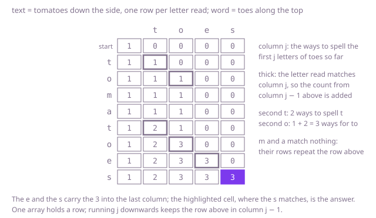

## The question

Given a text and a word, count the ways to strike letters out of the text so that the word is left: the different sets of positions of the text whose letters, in order, spell the word.

What makes it harder than it looks is that it asks how many, not whether. Example 1 has 3 ways, but checking whether `toes` is a subsequence of `tomatoes` says 1, and counting it as a run of letters side by side finds 1 too, the `toes` at the end. A repeated letter of the word must take different copies in the text: with one array of counts updated in the wrong direction, a single e of `coffee` fills both e's of `fee`, and the count comes out 6 instead of 2. And the counts on the way can dwarf the answer. With 300 a's, a b and 699 more a's as the text, and 300 a's and a b as the word, the answer is 1, since every a before the b must be kept; but the ways to spell 300 a's from the whole text number C(999, 300), 264 digits long. Checked arithmetic throws on that, and trying every way is exponential.

## How to think about it

The first idea is to walk the text from the front and decide for each letter: strike it out, or, when it matches the next letter of the word, keep it. The count is the sum of the counts of the two choices, and the word is spelled once its last letter is kept. It is correct, since every way is one sequence of such decisions, but the same question, how many ways to spell the word from position j on with the text from position i on, comes up along a great many paths.

There are only (n + 1) × (m + 1) such questions for a text of n letters and a word of m, so store each answer, or fill a table. Turned around to beginnings, `ways[i][j]` counts the ways to spell the first j letters of the word with the first i letters of the text: it is `ways[i - 1][j]`, striking out letter i, plus `ways[i - 1][j - 1]` when letter i of the text is letter j of the word and is kept. The empty beginning of the word has one way, striking out everything. Each row reads only the row above, so one array does it, if j runs downwards: then `ways[j - 1]` still holds the row above, the count without this letter. Running j upwards would add a count that already used this letter, so one copy of a letter would fill two places of the word.

The only arithmetic is addition. Java's `int` addition wraps around modulo 2^32, so every count in the array is right modulo 2^32 even when its true value has hundreds of digits, and the answer, being less than 2^31, comes out exact. Checked addition such as `Math.addExact` would throw on valid input; plain `int` or `long` addition is what is wanted.

Walk Example 1, `text = "tomatoes"`, `word = "toes"`, with one count each for the beginnings t, to, toe and toes. The first t makes t possible in 1 way, and the o after it makes to possible in 1 way. The m and the a match nothing. The second t brings t to 2 ways; the second o then adds those 2 to the 1 way for to, making 3. The e copies the 3 into toe and the s into toes: 3 ways.



## Brute force

Decide for each letter of the text, from the front, whether to strike it out or keep it as the next letter of the word. It comes first because it is the definition written as code, and it fixes the answers the faster versions must match. It is correct because each way is one set of kept positions, which is exactly one path of decisions through the recursion.

```java
static int ways(String text, String word) {
    return from(text, word, 0, 0);
}

/** Ways to spell word from position j on with the letters of text from position i on. */
private static int from(String text, String word, int i, int j) {
    if (j == word.length()) {
        return 1; // the word is spelled: strike out the rest of the text
    }
    if (i == text.length()) {
        return 0; // the text ran out before the word did
    }
    int ways = from(text, word, i + 1, j); // strike out text[i]
    if (text.charAt(i) == word.charAt(j)) {
        ways += from(text, word, i + 1, j + 1); // or keep it as word[j]
    }
    return ways;
}
```

**Complexity:** time exponential, up to about 2^n calls when the letters keep matching; extra space O(n) for the recursion, at most 1,001 deep, which fits in the stack.

## Better: memoised recursion

The same recursion, with the answer for each pair of positions stored the first time it is worked out.

```java
static int ways(String text, String word) {
    int[][] memo = new int[text.length()][word.length()];
    for (int[] row : memo) {
        Arrays.fill(row, -1); // -1: not worked out yet; the counts stored are 0 or more
    }
    return from(text, word, 0, 0, memo);
}

private static int from(String text, String word, int i, int j, int[][] memo) {
    if (j == word.length()) {
        return 1;
    }
    if (i == text.length()) {
        return 0;
    }
    if (memo[i][j] < 0) {
        int ways = from(text, word, i + 1, j, memo);
        if (text.charAt(i) == word.charAt(j)) {
            ways += from(text, word, i + 1, j + 1, memo);
        }
        memo[i][j] = ways;
    }
    return memo[i][j];
}
```

**Complexity:** time O(n × m), extra space O(n × m) for the memo, about 4 MB at 1,000 by 1,000, plus the recursion, at most 1,001 deep, which fits in the stack.

**Prefer it when:** you want every stored count to be a real count rather than a value modulo 2^32. Each one is the number of ways to finish a choice that has already spelled the first j letters, so none is larger than the answer and nothing wraps, which matters if you inspect the counts or switch to checked arithmetic. It does not save work: the memo is allocated and filled for every pair of positions before the search starts.

## Optimal: one array, word positions downwards

One count per beginning of the word, starting with 1 for the empty one. For each letter of the text, run the word positions downwards and, where the letter matches, add the count for the beginning one letter shorter. This is the reference solution.

```java
static int ways(String text, String word) {
    int m = word.length();
    int[] ways = new int[m + 1]; // ways[j]: ways to spell the first j letters of word from the text read so far
    ways[0] = 1; // the empty start of the word: strike out everything read so far
    for (int i = 0; i < text.length(); i++) {
        char letter = text.charAt(i);
        // downwards, so ways[j - 1] still leaves this letter unused and it is used once at most
        for (int j = m; j >= 1; j--) {
            if (word.charAt(j - 1) == letter) {
                ways[j] += ways[j - 1]; // may wrap for short prefixes; ways[m] stays right modulo 2^32
            }
        }
    }
    return ways[m];
}
```

**Complexity:** time O(n × m), extra space O(m). Counts other than the answer may wrap around; the answer is exact because it is less than 2^31.

## Complexity

| Approach | Time | Extra space |
| --- | --- | --- |
| Brute force | exponential, up to about 2^n calls | O(n) recursion, at most 1,001 deep |
| Better: memoised recursion | O(n × m) | O(n × m), recursion at most 1,001 deep |
| Optimal: one array, word positions downwards | O(n × m) | O(m) |

## Where it shows up

Counting how often a sequence occurs with gaps is common in analytics: how many times a log of user events contains view, then add to basket, then pay, in that order, is this count over event types instead of letters. In biology it counts the ways a short motif can be read out of a longer sequence with gaps. The same table with probabilities instead of counts sums over every alignment of a noisy input to a word, the way the forward algorithm of a hidden Markov model does in speech and handwriting recognition.

## Follow-up answers

**What if the count could be far larger than 2^31 and had to be reported modulo 10^9 + 7?** Reduce after every addition: `ways[j] = (ways[j] + ways[j - 1]) % 1_000_000_007`. Both terms are below the modulus, so the sum fits an `int`. Wrap-around no longer helps, because a count wrapped modulo 2^32 says nothing about its remainder modulo 10^9 + 7, so the reduction has to happen at every step. For the exact count, use `BigInteger`, at the cost of numbers hundreds of digits long.

**What if text were a million letters long and word only a few letters?** The same loop is a few million steps and the array has only m + 1 entries, so it already fits. To skip the positions a letter cannot match, list for each letter the positions where it occurs in the word, in decreasing order, and visit only those; each letter of the text then costs as many steps as it has copies in the word.

**What if the letters of word had to sit side by side in text?** Then each way is a starting position where the text continues with exactly the word, and the count is the number of such positions, overlaps included. Comparing at every position costs O(n × m); the Knuth–Morris–Pratt or Z-algorithm finds all of them in O(n + m).
