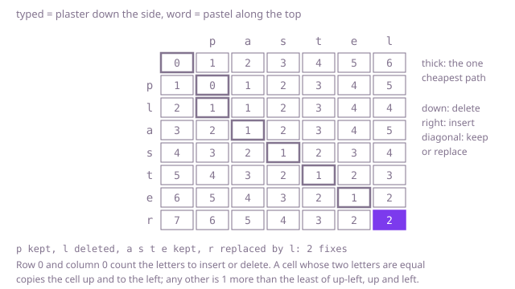

## The question

Given a typed word and the word that was meant, return the fewest fixes that turn one into the other, where a fix inserts a letter, deletes one or replaces one with another.

What makes it harder than it looks is that the quick measures each miss a kind of fix. Comparing the words position by position breaks as soon as one letter is missing or extra: in Example 1 it finds five of the six pairs different and the r left over, 6 in all, yet deleting the l lines up all but the last letter. Counting only deletions and insertions, which is what the longest common subsequence gives, misses that a replacement does in one fix what a deletion and an insertion do in two: Example 1 then takes 3. And trying every sequence of fixes branches three ways at every pair of letters that differ.

## How to think about it

The first idea is to compare the first letters of the two words. If they are equal, keep them and solve the rest of both. That is never worse: putting one letter on the front of a word, or taking it off, changes how far it is from the other word by at most one fix, so spending a fix on either of the two equal letters cannot beat pairing them for free. If the first letters differ, the cheapest way starts with a fix on one of them: replace the typed letter with the wanted one and solve the rest of both, delete the typed letter and solve the rest of `typed` against all of `word`, or insert the wanted letter and solve all of `typed` against the rest of `word`. Take the cheapest of the three and add one. It is correct, but every difference splits it in three, and the same pair of suffixes is reached along a huge number of paths.

The answer depends only on where each word's rest starts, so there are only (n + 1) × (m + 1) different questions. Turn it around to beginnings and fill a table: `fix[i][j]` is the fewest fixes turning the first `i` letters of `typed` into the first `j` letters of `word`. An empty beginning of `typed` needs `j` insertions, and turning `i` letters into nothing needs `i` deletions, so row 0 counts up along the top and column 0 down the side. When the two last letters are equal, `fix[i][j]` is `fix[i - 1][j - 1]`. Otherwise it is one more than the smallest of `fix[i - 1][j - 1]` (replace the last typed letter), `fix[i - 1][j]` (delete it) and `fix[i][j - 1]` (insert the last letter of `word`). Each row reads only the row above and itself, so two rows are enough.

Walk Example 1, `typed = "plaster"` down the side and `word = "pastel"` along the top. The p's meet at cell (1, 1), which copies the 0 from the corner. The l has no partner: cell (2, 1) is 1, reached by deleting it. From there the a, s, t and e of `plaster` each meet their twins in `pastel` on a diagonal, and the 1 carries along to cell (6, 5). The last cell sets the r of `plaster` against the l of `pastel`: replacing it costs 1 + `fix[6][5]` = 2, while deleting it or inserting the l both cost 1 + 2 = 3. The answer is 2.



## Brute force

Compare the first letters: keep them when equal, otherwise try all three fixes on them. It comes first because it is the rule above written as code, and it fixes the answers the faster versions must match. It is correct because every way of turning one word into the other starts by keeping the first letters, or by one of the three fixes on them, and keeping equal letters is never worse, as argued above.

```java
static int fewestFixes(String typed, String word) {
    return from(typed, word, 0, 0);
}

/** The fewest fixes turning typed from position i on into word from position j on. */
private static int from(String typed, String word, int i, int j) {
    if (i == typed.length()) {
        return word.length() - j; // insert the rest of word
    }
    if (j == word.length()) {
        return typed.length() - i; // delete the rest of typed
    }
    if (typed.charAt(i) == word.charAt(j)) {
        return from(typed, word, i + 1, j + 1); // equal first letters: keeping them is never worse
    }
    int replace = from(typed, word, i + 1, j + 1);
    int delete = from(typed, word, i + 1, j);
    int insert = from(typed, word, i, j + 1);
    return 1 + Math.min(replace, Math.min(delete, insert));
}
```

**Complexity:** time exponential, up to 3^(n + m) calls when the letters keep differing; extra space O(n + m) for the recursion, at most 1,001 calls deep at 500 letters each, which fits the test thread's stack.

## Better: a table over every pair of beginnings

Fill `fix[i][j]` for every pair of beginnings, row by row, from the rule above. The bottom-right cell is the answer.

```java
static int fewestFixes(String typed, String word) {
    int n = typed.length();
    int m = word.length();
    int[][] fix = new int[n + 1][m + 1]; // fix[i][j]: the first i letters of typed into the first j of word
    for (int i = 0; i <= n; i++) {
        fix[i][0] = i; // delete all i letters
    }
    for (int j = 0; j <= m; j++) {
        fix[0][j] = j; // insert all j letters
    }
    for (int i = 1; i <= n; i++) {
        for (int j = 1; j <= m; j++) {
            if (typed.charAt(i - 1) == word.charAt(j - 1)) {
                fix[i][j] = fix[i - 1][j - 1]; // equal last letters: keep them
            } else {
                fix[i][j] = 1 + Math.min(fix[i - 1][j - 1], Math.min(fix[i - 1][j], fix[i][j - 1]));
            }
        }
    }
    return fix[n][m];
}
```

**Complexity:** time O(n × m), extra space O(n × m), about 1 MB at 500 by 500.

**Prefer it when:** you need the fixes themselves and not just their number. The full table lets you walk back from the corner and read them off, which two rows cannot.

## Optimal: two rows

The same rule, keeping only the row above and the row being filled, and swapping them after each row. This is the reference solution.

```java
static int fewestFixes(String typed, String word) {
    // prev[j]: the fewest fixes turning the first i - 1 letters of typed into the first j of word
    int[] prev = new int[word.length() + 1];
    int[] cur = new int[word.length() + 1];
    for (int j = 0; j <= word.length(); j++) {
        prev[j] = j; // nothing typed: insert all j letters
    }
    for (int i = 1; i <= typed.length(); i++) {
        cur[0] = i; // nothing of word wanted: delete all i letters
        for (int j = 1; j <= word.length(); j++) {
            if (typed.charAt(i - 1) == word.charAt(j - 1)) {
                cur[j] = prev[j - 1]; // equal last letters: keep them, no fix
            } else {
                // replace the last typed letter, delete it, or insert the last letter of word
                cur[j] = 1 + Math.min(prev[j - 1], Math.min(prev[j], cur[j - 1]));
            }
        }
        int[] done = prev;
        prev = cur;
        cur = done; // reused for the next row; every entry is overwritten
    }
    return prev[word.length()];
}
```

**Complexity:** time O(n × m), extra space O(m). A deletion one way is an insertion the other way, so the answer does not change when the words swap places, and passing the shorter one as `word` makes the space O(min(n, m)).

## Complexity

| Approach | Time | Extra space |
| --- | --- | --- |
| Brute force | exponential, up to 3^(n + m) calls | O(n + m) recursion, at most 1,001 deep |
| Better: a table over every pair of beginnings | O(n × m) | O(n × m) |
| Optimal: two rows | O(n × m) | O(m) |

## Where it shows up

Spell checkers and search boxes rank their "did you mean" suggestions by this distance, often with a trie or a cap on the distance so as not to compare against every word in full. Deduplicating names and addresses in customer records compares entries the same way, and so does fuzzy matching of file names. With costs per letter pair instead of 1 for every fix, the same table aligns DNA and protein sequences.

## Follow-up answers

**What if you also had to list the fixes?** Keep the full table and walk back from the corner. Where the two letters are equal and the cell equals the one up and to the left, keep them and step diagonally; otherwise step to a neighbour whose value is one less: up and to the left is a replacement, up is a deletion, left is an insertion. Stop at the top-left corner and reverse the list. Several lists can be cheapest, and the choice on a tie picks one; the walk adds O(n + m) to the O(n × m) table.

**What if you only had to know whether the two words are at most k fixes apart, for a small k?** A cell `fix[i][j]` is at least |i − j|, since the lengths differ by that much, so only the cells within k of the diagonal can hold k or less. Fill that band of width 2k + 1, treating the cells outside it as more than k, and stop as soon as a whole band row is above k. That is O(k × n) time, and if the lengths differ by more than k the answer is no at once.

**What if swapping two neighbouring letters also counted as one fix?** Add a fourth case: when the last two letters of the typed beginning are the last two of the word's beginning in the other order, `fix[i][j]` may also be `fix[i - 2][j - 2] + 1`. That needs three rows instead of two. A typo such as `brigde` for `bridge` then costs 1 instead of 2. This version never edits a swapped pair again; allowing that as well needs a further table of where each letter was last seen.
