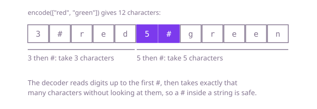

## The question

Pack a list of strings into one string, then unpack it again so the original list comes back exactly: same strings, same order, same count. The decoder may run on a different object from the encoder, so nothing can be kept between the two calls.

What makes it harder than it looks is that the decoder must find where each string ends, and the strings may contain anything. A comma, a `#`, digits that look like a length and an empty string are all legal. Two lists must also never share an encoding: `[]` and `[""]` differ, and so do `["a", "b"]` and `["ab"]`.

## How to think about it

The first idea is a separator: join the strings with a comma. It breaks the moment a string contains a comma. The usual repair is to escape the comma and the escape character, and end every string with a separator so that an empty list and a list of one empty string stay different. That works, but the decoder now has to look at every character, tracking whether the last one was an escape. The better idea is to stop searching for the end and write it down: put the length in front of each string. The decoder reads the length, then takes exactly that many characters without reading them as structure, so whatever the content holds cannot confuse it. What is left is how the decoder finds the end of the length itself. A fixed width does it with no search, and a marker after the digits does it with no wasted width.

Walk Example 1, `["red", "green"]`, with a length, a `#` marker and then the string. The encoding is `3#red5#green`. The decoder reads digits up to the first `#` and gets 3, takes the next 3 characters, `red`, then reads digits up to the next `#`, gets 5, and takes `green`. The text is used up, so it stops. In Example 2, `["3#ab", "#"]` becomes `4#3#ab1##`: after reading 4, the decoder takes `3#ab` as plain content and never reads its `3#` as structure. A list with one empty string becomes `0#`, and the empty list becomes the empty text, so those two stay different.



## Brute force

Write every string with its characters escaped, followed by a terminator. Use a comma as the terminator and a backslash as the escape: a comma or a backslash inside a string is written with a backslash before it. It is the first design most people reach for, and it is correct because every real comma in the output is a terminator, since a comma from the content always comes with a backslash in front, and a backslash in the content is itself escaped. `[]` encodes to the empty text and `[""]` to a single comma, so they differ.

```java
String encode(List<String> strings) {
    StringBuilder out = new StringBuilder();
    for (String s : strings) {
        for (char c : s.toCharArray()) {
            if (c == ',' || c == '\\') {
                out.append('\\'); // escape the terminator and the escape itself
            }
            out.append(c);
        }
        out.append(','); // terminator after every string, so [] and [""] differ
    }
    return out.toString();
}

List<String> decode(String text) {
    List<String> result = new ArrayList<>();
    StringBuilder current = new StringBuilder();
    for (int i = 0; i < text.length(); i++) {
        char c = text.charAt(i);
        if (c == '\\') {
            current.append(text.charAt(++i)); // the next character is content, whatever it is
        } else if (c == ',') {
            result.add(current.toString()); // an unescaped comma ends the string
            current.setLength(0);
        } else {
            current.append(c);
        }
    }
    return result;
}
```

**Complexity:** with n the total number of characters, time O(n) for both methods and extra space O(n). The encoded text can be up to twice as long as the input when every character needs an escape. Every character of the content is inspected on both sides.

## Better: fixed-width length prefix

Write each string's length in a fixed number of digits, then the string. The decoder reads exactly that many digits, so there is no marker to search for, and it takes the next `length` characters without inspecting them. The width must cover the largest possible length: the whole input is at most 2,000,000 characters, so 7 digits are enough.

```java
String encode(List<String> strings) {
    StringBuilder out = new StringBuilder();
    for (String s : strings) {
        out.append(String.format("%07d", s.length())).append(s); // 7 digits hold any length up to 9,999,999
    }
    return out.toString();
}

List<String> decode(String text) {
    List<String> result = new ArrayList<>();
    int pos = 0;
    while (pos < text.length()) {
        int length = Integer.parseInt(text.substring(pos, pos + 7)); // always exactly 7 digits
        pos += 7;
        result.add(text.substring(pos, pos + length)); // take that many characters, whatever they are
        pos += length;
    }
    return result;
}
```

**Complexity:** time O(n) with n the total number of characters, plus the number of strings for the headers, extra space O(n). The header costs 7 characters per string however short the string is.

**Prefer it when:** the format must be read at fixed offsets and you know a maximum length. The header is always the same size, so a reader can find the length field without scanning for anything. It is a poor fit for many short strings (7 characters of header for a one-letter string), and it silently breaks for a string longer than the width allows.

## Optimal: length, marker, content

Write the length in as many digits as it needs, then a `#`, then the string. The first `#` after the position is always the end of the length, because everything before it is digits; whatever comes after it is content, taken by count. No width limit, no wasted digits, and the decoder never reads content as structure. This is the reference solution.

```java
String encode(List<String> strings) {
    StringBuilder out = new StringBuilder();
    for (String s : strings) {
        out.append(s.length()).append('#').append(s); // length, marker, then the raw content
    }
    return out.toString();
}

List<String> decode(String text) {
    List<String> result = new ArrayList<>();
    int pos = 0;
    while (pos < text.length()) {
        int marker = text.indexOf('#', pos); // the first marker after pos is ours: the prefix is only digits
        int length = Integer.parseInt(text.substring(pos, marker));
        pos = marker + 1;
        result.add(text.substring(pos, pos + length)); // take exactly length characters, whatever they are
        pos += length;
    }
    return result;
}
```

**Complexity:** time O(n) with n the total number of characters, plus the number of strings for the headers, extra space O(n). The decoder inspects only the digits and markers, never the content, and each string costs its length plus the digits of its length plus one marker.

## Complexity

All three encodings are linear in the total number of characters, since the input is read once and the output written once; they differ in how much text they produce and in what the decoder must read.

| Approach | Time | Extra space |
| --- | --- | --- |
| Brute force: terminator and escaping | O(n), reads every character | O(n), output up to 2n |
| Better: fixed-width length prefix | O(n) | O(n), 7 characters per string |
| Optimal: length, marker, content | O(n) | O(n), digits of the length plus 1 per string |

## Where it shows up

Length-prefixed fields are how many wire formats are framed: network protocols, binary file formats and message queues write a size before a payload so the reader knows how much to take. Storing several values in one text column or one cache entry has the same problem, and the same fix. Escaping is the other family, found in CSV files and in shell and URL quoting.

## Follow-up answers

**How would you change it to read the encoded text as a stream, without holding all of it in memory?** The format already allows it. Read characters until the marker to get the length, then read that many characters and hand the string on. Only one string is in memory at a time.

**What if the strings were bytes, not characters?** Write the length as a fixed-width integer, say four bytes, instead of digits and a marker. The decoder then reads four bytes, then that many bytes. The prefix has a fixed size, so no marker is needed at all.

**How would you version the format so older encoded data stays readable?** Start the encoded data with a version number, written in the same length-prefixed style. The decoder reads it first and picks the matching reader, so a new format never has to guess whether old data is new.
