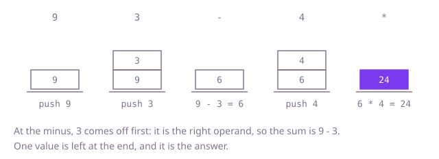

## The question

An arithmetic expression is written in postfix order: each operator follows the two values it applies to. Given the tokens, compute the value, with division rounding towards zero.

What makes it harder than it looks: the order of the operands. In `3 9 -` the value read first is the left operand, so the result is `3 - 9`, not `9 - 3`. A token like `"-5"` is a number, while `"-"` alone is the operator. Division of a negative number must round towards zero, not down. And a long expression can hold tens of thousands of values waiting for their operators, which matters for anything recursive.

## How to think about it

The first idea is to apply the operators one at a time: find the first operator in the list, which must have two numbers right before it, replace those three tokens with the result, and repeat until one token is left. It is correct, and it is slow for the same reason each time: every collapse shifts the rest of the list, and the search for the first operator starts from the front again. Look at what is actually needed. An operator uses the two values read most recently that nobody has used yet, and leaves one value that later operators may use. So the only things worth remembering are the values still waiting, and the one that matters next is always the newest. That is a stack: push numbers, and at an operator pop two, compute, and push the result.

Walk Example 1, `tokens = ["9", "3", "-", "4", "*"]`. Push 9, then 3: the stack holds 9, 3. At `-`, pop 3 (the right operand) and then 9 (the left), compute 9 - 3 = 6 and push 6. Push 4: the stack holds 6, 4. At `*`, pop 4 and 6, push 6 * 4 = 24. One value is left, 24. The order in which the two are popped is the point: the first pop gives the right operand.



## Brute force

Keep the tokens in a list. Find the first operator, which must have two numbers directly before it, because everything to its left is a number. Replace the two numbers and the operator by their result, and repeat until one token remains. It is what you say first, and it fixes the answer every faster version must agree with. It is correct because evaluating the first operator on the two values just before it is always a valid step of the expression, and each step leaves a shorter valid expression.

```java
static int evaluate(String[] tokens) {
    List<String> list = new ArrayList<>(Arrays.asList(tokens));
    while (list.size() > 1) {
        int at = 0;
        while (!isOperator(list.get(at))) {
            at++; // the first operator always has two numbers before it
        }
        int left = Integer.parseInt(list.get(at - 2));
        int right = Integer.parseInt(list.get(at - 1));
        int result = switch (list.get(at).charAt(0)) {
            case '+' -> left + right;
            case '-' -> left - right;
            case '*' -> left * right;
            default -> left / right; // Java rounds towards zero
        };
        list.set(at - 2, String.valueOf(result));
        list.remove(at); // two removals shift the rest of the list each time
        list.remove(at - 1);
    }
    return Integer.parseInt(list.get(0));
}

private static boolean isOperator(String token) {
    return token.length() == 1 && "+-*/".indexOf(token.charAt(0)) >= 0; // "-5" has length 2
}
```

**Complexity:** time O(n²), since there are about n / 2 collapses and each searches from the front and shifts the rest of the list; extra space O(n) for the list.

## Better: recursion from the last token

The last token is the root of the expression: an operator, whose right operand is the expression just before it, and whose left operand is the expression before that. Walking from the end, a function takes the next token: a number is returned as it is, and an operator evaluates its right operand first and then its left. One shared position moves backwards through the tokens, so each token is read exactly once.

```java
static int evaluate(String[] tokens) {
    int[] next = {tokens.length - 1}; // the position to read, moving left
    return evalFrom(tokens, next);
}

private static int evalFrom(String[] tokens, int[] next) {
    String token = tokens[next[0]--];
    if (!(token.length() == 1 && "+-*/".indexOf(token.charAt(0)) >= 0)) {
        return Integer.parseInt(token); // a number, including "-5"
    }
    int right = evalFrom(tokens, next); // read backwards, so the right operand comes first
    int left = evalFrom(tokens, next);
    return switch (token.charAt(0)) {
        case '+' -> left + right;
        case '-' -> left - right;
        case '*' -> left * right;
        default -> left / right; // Java rounds towards zero
    };
}
```

**Complexity:** time O(n), extra space O(d) for the call stack, where d is the depth of the expression, up to n / 2; for this question the depth can reach about 5 * 10^4, and the recursion overflows Java's default call stack there (the 50,000-operand test fails with a stack overflow).

**Prefer it when:** the expressions are shallow and you want the structure of the expression (the calls follow its tree). It is the wrong choice for this question's inputs, since a long chain of additions makes the calls as deep as the expression, and here the depth can reach about 5 * 10^4, which overflows Java's default call stack: the 50,000-operand test fails with a stack overflow.

## Optimal: a stack of values

Push each number. At an operator, pop the right operand, then the left, apply the operator and push the result. At the end one value is left. An `int` array as the stack avoids the call-stack depth limit and the boxing of a `Deque<Integer>`. This is the reference solution.

```java
static int evaluate(String[] tokens) {
    int[] stack = new int[tokens.length];
    int size = 0;
    for (String token : tokens) {
        if (token.length() == 1 && "+-*/".indexOf(token.charAt(0)) >= 0) {
            int right = stack[--size]; // the value read last is the right operand
            int left = stack[--size];
            int result = switch (token.charAt(0)) {
                case '+' -> left + right;
                case '-' -> left - right;
                case '*' -> left * right;
                default -> left / right; // Java rounds towards zero
            };
            stack[size++] = result;
        } else {
            stack[size++] = Integer.parseInt(token); // "-5" is a number
        }
    }
    return stack[0];
}
```

**Complexity:** time O(n), extra space O(n) (up to about n / 2 values can wait on the stack at once).

## Complexity

| Approach | Time | Extra space |
| --- | --- | --- |
| Brute force | O(n²) | O(n) |
| Better: recursion from the last token | O(n) | O(d) call stack, up to O(n); about 5 * 10^4 for this question, which overflows |
| Optimal: a stack of values | O(n) | O(n) |

## Where it shows up

No coding-round problem is linked to this question. Postfix is how calculators and stack-based virtual machines run arithmetic: the bytecode of the JVM and of WebAssembly pushes operands and applies operators to the top of an operand stack, which is exactly this loop. Spreadsheet engines and expression evaluators in rule engines often compile a formula to postfix once and then evaluate it many times, since the evaluation needs no brackets and no precedence rules.

## Follow-up answers

**How would you convert an ordinary infix expression with brackets into this form?** Use a stack of operators (the shunting-yard method). Output numbers at once. When an operator arrives, first pop and output every operator on the stack with higher precedence, or equal precedence for a left-associative one, then push the new one. Push an opening bracket; on a closing bracket pop and output operators down to the opening bracket. At the end pop whatever is left.

**How would you report a malformed expression instead of assuming it is valid?** Check before each pop. An operator that finds fewer than two values on the stack is missing an operand, an unknown token that is neither a number nor an operator is an error, and at the end the stack must hold exactly one value; more than one means operands were left over. Division by zero and an overflow of `int` are checked at the operation, for example with `Math.addExact`.

**What changes if the numbers can be decimals?** Store `double` values on the stack and parse with `Double.parseDouble`, and divide without any rounding rule. Money needs `BigDecimal` instead, because binary fractions such as 0.1 cannot be held exactly. A token such as `"-5.5"` is still told apart from the operator by its length, as before.
