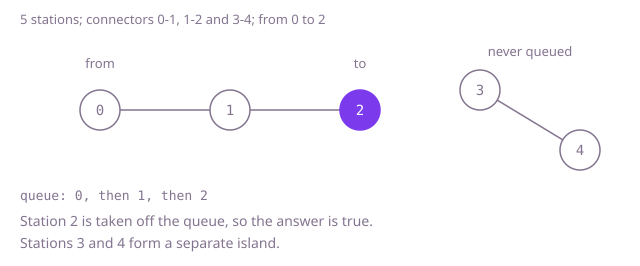

## The question

You get a network of stations joined by two-way connectors, and two stations. Say whether a rider can get from one to the other by following connectors, changing at any station along the way.

What makes it harder than it looks: the connectors are given as a flat list, but the natural question is "who is next to this station", so the first job is to turn the list into something you can ask that of. Connectors run both ways, so each one has to be usable from both ends. The network can have loops, and a search that does not remember where it has been goes round one forever. And rescanning the whole connector list for every step of the walk is quadratic on a long chain.

## How to think about it

The first idea is to grow the set of reachable stations: start with `from`, and keep scanning the connectors, adding the other end of any connector that has exactly one end in the set, until a full scan adds nothing. It is correct, but a long chain listed from the far end adds one station per scan, and every scan reads all the connectors. The repeated work is finding the neighbours of a station by reading everything. Group the connectors by station once, and "who is next to this station" is a lookup. With that, a breadth-first search from `from` with a visited mark per station reaches everything reachable exactly once. A different view needs no search at all: the stations that are joined form groups, and a union-find structure merges two groups for every connector, so the answer is whether `from` and `to` ended in the same group.

Walk Example 1: `n = 5`, `links = [[0, 1], [1, 2], [3, 4]]`, from 0 to 2. The neighbour lists are 0: {1}, 1: {0, 2}, 2: {1}, 3: {4}, 4: {3}. Start the queue with 0, marked. Take 0 off: its neighbour 1 is new, so mark and queue it. Take 1 off: neighbour 0 is marked, neighbour 2 is new, so mark and queue it. Take 2 off: it is `to`, so the answer is `true`. Stations 3 and 4 were never queued.



## Brute force

Keep a flag per station for "reached", with `from` set. Scan the connectors; whenever one has exactly one end reached, mark the other end too. Repeat full scans until a scan changes nothing, or `to` is reached. It is what you say first, and it fixes the answer every faster version must agree with. It is correct because the reached set only grows through connectors, and it stops only when no connector leaves it, so it holds exactly the stations reachable from `from`.

```java
static boolean connected(int n, int[][] links, int from, int to) {
    boolean[] reached = new boolean[n];
    reached[from] = true;
    boolean grew = true;
    while (grew && !reached[to]) {
        grew = false;
        for (int[] link : links) {
            if (reached[link[0]] != reached[link[1]]) { // exactly one end reached: the other joins
                reached[link[0]] = true;
                reached[link[1]] = true;
                grew = true;
            }
        }
    }
    return reached[to];
}
```

**Complexity:** time O(n times m) for m connectors (each scan costs O(m) and every scan that continues reaches at least one more station), extra space O(n).

## Better: union-find over the connectors

Give every station its own group. For each connector, merge the group of one end with the group of the other. A `find` follows parent links to a group's root, shortening the path as it goes, and the merge hangs the smaller group under the larger. At the end, `from` and `to` are connected exactly when they have the same root. There are no neighbour lists and no search.

```java
static boolean connected(int n, int[][] links, int from, int to) {
    int[] parent = new int[n];
    int[] size = new int[n];
    for (int i = 0; i < n; i++) {
        parent[i] = i;
        size[i] = 1;
    }
    for (int[] link : links) {
        int a = find(parent, link[0]);
        int b = find(parent, link[1]);
        if (a != b) {
            if (size[a] < size[b]) { // hang the smaller group under the larger
                int swap = a;
                a = b;
                b = swap;
            }
            parent[b] = a;
            size[a] += size[b];
        }
    }
    return find(parent, from) == find(parent, to);
}

private static int find(int[] parent, int x) {
    while (parent[x] != x) {
        parent[x] = parent[parent[x]]; // path halving: skip a level as we climb
        x = parent[x];
    }
    return x;
}
```

**Complexity:** time O((n + m) times α(n)), where α is the inverse Ackermann function and is at most 4 for any input that fits in memory, so effectively linear; extra space O(n).

**Prefer it when:** the same network is asked many from-to questions, or connectors keep arriving and you must answer between arrivals: each question is two finds. It cannot return the route, and it does not work for one-way connectors.

## Optimal: group the connectors by station, then breadth-first search

Build a list of neighbours per station, adding each connector to both ends. Then run a breadth-first search from `from`. Mark a station as visited at the moment it is queued, so it is queued once however many neighbours point at it, and answer `true` as soon as `to` is taken off the queue. If the queue empties, everything reachable has been seen and `to` was not among it. The case `from == to` is handled by the same search, since the start counts as reached. This is the reference solution.

```java
static boolean connected(int n, int[][] links, int from, int to) {
    List<List<Integer>> next = new ArrayList<>();
    for (int i = 0; i < n; i++) {
        next.add(new ArrayList<>());
    }
    for (int[] link : links) {
        next.get(link[0]).add(link[1]); // both directions
        next.get(link[1]).add(link[0]);
    }
    boolean[] seen = new boolean[n];
    Deque<Integer> queue = new ArrayDeque<>();
    seen[from] = true;
    queue.add(from);
    while (!queue.isEmpty()) {
        int station = queue.poll();
        if (station == to) {
            return true;
        }
        for (int neighbour : next.get(station)) {
            if (!seen[neighbour]) {
                seen[neighbour] = true; // mark when queued, so it is queued once
                queue.add(neighbour);
            }
        }
    }
    return false;
}
```

**Complexity:** time O(n + m), extra space O(n + m) for the neighbour lists and the queue.

## Complexity

| Approach | Time | Extra space |
| --- | --- | --- |
| Brute force: rescan the connectors until nothing new is reached | O(n times m) | O(n) |
| Better: union-find over the connectors | O((n + m) times α(n)), effectively linear | O(n) |
| Optimal: neighbour lists and breadth-first search | O(n + m) | O(n + m) |

## Where it shows up

`friend-suggestion` walks the friendship graph with a visited map. `SocialGraph.addFriendship` stores a friendship on both people, as the neighbour lists here do for a connector, and `degreesApart` in `FriendFinder` is a breadth-first search from one user. The map `steps` is both the visited set and the distance (`putIfAbsent` returns null only the first time a user is reached, which is the moment the user is queued), and the search returns the distance when the target is taken off the queue, or -1 when the queue runs out. This question is the same search with a yes or no instead of a distance.

In practice the same reachability check answers whether two machines are on the same network segment, whether a cell in a grid of open and blocked squares can be walked to from another, and whether two accounts are linked through shared contacts.

## Follow-up answers

**How would you answer many from-to questions on the same network?** Build the structure once. With union-find, each question is two finds. Or label every station with its component number in one pass of searches, and then two stations are connected exactly when their labels match.

**What changes if the connectors work in one direction only?** Add each connector at one end only. The search is otherwise the same, but the answer is no longer symmetric: `from` reaching `to` does not mean `to` reaches `from`, and union-find no longer applies.

**How would you return an actual route, not just yes or no?** Record for each station the station it was reached from when it is first queued. When `to` is reached, follow those parents back to `from` and reverse the list. Breadth-first search makes that route the one with the fewest connectors.
