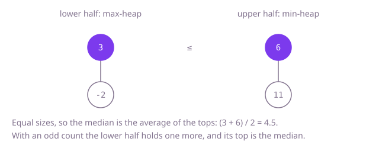

## The question

Numbers arrive one at a time, and at any moment you must report the median of everything so far: the middle number, or the average of the two middle numbers when the count is even.

What makes it harder than it looks: sorting answers it, but the tests ask for the median after every one of 100,000 numbers, and re-sorting each time is billions of steps. Two small traps sit in the average: dividing in integers turns 4.5 into 4, and adding two large `int` values overflows before you divide.

## How to think about it

The first idea is to keep every number and sort a copy whenever the median is asked for. It is correct and fixes the answer to compare against, but each request pays O(n log n) to rebuild an order that barely changed.

Keeping the numbers sorted as they arrive is the next step: find each new number's place by binary search and shift the larger ones up. The median is then a read of the middle slots. Adding costs a shift of up to n values, which is fast in practice as one block copy, but still linear.

What the median really needs is much less than full order. Split the numbers into a lower half and an upper half, with the lower half the same size or one larger. The median is the largest of the lower half, or the average of that and the smallest of the upper half. So each half only has to hand over its value nearest the middle: a max-heap for the lower half and a min-heap for the upper half. A new number goes into the lower heap, the lower heap's largest moves to the upper heap (so every lower value stays at most every upper value), and if the upper heap is now bigger, its smallest moves back. Each step is O(log n), and the median is a peek.

Walk Example 1. `addNum(6)`: 6 goes low, moves up, and moves back, so low is {6} and high is empty; the median is 6. `addNum(-2)`: -2 goes low, the largest of low, 6, moves up; low {-2}, high {6}; the median is (-2 + 6) / 2 = 2. `addNum(11)`: 11 goes low and moves straight up, high {6, 11} is bigger, so 6 moves back; low {-2, 6}, high {11}; the median is 6. `addNum(3)`: 3 goes low, 6 moves up; low {-2, 3}, high {6, 11}; the median is (3 + 6) / 2 = 4.5.



## Brute force

Keep the numbers in a list. On each `findMedian`, copy them into an array, sort it and read the middle. It comes first because it is the definition written as code, and it fixes the answer to compare against. It is correct because the sorted copy holds every number, and the average is taken in `long` and divided as a `double`.

```java
class MedianFinder {
    private final List<Integer> numbers = new ArrayList<>();

    void addNum(int num) {
        numbers.add(num);
    }

    double findMedian() {
        int[] sorted = new int[numbers.size()];
        for (int i = 0; i < sorted.length; i++) {
            sorted[i] = numbers.get(i);
        }
        Arrays.sort(sorted); // all the numbers, every time
        int n = sorted.length;
        if (n % 2 == 1) {
            return sorted[n / 2];
        }
        return ((long) sorted[n / 2 - 1] + sorted[n / 2]) / 2.0; // long sum, then a real division
    }
}
```

**Complexity:** `addNum` O(1) amortized, `findMedian` O(n log n) for n numbers; extra space O(n).

## Better: a sorted array with binary-search insertion

Keep an array that is always sorted. Each new number is placed by binary search, with the larger numbers shifted up one slot; the median reads the middle slots.

```java
class MedianFinder {
    private int[] sorted = new int[16];
    private int size = 0;

    void addNum(int num) {
        if (size == sorted.length) {
            sorted = Arrays.copyOf(sorted, size * 2);
        }
        int at = Arrays.binarySearch(sorted, 0, size, num);
        if (at < 0) {
            at = -at - 1; // where num belongs
        }
        System.arraycopy(sorted, at, sorted, at + 1, size - at); // shift the larger values up
        sorted[at] = num;
        size++;
    }

    double findMedian() {
        if (size % 2 == 1) {
            return sorted[size / 2];
        }
        return ((long) sorted[size / 2 - 1] + sorted[size / 2]) / 2.0;
    }
}
```

**Complexity:** `addNum` O(n) for the shift (the search is O(log n), growth amortized), `findMedian` O(1); extra space O(n).

**Prefer it when:** you also need other order questions answered, such as any percentile or the smallest values: this code keeps the whole array sorted, so each is a single read. The shift is one block copy of `int` values, so for a hundred thousand numbers it is fast in practice; it is the linear cost that loses at millions.

## Optimal: two heaps

A max-heap holds the lower half and a min-heap the upper half, with the lower half the same size or one larger. Every new number passes through the lower heap into the upper one, and the upper heap gives one back if it grew too big. The median is the lower top, or the average of both tops. This is the reference solution.

```java
class MedianFinder {
    private final PriorityQueue<Integer> low = new PriorityQueue<>(Collections.reverseOrder()); // smaller half, largest on top
    private final PriorityQueue<Integer> high = new PriorityQueue<>(); // larger half, smallest on top

    void addNum(int num) {
        low.add(num);
        high.add(low.poll()); // the largest of the smaller half moves up, so every low <= every high
        if (high.size() > low.size()) {
            low.add(high.poll()); // keep low the same size as high, or one larger
        }
    }

    double findMedian() {
        if (low.size() > high.size()) {
            return low.peek();
        }
        return ((long) low.peek() + high.peek()) / 2.0; // long: the sum of two ints can overflow
    }
}
```

**Complexity:** `addNum` O(log n), `findMedian` O(1); extra space O(n).

## Complexity

| Approach | addNum | findMedian | Extra space |
| --- | --- | --- | --- |
| Brute force | O(1) amortized | O(n log n) | O(n) |
| Better: sorted array with insertion | O(n), growth amortized | O(1) | O(n) |
| Optimal: two heaps | O(log n) | O(1) | O(n) |

## Where it shows up

No coding-round problem is linked to this question. A running median is a robust "typical value" that one huge outlier cannot drag: monitoring dashboards show the median latency of a service as requests complete, trading systems track the median price of recent trades, and sensor pipelines smooth noisy readings with a median instead of a mean. The two-heap split is the textbook way to keep it current as data streams in.

## Follow-up answers

**What if every number were between 0 and 100?** Keep 101 counters and the total count. `addNum` increments one counter, and `findMedian` walks the counters until it reaches the middle position or positions: O(1) per add and O(101) per median, with no heaps and constant memory.

**How would you report the median of only the last w numbers?** Numbers now leave as well as arrive, and a heap cannot remove an arbitrary value cheaply. Keep the window in a queue to know which number leaves, and replace the heaps with two ordered multisets, such as `TreeMap`s from value to count, balanced the same way. Removing the leaving number from whichever half holds it and rebalancing keeps every step O(log w). Lazy deletion from the heaps, skipping removed values when they reach the top, is the other common answer.

**How would you report any percentile, such as the 90th, instead of the median?** Keep the same two heaps but balance them at a different ratio: the lower heap holds 90% of the numbers and the upper heap 10%, so the lower top is the 90th percentile. For many percentiles at once, keep all numbers in an order-statistic structure, or accept an approximation with a sketch such as t-digest, which is what monitoring systems use at scale.
