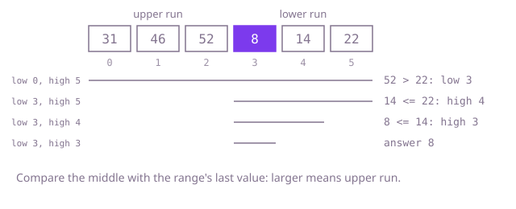

## The question

A strictly increasing array had some unknown number of its leading values moved to the end. Return the smallest value, quickly enough for tens of thousands of calls on half-million-value arrays.

What makes it harder than it looks: the array is not sorted, so a plain binary search does not apply, yet it is sorted enough to halve. The rotation can be zero, and the natural test "is the middle at least the first value?" gets that case wrong: in an unrotated array every value is at least the first, so it walks right and returns the largest value. Two-element arrays in both orders are where a careless range update loses the answer.

## How to think about it

The first idea is to scan for the smallest value. It is correct, and it does not use the structure: the array is two increasing runs, the upper run first and the lower run after it, and the minimum is the first value of the lower run, right after the only drop.

Every value of the upper run is larger than every value of the lower run, and the last value of the array always belongs to the lower run (if there is no rotation, the whole array is the lower run). So comparing the middle with the last value of the range tells me which run the middle is in. If the middle is larger, it is in the upper run and the minimum is to its right: `low = middle + 1`. Otherwise the middle is in the lower run, so the minimum is the middle or to its left: `high = middle`, not `middle - 1`, because the middle may be the minimum. When the range is one value, that value is the minimum.

Walk Example 1, `nums = [31, 46, 52, 8, 14, 22]`. The range is 0 to 5. The middle is 2, holding 52, larger than 22, so `low = 3`. The middle of 3 to 5 is 4, holding 14, not larger than 22, so `high = 4`. The middle of 3 to 4 is 3, holding 8, not larger than 14, so `high = 3`. The range is the single index 3, and the minimum is 8.



## Brute force

Look at every value and keep the smallest. It comes first because it is what anyone says first, and it fixes the answer to compare against. It is correct because it sees every value.

```java
static int min(int[] nums) {
    int best = nums[0];
    for (int value : nums) {
        if (value < best) {
            best = value;
        }
    }
    return best;
}
```

**Complexity:** time O(n) per call, extra space O(1).

## Better: stop at the drop

The values only ever go down once, at the start of the lower run. Walk from the left and return the first value smaller than the one before it; if there is no drop, the array was not rotated and the first value is the minimum.

```java
static int min(int[] nums) {
    for (int i = 1; i < nums.length; i++) {
        if (nums[i] < nums[i - 1]) {
            return nums[i]; // the only drop is where the lower run starts
        }
    }
    return nums[0]; // no drop: not rotated
}
```

**Complexity:** time O(n - r) per call when rotated, since the minimum sits at index n - r; O(n) when not rotated or when r = 1. Extra space O(1).

**Prefer it when:** the drop is known to be near the start (r close to n), as in a circular buffer that has only just wrapped.

## Optimal: binary search against the last value

Keep `[low, high]` holding the minimum. A middle larger than `nums[high]` is in the upper run, so the minimum is after it; otherwise the minimum is the middle or before it. This is the reference solution.

```java
static int min(int[] nums) {
    int low = 0;
    int high = nums.length - 1; // the minimum always lies in [low, high]
    while (low < high) {
        int middle = (low + high) >>> 1;
        if (nums[middle] > nums[high]) {
            low = middle + 1; // the drop to the minimum is after the middle
        } else {
            high = middle; // the middle may itself be the minimum
        }
    }
    return nums[low];
}
```

**Complexity:** time O(log n) per call, extra space O(1).

## Complexity

| Approach | Time | Extra space |
| --- | --- | --- |
| Brute force | O(n) per call | O(1) |
| Better: stop at the drop | O(n - r) per call when rotated, O(n) when not rotated or r = 1 | O(1) |
| Optimal: binary search against the last value | O(log n) per call | O(1) |

## Where it shows up

Circular buffers and ring logs, where the oldest entry sits right after the newest and the write position is not stored; finding where a sorted, wrapped sequence such as a log with sequence numbers or a day's readings starting mid-cycle actually begins; and as the first step of searching a rotated array, which finds the rotation point and then searches one of the two runs.

## Follow-up answers

**Can you find it in O(log n) time?** Yes: compare the middle with the last value of the range. A larger middle is in the upper run, so discard the left half including the middle; otherwise discard everything after the middle. Each step halves the range.

**What if values could repeat?** When the middle equals the last value you cannot tell which run it is in, as in `[4, 1, 4, 4, 4]` against `[4, 4, 4, 1, 4]`. Drop the last value (`high--`), which is safe because the middle still holds an equal one. The worst case, almost all values equal, becomes O(n).

**How would you also return how many positions the array was rotated by?** The minimum was at index 0, and moving the first r values to the end puts it at index n - r, or 0 when r is 0. So the search's final `low` gives the count as `(n - low) % n`.
