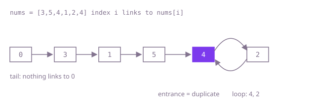

## The question

An array holds `n + 1` values, each from 1 to `n`, and exactly one value repeats (perhaps many times); return it. The array must not be changed, and the goal is constant extra space.

What makes it harder than it looks: the quick tricks are all ruled out. A set of seen values costs O(n) memory, sorting and sign-marking write to the array, and "sum of the values minus 1 + 2 + ... + n" only works when the duplicate appears exactly twice and nothing else is missing, which Example 2 breaks.

## How to think about it

The first idea is to compare every pair: no memory, no writes, but O(n²) time. The next is to remember what you have seen, in a boolean array indexed by value: one pass, but O(n) memory. Between them sits a search on the value instead of the positions: if more than `m` values are at most `m`, the duplicate is at most `m`, so you can halve the range of candidate values with one counting pass each time. That is O(1) memory and O(n log n) time.

The linear, constant-space answer comes from reading the array as links. Every value is a valid index, so treat index `i` as a node whose `next` is `nums[i]`. No value is 0, so nothing links back to index 0; a walk from 0 must eventually revisit a node, so it runs down a tail into a loop. The node where the tail joins the loop has two incoming links, one from the tail and one from inside the loop, so two different indexes hold its number: it is the duplicate. Finding where a linked list's loop starts is the slow and fast pointer method: the two meet inside the loop, then a pointer from the start and one from the meeting point, stepping together, meet exactly at the loop's entrance.

Walk Example 1, `[3,5,4,1,2,4]`. The links are 0→3→1→5→4→2→4, so the tail is 0, 3, 1, 5 and the loop is 4, 2. Slow goes 3, 1, 5, 4; fast goes 1, 4, 4, 4; they meet at 4 after four steps. Then a finder from 0 and the slow pointer from 4 step together: 3 and 2, 1 and 4, 5 and 2, 4 and 4. They meet at 4, the answer.



## Brute force

Compare every pair of positions and return the first value that appears twice. It comes first because it is what you say first, and it fixes the answer to compare against. It is correct because the duplicate occupies at least two positions, so some pair finds it, and no other value can match.

```java
static int find(int[] nums) {
    for (int i = 0; i < nums.length; i++) {
        for (int j = i + 1; j < nums.length; j++) {
            if (nums[i] == nums[j]) {
                return nums[i];
            }
        }
    }
    throw new IllegalArgumentException("no value repeats");
}
```

**Complexity:** time O(n²), extra space O(1).

## Better: mark seen values

Keep a boolean per possible value and return the first value whose flag is already set. Values run from 1 to `n`, so a plain array indexed by value replaces a hash set.

```java
static int find(int[] nums) {
    boolean[] seen = new boolean[nums.length]; // values run from 1 to n = nums.length - 1
    for (int value : nums) {
        if (seen[value]) {
            return value;
        }
        seen[value] = true;
    }
    throw new IllegalArgumentException("no value repeats");
}
```

**Complexity:** time O(n), extra space O(n) for the flags.

**Prefer it when:** memory is not a concern and the code should be obviously right at a glance; it is the shortest linear-time version.

## Better: binary search on the value

Count how many values are at most `middle`. Without a duplicate in 1..`middle` that count is at most `middle`; more than that means the duplicate is in the lower half. Each count is one pass, and the candidate range halves each time.

```java
static int find(int[] nums) {
    int low = 1;
    int high = nums.length - 1;
    while (low < high) {
        int middle = (low + high) >>> 1;
        int atMost = 0; // how many values are in 1..middle
        for (int value : nums) {
            if (value <= middle) {
                atMost++;
            }
        }
        if (atMost > middle) {
            high = middle; // more values than slots in 1..middle: the duplicate is there
        } else {
            low = middle + 1;
        }
    }
    return low;
}
```

**Complexity:** time O(n log n), extra space O(1).

**Prefer it when:** the values arrive as a stream you can read several times but not index into, such as a file read front to back; the link walk needs random access to `nums[i]`.

## Optimal: slow and fast pointers on the links

Walk the links `i → nums[i]` from index 0 with a slow and a fast pointer until they meet, then step a finder from 0 and the slow pointer together; they meet at the entrance of the loop, the duplicate. This is the reference solution.

```java
static int find(int[] nums) {
    // read nums as links i -> nums[i]: no value is 0, so the walk from 0 runs into a loop
    int slow = 0;
    int fast = 0;
    do {
        slow = nums[slow];
        fast = nums[nums[fast]];
    } while (slow != fast);
    // the loop is entered at the value two indexes point to: the duplicate
    int finder = 0;
    while (finder != slow) {
        finder = nums[finder];
        slow = nums[slow];
    }
    return slow;
}
```

**Complexity:** time O(n), extra space O(1).

## Complexity

| Approach | Time | Extra space |
| --- | --- | --- |
| Brute force | O(n²) | O(1) |
| Better: mark seen values | O(n) | O(n) |
| Better: binary search on the value | O(n log n) | O(1) |
| Optimal: slow and fast pointers on the links | O(n) | O(1) |

## Where it shows up

No coding-round problem is linked to this question. Treating "value as the index of the next element" turns arrays into linked structures in many places: free lists inside a fixed array, parent arrays in union-find, and the iterated functions of pseudo-random generators, where finding the start of the loop (the same Floyd method) tells you the period and the warm-up length of the sequence. Pollard's rho factoring uses the same loop-finding idea.

## Follow-up answers

**Why does the walk from index 0 always reach a loop, and why does it enter the loop at the duplicate?** Every index has exactly one outgoing link (`nums[i]` is always a valid index), so a walk never stops, and with finitely many indexes it must revisit one: it runs into a loop. Nothing links to index 0, so 0 is on the tail and the tail is at least one step long. The node where the tail joins the loop is then pointed to from the tail and from inside the loop, two different indexes holding the same value, so it is the duplicate.

**Why does the sum of the values not give the answer?** Subtracting 1 + 2 + ... + n from the sum gives the duplicate only when it appears exactly twice and every other value is present once. In `[2,6,2,1,2,5,2]` the 2 appears four times and 3 and 4 are missing: the sum is 20, 1 + ... + 6 is 21, and the difference is -1, not 2.

**What would you do if the array could be changed?** Then sign-marking is the shortest O(n), O(1) method: for each value `v`, look at `nums[|v|]`; if it is already negative, `|v|` is the duplicate, otherwise negate it. Cyclic sort, swapping each value to the index it names until a swap would put a value onto its own copy, works too. Both write to the array, which this question forbids.
