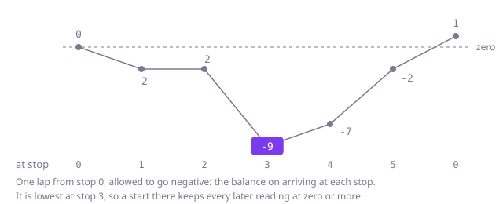

## The question

A shuttle drives a loop of charging stops; each stop adds charge and each leg to the next stop uses some. Return the lowest-numbered stop from which the shuttle, starting empty, gets all the way round without running out on a leg, or -1 if no stop works.

What makes it harder than it looks is that the obvious picks are wrong. In Example 1 the stop with the most charge, stop 1, runs out on its second leg, and stop 4, which gains the most on its own leg, runs out later, on the leg from stop 2. When the stops give less charge in total than the loop uses, no start works, even though a long stretch may look fine (Example 2). Several stops can work (Example 3), and the rule asks for the lowest. And driving the loop from every stop costs up to n laps of n legs, 10^10 steps at 100,000 stops.

## How to think about it

The first idea is to drive the loop from each stop in turn and return the first that gets round. It is O(n²), and what it wastes is the knowledge a failed attempt gives about the stops it passed.

Look at a failure closely. Say a start runs out on the leg from stop `i`. Every stop between that start and `i` was reached with a battery of zero or more, and starting at one of them with an empty battery has at most as much charge at every later point, so it would run out on the leg from `i` too, or sooner. All of them can be skipped: the next start worth trying is `i + 1`. With that skip, each stop is driven past at most twice, once on the way to a failure and once more if the last start wraps round, so the search becomes O(n).

The last step removes the wrap. Drive one lap from stop 0 and let the balance go negative, recording it on arriving at each stop. Starting at stop `s` instead lowers every later reading by the balance at `s` and, after the wrap, adds the lap's total. So when the total is zero or more, a start at the stop where the balance is lowest never reads below zero, while a start at any stop before the first lowest point reads below zero on arriving there. The first stop where the lowest balance is reached is therefore the answer; when the total is negative, nothing works. The greedy pass finds that stop without remembering the balances: keep the battery since the current candidate start, and when it goes negative on the leg from stop `i`, make `i + 1` the candidate and empty the battery. That happens exactly when the balance falls below every balance before it, so the last candidate is the first lowest point. At the end, return it if the total is zero or more, and -1 otherwise. The choice is safe because every stop before the candidate was skipped by the argument above, and the candidate itself is the lowest point of the lap.

Walk Example 1, `charge = [6,9,0,5,6,5]`, `drain = [8,9,7,3,1,2]`. The gains on each leg are -2, 0, -7, 2, 5 and 3. From stop 0 the battery is -2 after one leg, so the candidate becomes stop 1. From stop 1 it is 0 after the leg from stop 1, which is allowed, then -7 after the leg from stop 2, so the candidate becomes stop 3. From stop 3 it reads 2, 7 and 10 to the end of the list. The total is 31 - 30 = 1, so the answer is stop 3. The one-lap balance tells the same story: -2, -2, -9, -7, -2 and 1 on arriving at stops 1 to 5 and back at 0, lowest at stop 3.



## Brute force

Try each stop in order, drive the loop from it and return the first stop that gets round. It comes first because it is the rule written as code, and it fixes the answers to compare against. It is correct because it checks every leg from every start, and trying the stops in order makes the first success the lowest-numbered one. Every battery value is a sum of some stops' charge minus their drain, which the constraints keep inside an `int`.

```java
static int startStop(int[] charge, int[] drain) {
    int n = charge.length;
    for (int start = 0; start < n; start++) { // lowest-numbered first
        int battery = 0;
        int legs = 0; // legs driven so far without running out
        while (legs < n) {
            int stop = (start + legs) % n;
            battery += charge[stop] - drain[stop];
            if (battery < 0) {
                break; // ran out on the leg from this stop
            }
            legs++;
        }
        if (legs == n) {
            return start;
        }
    }
    return -1;
}
```

**Complexity:** time O(n²), extra space O(1).

## Better: skip the stops a failure rules out

The same search, but after a start runs out on the leg from some stop, the next start is the stop after it rather than the next stop in line. A start that runs out after wrapping round past the end of the list leaves no stop untried, so the answer is then -1.

```java
static int startStop(int[] charge, int[] drain) {
    int n = charge.length;
    int start = 0;
    while (start < n) {
        int battery = 0;
        int legs = 0;
        while (legs < n) {
            int stop = (start + legs) % n;
            battery += charge[stop] - drain[stop];
            if (battery < 0) {
                break;
            }
            legs++;
        }
        if (legs == n) {
            return start;
        }
        start += legs + 1; // every stop from start to the one it ran out on fails too
    }
    return -1;
}
```

**Complexity:** time O(n): the starts it tries cover the list once, and only the last one can wrap round, so it drives at most 2n legs. Extra space O(1).

**Prefer it when:** the readings are not just the balance shifted by a constant, for example when the battery is capped: the skip argument still holds there and the total check does not (see the follow-ups). The stop it returns has just been driven all the way round, so it needs no argument about the total.

## Optimal: one pass with a running candidate

Walk the stops once, keeping the total gain of the whole loop and the battery since the current candidate start. When the battery goes negative, the next stop becomes the candidate and the battery is emptied. At the end the candidate works if the total is zero or more. This is the reference solution.

```java
static int startStop(int[] charge, int[] drain) {
    int total = 0; // charge minus drain over the whole loop
    int battery = 0; // battery since the current candidate start
    int start = 0;
    for (int i = 0; i < charge.length; i++) {
        int gain = charge[i] - drain[i];
        total += gain;
        battery += gain;
        if (battery < 0) { // ran out on the leg from stop i: no stop from start to i works
            start = i + 1;
            battery = 0;
        }
    }
    return total < 0 ? -1 : start; // with enough charge overall, the last candidate works
}
```

**Complexity:** time O(n), extra space O(1). The candidate becomes `n` only when the battery goes negative on the last leg, which also makes the total negative, so a returned stop is always in range.

## Complexity

| Approach | Time | Extra space |
| --- | --- | --- |
| Brute force | O(n²) | O(1) |
| Better: skip the stops a failure rules out | O(n), at most 2n legs | O(1) |
| Optimal: one pass with a running candidate | O(n) | O(1) |

## Where it shows up

Any loop where a resource is gained and spent in turn asks it: where a delivery round or a patrol should start so that a vehicle never runs dry, at which hour a battery-backed system should begin a daily cycle of solar charge and load so that it never drops below empty, or where to begin a circular buffer of credits and debits so that the running balance never goes negative. The one-lap balance is the same idea as finding the day a running account hits its low point.

## Follow-up answers

**What if you had to list every stop that works?** Use the one-lap balance from stop 0, ending with the lap's total on the return. A start at stop `s` reads the later balances minus the balance at `s`, and after the wrap the earlier ones plus the total, minus the balance at `s`. So when the total is zero or more, `s` works if no balance from `s` to the end of the lap, the total included, is below its own, and no balance from the start of the lap up to `s`, with the total added, is below it either; when the total is negative, none works. A pass from the right gives the lowest balance from each stop on and a pass from the left the lowest up to it, so the whole list costs O(n). With a positive total, stops other than the lowest point can work, as stop 1 does in Example 3.

**What if the battery could hold only a limited amount?** Charge beyond the limit is lost, so the readings are no longer the balance shifted by a constant, and the total no longer decides. The skip still holds, because a fuller battery never does worse than an emptier one on the legs that follow. So the Better version still works: try candidates with the skip, capping the battery at each stop, and the stop it finally drives all the way round is the answer, still in at most 2n legs.

**What if the shuttle had to start at stop 0 and could be charged before it leaves: how much would it need?** Exactly enough to lift the lowest point of the one-lap balance to zero: the negative of the lowest balance, or nothing when the balance never goes below zero. On Example 1 that is 9 units.
