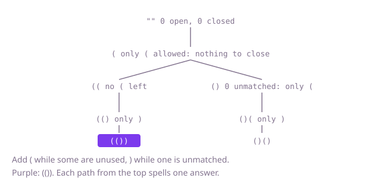

## The question

Given n, list every balanced string of n opening and n closing brackets, each once. A string is balanced when, reading from the left, closing brackets never outnumber opening ones and the two counts end equal.

What makes it harder than it looks is that equal counts are not enough: `)(` has one of each and is not balanced, so a check that only counts brackets lets bad strings through. The other trap is the smallest case: n = 0 has one answer, the empty string, so the result is a list holding `""`, not an empty list. Speed matters less here, because the answer itself grows almost as fast as the search; what is worth saving is the work on strings that can never be completed.

## How to think about it

The first idea is to write down every string of 2n brackets, 2^(2n) of them, and keep the balanced ones. It is correct and fixes the answer to compare against, but for n = 8 only 1,430 of the 65,536 strings survive.

Build the string from the left instead and ask, at each step, which bracket could come next without ruining it. A `)` with no unmatched `(` before it ruins the string for good, so never add one; that alone removes every string that goes negative. Strings can still fail at the end by holding too many `(`, so also stop adding `(` once n have been used. With both rules every prefix built can still be completed, so every branch ends in an answer and nothing is thrown away. One `StringBuilder` is enough: append going down, remove coming back.

Walk Example 1, `n = 2`. The empty prefix can only take `(`. From `(`, both are allowed: `((` has no `(` left, so it takes `)` twice and gives `(())`; `()` has nothing unmatched, so it takes `(`, then `)`, and gives `()()`. Two leaves, two strings.



## Brute force

Read each number from 0 to 2^(2n) − 1 as a string of brackets, bit i set meaning `(` at position i, and keep the balanced ones. It comes first because it is the definition of the answer written as code, and it fixes the answer the other versions must agree with. It is correct because the numbers are exactly the 2^(2n) strings of length 2n, each once; at `n <= 8` the shift is at most `1 << 16`.

```java
static List<String> generate(int n) {
    List<String> result = new ArrayList<>();
    for (int mask = 0; mask < (1 << (2 * n)); mask++) {
        StringBuilder s = new StringBuilder();
        int depth = 0;
        for (int i = 0; i < 2 * n && depth >= 0; i++) { // stop at the first unmatched ')'
            boolean open = (mask & (1 << i)) != 0;
            s.append(open ? '(' : ')');
            depth += open ? 1 : -1;
        }
        if (depth == 0 && s.length() == 2 * n) {
            result.add(s.toString());
        }
    }
    return result;
}
```

**Complexity:** time O(n · 4^n), since every one of the 4^n masks is read for up to 2n positions; extra space O(n) for the string being built, beyond the output.

## Better: never close more than opened

Build left to right and only add `)` while there is an unmatched `(`, but let `(` be added freely; at length 2n keep the string if it has exactly n of each. Prefixes that go negative are never built, which removes most of the waste, but branches with too many `(` still run to the end before failing.

```java
static List<String> generate(int n) {
    List<String> result = new ArrayList<>();
    grow(n, 0, 0, new StringBuilder(), result);
    return result;
}

private static void grow(int n, int open, int closed, StringBuilder built, List<String> result) {
    if (built.length() == 2 * n) {
        if (open == n) { // too many '(' are only found out here
            result.add(built.toString());
        }
        return;
    }
    built.append('(');
    grow(n, open + 1, closed, built, result);
    built.setLength(built.length() - 1);
    if (closed < open) {
        built.append(')');
        grow(n, open, closed + 1, built, result);
        built.setLength(built.length() - 1);
    }
}
```

**Complexity:** time O(n · C(2n, n)) in the worst case, the number of prefixes that never go negative, each finished string costing O(n) to copy; extra space O(n) for the builder and a recursion depth of 2n, beyond the output.

**Prefer it when:** you only know the "never close too early" rule, for example while checking a stream whose total length is fixed but whose number of pairs is not.

## Optimal: open while some are left, close while one is unmatched

Add `(` only while fewer than n have been used, and `)` only while fewer have been closed than opened. Every prefix built can then be completed, so every branch ends in an answer. This is the reference solution.

```java
static List<String> generate(int n) {
    List<String> result = new ArrayList<>();
    grow(n, 0, 0, new StringBuilder(), result);
    return result;
}

// Extends built, which holds open '(' and closed ')' so far, with closed <= open <= n.
private static void grow(int n, int open, int closed, StringBuilder built, List<String> result) {
    if (closed == n) {
        result.add(built.toString()); // closed == n forces open == n: the string is complete
        return;
    }
    if (open < n) { // an opening bracket is allowed while some are unused
        built.append('(');
        grow(n, open + 1, closed, built, result);
        built.setLength(built.length() - 1);
    }
    if (closed < open) { // a closing bracket needs an unmatched opening one before it
        built.append(')');
        grow(n, open, closed + 1, built, result);
        built.setLength(built.length() - 1);
    }
}
```

**Complexity:** time O(n · Cat(n)), where Cat(n) = C(2n, n) / (n + 1) is the number of answers, about 4^n / n^1.5, because every branch ends in an answer and each costs O(n) to build and copy; that is O(4^n / √n). Extra space O(n) for the builder and a recursion depth of 2n, beyond the output; at `n <= 8` the depth is no risk.

## Complexity

| Approach | Time | Extra space (beyond the output) |
| --- | --- | --- |
| Brute force: every string, keep the balanced | O(n · 4^n) | O(n) |
| Better: never close more than opened | O(n · C(2n, n)) worst case | O(n), recursion depth 2n |
| Optimal: both rules | O(n · Cat(n)) = O(4^n / √n) | O(n), recursion depth 2n |

## Where it shows up

No coding-round problem is linked to this question. Generating every well-formed nesting is how property-based test tools produce valid inputs for parsers, how expression builders list every way to bracket a product of matrices, and how one lists every shape of a binary tree with n nodes, since those shapes match balanced strings one to one. The two rules are the general move of a constrained generator: only take a step that leaves the rest completable.

## Follow-up answers

**How many strings are there for n pairs, and how would you count them without listing them?** The count is the n-th Catalan number, 1, 1, 2, 5, 14, 42 and so on. A balanced string is `(` inner `)` rest, with inner and rest balanced, so `count[n]` is the sum over i of `count[i] * count[n − 1 − i]`, which is O(n²) time; the closed form C(2n, n) / (n + 1) gives it in O(n).

**How would you list them in sorted order?** The reference already does: it tries `(` before `)` at every step, and `(` sorts before `)` in character order, so the strings come out in sorted order with no sort needed.

**What changes with two kinds of brackets, round and square, that must nest properly?** A count of unmatched brackets is no longer enough, because `(]` balances the count but closes the wrong kind. Keep a stack of the unmatched opening brackets: a closing bracket is allowed only if it matches the top of the stack. Each balanced shape can then be filled with either kind for each pair, so there are Cat(n) · 2^n answers.
