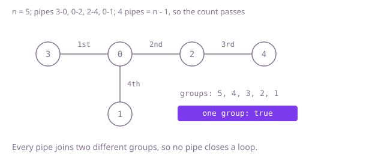

## The question

You get `n` valves and a list of two-way pipes. Say whether the pipes form a tree: every valve reachable from every other, and no loop.

What makes it harder than it looks: it is two conditions, and each one alone is easy to mistake for the whole. Checking only for loops accepts a plan with valves cut off. Checking only the pipe count, `n - 1`, accepts a plan where a loop in one corner has used up the pipe some other valve needed. And a recursive search goes as deep as the longest chain of valves, which overflows on a line of 100,000.

## How to think about it

The first idea checks both conditions head on. Lay the pipes one at a time; before laying each one, search the pipes laid so far to see whether its two valves are already connected, because if they are, this pipe closes a loop. After the last pipe, search once from valve 0 and check that every valve was reached. It is correct but searches the growing network once per pipe, which is quadratic on a long line.

Two facts make it cheaper. First, a tree over `n` valves always has exactly `n - 1` pipes, so any other count is an immediate no. Second, with the count right, the two conditions become one: `n - 1` pipes with no loop must connect everything, and `n - 1` pipes that connect everything cannot have a loop. So after the count check, one search from valve 0 that reaches every valve settles it. Or, without neighbour lists, read the pipes in order and keep groups of connected valves with union-find: the plan fails the moment a pipe joins two valves of the same group.

Walk Example 2: `n = 5` and four pipes, so the count passes. Union-find merges 0 and 1, then 2 joins them; then pipe `[2, 0]` finds 2 and 0 already in one group, so it closes a loop and the answer is `false`. Valves 3 and 4 never needed checking. In Example 1 the four pipes merge five single valves into one group without a repeat, so the answer is `true`.



## Brute force

Before laying each pipe, search the network built so far from one of its ends; if the other end is reached, the pipe closes a loop. After all pipes, search from valve 0 and require every valve to be reached. It is what you say first, and it fixes the answer to compare against. It is correct because it checks both conditions exactly as defined.

```java
static boolean isTree(int n, int[][] links) {
    List<List<Integer>> next = new ArrayList<>();
    for (int i = 0; i < n; i++) {
        next.add(new ArrayList<>());
    }
    for (int[] link : links) {
        if (reachable(next, link[0])[link[1]]) { // already connected: this pipe closes a loop
            return false;
        }
        next.get(link[0]).add(link[1]);
        next.get(link[1]).add(link[0]);
    }
    for (boolean seen : reachable(next, 0)) { // every valve must be reached
        if (!seen) {
            return false;
        }
    }
    return true;
}

private static boolean[] reachable(List<List<Integer>> next, int from) {
    boolean[] seen = new boolean[next.size()];
    Deque<Integer> queue = new ArrayDeque<>();
    seen[from] = true;
    queue.add(from);
    while (!queue.isEmpty()) {
        for (int other : next.get(queue.poll())) {
            if (!seen[other]) {
                seen[other] = true;
                queue.add(other);
            }
        }
    }
    return seen;
}
```

**Complexity:** time O(m times n) for m pipes, one O(n) search per pipe, extra space O(n + m).

## Better: count the pipes, then one search

Reject any count other than `n - 1`. Then build neighbour lists and search from valve 0 with a queue, counting the valves reached. With exactly `n - 1` pipes, reaching all `n` valves means there is no loop, so that single count is the answer.

```java
static boolean isTree(int n, int[][] links) {
    if (links.length != n - 1) { // a tree has exactly n - 1 pipes
        return false;
    }
    List<List<Integer>> next = new ArrayList<>();
    for (int i = 0; i < n; i++) {
        next.add(new ArrayList<>());
    }
    for (int[] link : links) {
        next.get(link[0]).add(link[1]);
        next.get(link[1]).add(link[0]);
    }
    boolean[] seen = new boolean[n];
    Deque<Integer> queue = new ArrayDeque<>();
    seen[0] = true;
    queue.add(0);
    int reached = 1;
    while (!queue.isEmpty()) {
        for (int other : next.get(queue.poll())) {
            if (!seen[other]) {
                seen[other] = true;
                reached++;
                queue.add(other);
            }
        }
    }
    return reached == n; // with n - 1 pipes, connected means no loop
}
```

**Complexity:** time O(n + m), extra space O(n + m) for the neighbour lists and the queue. The queue is explicit; a recursive search would be as deep as the longest chain and overflows on a line of 100,000 valves.

**Prefer it when:** you also want to report which valves are cut off: they are the ones the search never marked.

## Optimal: count the pipes, then union-find

Reject any count other than `n - 1`. Then read the pipes in order with union-find: find each end's representative, fail if they are equal, since that pipe closes a loop, and otherwise merge the smaller group under the larger. If every pipe merges two groups, `n - 1` merges have turned `n` groups into one, so the plan is connected too. This is the reference solution.

```java
static boolean isTree(int n, int[][] links) {
    if (links.length != n - 1) { // a tree has exactly n - 1 pipes
        return false;
    }
    int[] parent = new int[n];
    int[] size = new int[n];
    for (int i = 0; i < n; i++) {
        parent[i] = i;
        size[i] = 1;
    }
    for (int[] link : links) {
        int a = find(parent, link[0]);
        int b = find(parent, link[1]);
        if (a == b) { // already connected: a loop
            return false;
        }
        if (size[a] < size[b]) { // hang the smaller group under the larger
            int swap = a;
            a = b;
            b = swap;
        }
        parent[b] = a;
        size[a] += size[b];
    }
    return true; // n - 1 merges leave a single group
}

private static int find(int[] parent, int x) {
    while (parent[x] != x) {
        parent[x] = parent[parent[x]]; // path halving
        x = parent[x];
    }
    return x;
}
```

**Complexity:** time O(n times α(n)), where α is the inverse Ackermann function and is at most 4 for any input that fits in memory, so effectively linear (the count check rejects any other number of pipes in O(1)); extra space O(n). No recursion.

## Complexity

| Approach | Time | Extra space |
| --- | --- | --- |
| Brute force: search before every pipe, then once more | O(m times n) | O(n + m) |
| Better: count check, then one explicit-queue search | O(n + m) | O(n + m) |
| Optimal: count check, then union-find | O(n times α(n)), effectively linear | O(n) |

## Where it shows up

Checking that links form a tree is how a build tool or package manager can confirm that a set of parent links describes one hierarchy, how an org chart import checks that every employee reaches the top through exactly one chain of managers, and how network design checks that a planned cabling layout is a spanning tree with no redundant loops before the switches are configured.

## Follow-up answers

**What changes if the pipes are one-way, and you must check for a rooted tree?** Exactly one valve may have no incoming pipe, the root; every other valve must have exactly one incoming pipe; and a search from the root must reach all `n` valves. The count `n - 1` still holds, but union-find on its own no longer checks direction, so the in-degree check is needed as well.

**How would you report what is wrong when the answer is no?** Union-find can return the first pipe that closes a loop. After reading all the pipes, the number of distinct representatives tells how many separate pieces the plan falls into, and any piece without valve 0 is cut off.

**What if pipes arrive one at a time and you must answer after each?** Keep the union-find and a count of merges. The plan is a tree exactly when no pipe so far has closed a loop and the merges have reached `n - 1`; once a loop appears the answer stays `false` for good, because pipes are never removed.
