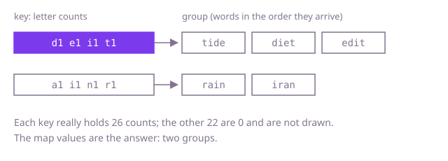

## The question

Given an array of lowercase words, split it into groups of anagrams: words that use exactly the same letters the same number of times. Repeated words stay in the group, and the order of groups and of words does not matter.

What makes it harder than it looks is the number of words. With 60,000 words you cannot ask every word whether it belongs with every other, and "same letters" is not enough on its own: `abb` and `baa` use the same two letters but are not anagrams, because the counts differ.

## How to think about it

The first idea is to take each word, compare it with one member of every group so far, and either join a group or start a new one. That is correct, but the cost is words times groups, and with tens of thousands of groups it is quadratic. What the comparison repeats is the same question, "are these two the same up to order?". Answer it once per word instead: compute a key that all anagrams of a word share and nothing else does, and let a hash map from key to list do the grouping. The key can be the word's letters sorted, or its 26 letter counts. Sorting costs a log factor per word; counting does not.

Walk Example 1, `["tide", "diet", "edit", "rain", "iran"]`. The key of `tide` is one each of `d`, `e`, `i`, `t`, and `diet` and `edit` produce the same key, so all three land in one list. `rain` has one each of `a`, `i`, `n`, `r`, and so does `iran`: a second list. The map has two values, and those are the two groups.



## Brute force

Keep a list of groups. For each word, compare it with the first member of every existing group using a letter-count comparison; join the first group that matches, or start a new one. It is the direct reading of the question, and it is correct because anagram-ness is symmetric and transitive, so one member of a group stands for all of them.

```java
static List<List<String>> group(String[] words) {
    List<List<String>> groups = new ArrayList<>();
    for (String word : words) {
        boolean placed = false;
        for (List<String> group : groups) {
            if (sameLetters(group.get(0), word)) { // one member stands for the whole group
                group.add(word);
                placed = true;
                break;
            }
        }
        if (!placed) {
            List<String> fresh = new ArrayList<>();
            fresh.add(word);
            groups.add(fresh);
        }
    }
    return groups;
}

static boolean sameLetters(String a, String b) {
    if (a.length() != b.length()) return false;
    int[] counts = new int[26];
    for (int i = 0; i < a.length(); i++) {
        counts[a.charAt(i) - 'a']++;
        counts[b.charAt(i) - 'a']--;
    }
    for (int count : counts) {
        if (count != 0) return false;
    }
    return true;
}
```

**Complexity:** with n words, g groups and words of length at most L: time O(n · g · L) (worse than O(n²) when most words are alone), extra space O(n · L) for the groups.

## Better: sorted letters as the key

Sorting the letters of a word gives a string that every anagram shares and nothing else does. Use it as a map key and group in one pass.

```java
static List<List<String>> group(String[] words) {
    Map<String, List<String>> groups = new HashMap<>();
    for (String word : words) {
        char[] letters = word.toCharArray();
        Arrays.sort(letters); // anagrams sort to the same string
        String key = new String(letters);
        groups.computeIfAbsent(key, k -> new ArrayList<>()).add(word);
    }
    return new ArrayList<>(groups.values());
}
```

**Complexity:** time O(n · L log L) plus hashing each key, extra space O(n · L).

**Prefer it when:** words are short or may contain any characters. The key is just the sorted word, so it works unchanged for uppercase, digits or accents, and for a very short word, sorting a handful of characters costs about as much as filling a 26-slot key.

## Optimal: letter counts as the key

Count the letters of each word and use the counts themselves as the key. Counting is linear in the word, so the log factor disappears. This is the reference solution.

```java
static List<List<String>> group(String[] words) {
    Map<String, List<String>> groups = new HashMap<>();
    for (String word : words) {
        // counts[i] is how many times letter 'a' + i occurs; a char holds up to 65,535, and a word has at most 100
        char[] counts = new char[26];
        for (int i = 0; i < word.length(); i++) {
            counts[word.charAt(i) - 'a']++;
        }
        groups.computeIfAbsent(new String(counts), k -> new ArrayList<>()).add(word); // anagrams give equal counts
    }
    return new ArrayList<>(groups.values());
}
```

**Complexity:** time O(n · (L + 26)), which is O(n · L) for a fixed alphabet, extra space O(n · L). Hashing a key costs O(26), a constant.

## Complexity

| Approach | Time | Extra space |
| --- | --- | --- |
| Brute force | O(n · g · L) | O(n · L) |
| Better: sorted letters as the key | O(n · L log L) | O(n · L) |
| Optimal: letter counts as the key | O(n · L) | O(n · L) |

## Where it shows up

`playlist-dedupe` has the same shape: its `dedupe` reduces each track to a normalised song key (trimmed, lower case, no remaster suffix) and keeps one track per key in a `HashSet`. Here the key is the letter counts; there it is the cleaned-up title. The habit is the same: decide once what makes two things equal, write it as a key function, and let the hash collection do the rest. Outside the problem set it is how search engines cluster near-identical documents and how a spell checker finds candidate words with the same letters.

## Follow-up answers

**What if the words can contain any Unicode characters?** Sort the code points instead of 26 counters, or use a map of character to count as the key. Take care with characters outside the basic plane, which take two `char` values in Java.

**Can you build the key in O(length) instead of O(length log length)?** Yes, count the letters into an array of 26 numbers and use that as the key, as the optimal solution does. It beats sorting when words are long.

**How would you do this when the words do not fit in memory?** Compute the key as the words stream by and send each word to a partition chosen by the hash of its key, on disk or on other machines. Each partition holds whole groups, so it can be grouped on its own.
