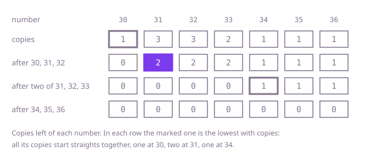

## The question

You hold numbered cards, in no order and with repeats, and want to lay all of them out as straights: groups of `size` cards with consecutive numbers. Return whether that can be done.

What makes it harder than it looks is that the two obvious moves are wrong. A straight started at whatever card comes first can take a card a lower straight needed: in Example 1 a straight from the first card, 32, takes the only 34, and 35 and 36 are stranded. Cutting the sorted hand into blocks of `size` fails as soon as a number repeats, since copies of one number can never share a straight (Example 3). And with up to 100,000 cards, trying the ways of grouping them is out of the question.

## How to think about it

The first idea is a search: put a card into some straight and see whether the rest still splits. That branches at every card. What removes the branching is that one card is never in doubt: the smallest card in the hand. It cannot be the second or a later card of its straight, because that straight would need a smaller card, and there is none. So it is the lowest card of its straight, and that straight is forced: the smallest number and one card each of the next `size - 1` numbers. Taking those cards is safe. Every split of the hand has a straight starting at the smallest number, and copies of a number are interchangeable, so which copies this straight takes makes no difference to what the rest can do. Remove it, and the same holds for the smallest card of what is left. If a number the forced straight needs is missing, no split exists.

That makes the search a single greedy walk, and what remains is its cost. Done on the sorted array, crossing cards off and searching forward for each next number, it is the brute force: with many copies of few numbers, every search walks past the copies already taken, so it is O(n²). Counting removes the walking. Every copy of the lowest number left starts a straight of its own, because two copies cannot share one, so all of them can start together: walk the distinct numbers upwards, and where a number still has `c` copies, take `c` copies from each of the next `size - 1` numbers, which must all be there with at least `c` copies each. Read off the sorted hand, the counts cost the O(n log n) of sorting every card. The last step is to notice that only the distinct numbers need to be in order: count the copies in a hash map and sort just its keys.

Walk Example 1, `size = 3`. The numbers 30 to 36 have 1, 3, 3, 2, 1, 1 and 1 copies. The lowest, 30, has 1 copy, so one straight 30, 31, 32 starts there, leaving 0, 2, 2, 2, 1, 1, 1. Next, 31 has 2 copies left, so two straights 31, 32, 33 start together, leaving nothing on 31 to 33. Then 34 has 1 copy: 34, 35, 36 takes the rest, every count is 0, and the answer is true. In Example 2, `[10,12,11,13,11,14]` with `size = 3`, the numbers 10 to 14 have 1, 2, 1, 1 and 1 copies; the straight from 10 leaves 0, 1, 0, 1, 1, and the 11 left would need a 12: false.



## Brute force

Sort the hand and keep a flag per card for whether it is used. Take the first unused card, which is the smallest left, and for each of the next `size - 1` numbers search forward for an unused card with that number; repeat until every card is used. It comes first because it is the forced choice written as directly as possible, and it fixes the answers to compare against. It is correct by the argument above: the smallest card left must start a straight, and any unused copy of each next number will do. Each search may start at the card just taken, because the next number's copies all come after it in sorted order. The largest number a straight asks for is below 10^9 + 10^5, inside an `int`.

```java
static boolean canSplit(int[] cards, int size) {
    int[] sorted = cards.clone();
    Arrays.sort(sorted);
    boolean[] used = new boolean[sorted.length];
    for (int first = 0; first < sorted.length; first++) {
        if (used[first]) {
            continue;
        }
        used[first] = true; // the smallest card left must start a straight
        int at = first;
        for (int want = sorted[first] + 1; want < sorted[first] + size; want++) {
            while (at < sorted.length && (used[at] || sorted[at] < want)) {
                at++; // skip cards already taken and smaller numbers
            }
            if (at == sorted.length || sorted[at] != want) {
                return false; // no card left with the next number
            }
            used[at] = true;
        }
    }
    return true;
}
```

**Complexity:** time O(n²) in the worst case: with many copies of few numbers, each search walks past the copies still waiting and the copies already taken. Sorting adds O(n log n). Extra space O(n) for the sorted copy and the flags.

## Better: counts from the sorted hand

Sort, and squeeze the sorted hand into its distinct numbers with a count for each. Walk the numbers upwards. A number with `c` copies left starts `c` straights, which take `c` copies from each of the next `size - 1` numbers. Because the numbers are distinct and sorted, those must be the next `size - 1` entries, each exactly one more than the one before.

```java
static boolean canSplit(int[] cards, int size) {
    int[] sorted = cards.clone();
    Arrays.sort(sorted);
    int[] number = new int[sorted.length]; // the distinct numbers, ascending
    int[] left = new int[sorted.length]; // copies of each not yet in a straight
    int distinct = 0;
    for (int card : sorted) {
        if (distinct > 0 && number[distinct - 1] == card) {
            left[distinct - 1]++;
        } else {
            number[distinct] = card;
            left[distinct++] = 1;
        }
    }
    for (int i = 0; i < distinct; i++) {
        int starts = left[i]; // every copy of the lowest number left starts its own straight
        for (int j = 1; j < size && starts > 0; j++) {
            if (i + j == distinct || number[i + j] != number[i] + j || left[i + j] < starts) {
                return false; // those straights lack copies of number[i] + j
            }
            left[i + j] -= starts;
        }
    }
    return true;
}
```

**Complexity:** time O(n log n) for the sort. The walk after it is O(n): its inner loop runs only at numbers that start at least one straight, `size - 1` steps each, and there are at most n / `size` such numbers, because each straight uses `size` cards. Extra space O(n) for the sorted copy and the counts.

**Prefer it when:** the numbers are mostly distinct, so the Optimal would sort nearly every card anyway and pay for hashing and boxing on top: this version does the same with plain `int` arrays and is faster in practice. It is also the one to keep when the cards arrive already sorted: drop the sort, and what remains is a single O(n) scan with no hashing at all.

## Optimal: count first, sort only the distinct numbers

Count the copies of each number in a hash map, sort only the distinct numbers, and run the same walk over them, looking each next number up in the map. With d distinct numbers, the sort costs O(d log d) instead of O(n log n). This is the reference solution.

```java
static boolean canSplit(int[] cards, int size) {
    Map<Integer, Integer> left = new HashMap<>(); // number -> copies not yet in a straight
    for (int card : cards) {
        left.merge(card, 1, Integer::sum);
    }
    int[] numbers = new int[left.size()];
    int d = 0;
    for (int number : left.keySet()) {
        numbers[d++] = number;
    }
    Arrays.sort(numbers); // only the distinct numbers need to be in order
    for (int number : numbers) {
        int starts = left.get(number); // every copy of the lowest number left starts its own straight
        for (int next = number + 1; next < number + size && starts > 0; next++) {
            int copies = left.getOrDefault(next, 0);
            if (copies < starts) {
                return false; // those straights lack copies of next
            }
            left.put(next, copies - starts);
        }
    }
    return true;
}
```

**Complexity:** time O(n + d log d) on average for d distinct numbers: counting is O(n), the sort O(d log d), and the walk makes at most n map lookups, by the same count as in the Better approach. Java's `HashMap` turns crowded buckets into trees, so the worst case is O(log d) per map operation, O(n log d) in all. Extra space O(d) for the map and the sorted numbers.

## Complexity

| Approach | Time | Extra space |
| --- | --- | --- |
| Brute force | O(n²) worst case | O(n) |
| Better: counts from the sorted hand | O(n log n), the sort; O(n) after it | O(n) |
| Optimal: count first, sort only the distinct numbers | O(n + d log d) average, O(n log d) worst case, for d distinct numbers | O(d) |

## Where it shows up

Anything that packs numbered items into runs of consecutive numbers has this shape: splitting a stack of numbered tickets or cheques into books of consecutive numbers, giving each group a block of adjacent seat numbers, or building fixed-length shifts out of the free hours in a rota, each hour used once. The smallest-item-is-forced argument is the same one that drives most interval-scheduling greedies: whatever comes first has only one place it can go.

## Follow-up answers

**What if you also had to return the straights?** In the walk, a number that starts straights starts `starts` copies of the same straight, from that number up to `number + size - 1`, so record the pair (number, starts) at that point. Expanding the pairs gives the straights; listing them costs O(n) on top of the walk, one entry per card.

**What if every number were known to lie between 0 and 1,000 and the hand held millions of cards?** Count the copies in an array of 1,001 entries instead of a hash map, then run the same walk over the array in order, starting straights at each number with copies left and taking them from the next `size - 1` entries. That is O(n + 1,000) time with an array of fixed size: no sort and no hashing.

**What if a straight could be any length of size or more?** Walk the numbers upwards and keep, for each number, how many straights end there and already have at least `size` cards. A copy of number `x` first extends a straight ending at `x - 1`, since that never hurts: the copy has to go somewhere, and a new straight would need the next `size - 1` numbers as well. Only the copies left over start new straights, which take one copy each of the next `size - 1` numbers at once and fail if any is missing. Kept on the counts and the sorted distinct numbers of the walk, each card is handled once, so after the counting and the sort it is O(n).
