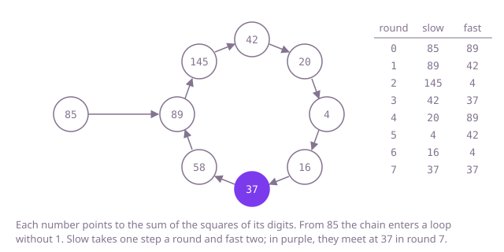

## The question

Start from a positive `int` and keep replacing it by the sum of the squares of its digits. Return `true` if the chain reaches 1 and `false` if it never does.

What makes it harder than it looks: a chain that is not happy never ends, so a loop that runs "until the value is 1" runs forever on most inputs: only about one number in seven is happy. The answer has to notice that the chain has come back to a number it already passed through. A shortcut that stops at the first single digit and checks for 1 is also wrong: 7 is happy (49, 97, 130, 10, 1), so a chain such as 1112's, which reaches 7 after one step, is not finished there.

## How to think about it

Every number has exactly one next number, so the chain is fully decided by where it starts, and as soon as any value comes up a second time, everything after it repeats. Can the chain avoid that by growing forever? No: a number with d digits has a digit-square sum of at most 81 · d, which is smaller than the number itself once d is 4 or more. For an `int` the first step already gives at most 730 (1999999999 gives 1 + 9 · 81), and from then on the values stay at most 730. So within at most 731 more steps some value repeats; in fact no `int` chain passes through more than 20 different values. Either the repeat is 1, which leads to itself, or the chain is on a loop without 1. Every unhappy chain ends on the same loop of eight numbers, 4, 16, 37, 58, 89, 145, 42 and 20, but the solution does not need to know that.

So the question is how to notice a repeat. Remembering every value in a set works. Knowing the bound, a table of 731 flags works just as well. And with no memory at all, run two walkers on the same chain, a slow one that takes one step per round and a fast one that takes two. If the chain reaches 1, the fast walker gets there first and stays. If it is a loop, the fast walker gains one step per round on the slow one, so once both are on the loop, it lands on the same value as the slow one within as many rounds as the loop is long.

Walk Example 2. Slow starts at 85 and fast one step ahead at 89. Round by round, slow goes 89, 145, 42, 20, 4, 16, 37 and fast goes 42, 4, 37, 89, 42, 4, 37: in round 7 both are at 37, and fast was never 1, so the answer is `false`. In Example 1, slow starts at 356 and fast at 70; after round 1 fast is at 97, after round 2 at 10, and after round 3 at 1, so the answer is `true`.



## Brute force

Keep a set of the values seen so far and follow the chain until it reaches 1 or a value that is already in the set. It comes first because it is the direct reading of the question, a chain followed until it ends or repeats, and it needs no fact about the numbers: it would work for any rule that maps a number to a next number. It is correct because a repeated value means the chain repeats from there, and a chain that has not reached 1 by its first repeat never will.

```java
static boolean isHappy(int n) {
    Set<Integer> seen = new HashSet<>();
    while (n != 1 && seen.add(n)) { // add is false once n comes round a second time
        n = next(n);
    }
    return n == 1;
}

private static int next(int n) {
    int sum = 0;
    for (; n > 0; n /= 10) {
        int digit = n % 10;
        sum += digit * digit;
    }
    return sum;
}
```

**Complexity:** time O(log n): the first step reads the at most 10 digits of `n`, and the rest of the chain is at most 20 values of at most three digits; extra space O(1), a set of at most 20 numbers, so even worst-case hash lookups cost little, though the set is allocated on every call.

## Better: a fixed table of flags

After one step every value is at most 730, so a `boolean` array of 731 flags can stand in for the set: no hashing and no boxed `Integer`s. The first step has to come before the first flag, since `n` itself can be far larger than 730. Leaving `n` unflagged costs nothing: if the chain comes back to `n`, the step after it lands on a flagged value.

```java
static boolean isHappy(int n) {
    boolean[] seen = new boolean[731]; // after one step every value is at most 730
    n = next(n);
    while (n != 1 && !seen[n]) {
        seen[n] = true;
        n = next(n);
    }
    return n == 1;
}

private static int next(int n) {
    int sum = 0;
    for (; n > 0; n /= 10) {
        int digit = n % 10;
        sum += digit * digit;
    }
    return sum;
}
```

**Complexity:** time O(log n), as for the set; extra space O(1), a fixed table of 731 flags.

**Prefer it when:** you know the bound on the values and want a plain loop that computes each value of the chain once; Floyd's walkers below compute three digit-square sums a round, many of them for values already passed, though they need no table. The same table, filled once with the answer for every value up to 730, also answers many questions quickly (see the last follow-up).

## Optimal: a slow and a fast walker

Run the chain twice at once, with `slow` one step per round and `fast` two, starting one step ahead. Stop when `fast` is 1, or when the two meet; the number is happy exactly when `fast` is 1. This is the reference solution.

```java
static boolean isHappy(int n) {
    int slow = n;
    int fast = next(n);
    // fast moves two steps a round, so it reaches 1 first, or meets slow on the loop
    while (fast != 1 && slow != fast) {
        slow = next(slow);
        fast = next(next(fast));
    }
    return fast == 1;
}

private static int next(int n) {
    int sum = 0;
    for (; n > 0; n /= 10) {
        int digit = n % 10;
        sum += digit * digit;
    }
    return sum;
}
```

The answer is read from `fast`, not `slow`: when `fast` reaches 1 the slow walker is usually still on the way. Starting both walkers at `n` would end the loop before its first round, since they are already equal.

**Complexity:** time O(log n): the walkers meet, or the fast one reaches 1, before the slow one has passed every value of the chain, at most 20, and the fast one takes twice its steps; extra space O(1), two numbers.

## Complexity

| Approach | Time | Extra space |
| --- | --- | --- |
| Brute force: a set of seen values | O(log n), at most 20 values after the first step | O(1), a set of at most 20 numbers |
| Better: a fixed table of flags | O(log n) | O(1), 731 flags |
| Optimal: a slow and a fast walker | O(log n), three steps computed a round | O(1), two numbers |

## Where it shows up

No coding-round problem is linked to this question. The two-walker trick is Floyd's cycle detection, and it works on anything where each state has one next state: Pollard's rho method for factoring large numbers walks x → x² + c modulo n at two speeds until they meet, and the same check tells whether a pseudo-random generator, a hash chain or a simulation has come back to a state it was in before, without storing the states.

## Follow-up answers

**Can you do it with only a constant amount of extra memory, without a set?** Yes, with the slow and the fast walker above: two `int`s. The fixed table of 731 flags is constant memory too, but only because the values are known to stay at most 730 after the first step; the walkers need no such fact.

**Why can the chain not grow forever, and how large can its values get after the first step?** A d-digit number is at least 10^(d - 1), and its digit-square sum is at most 81 · d. From 4 digits on, 81 · d is the smaller of the two, so the chain shrinks until it is below 1000, and a 3-digit number gives at most 243. For an `int` the largest value after one step is 730, from 1999999999, so from then on every value is at most 730, and the chain repeats within 731 steps. Running it from every start shows that no `int` chain has more than 20 different values, and that every unhappy chain ends on the loop 4, 16, 37, 58, 89, 145, 42, 20.

**How would you answer a million such questions about numbers up to 10^9 quickly?** Work out once whether each value from 1 to 729 is happy (729 is the largest digit-square sum of a number up to 10^9, from 999999999), with any of the methods above, and store the answers in a table. Each question is then one digit-square sum and a table lookup, at most 10 digits of work, instead of a chain followed afresh every time.
